# E2E connection trace — 1 Nov 2026

SPEC §21 (prompt 21-A): every chain in §21.1 driven end to end with one `trace_id` across proxy → Server Action/API → RPC → Postgres (rows, ledger, status_history, outbox) → worker → adapters/webhooks → Realtime → UI → e-mail → audit. Run by the platform engineer on 1 Nov 2026 against `main` (start `c9a1e60`, commits below, **not pushed**).

## How this run worked

| Item | Detail |
| --- | --- |
| App under test | Local production build of the working tree (`pnpm build` + `pnpm start -p 3100`); a second instance on :3101 for the worker-failure drill. Production (https://octopus-b2b.vercel.app) was used for the pg_cron → pg_net dispatcher check (it runs the previously deployed code). |
| Database | The live Supabase project (= production). Writes ran either inside rolled-back transactions (chains 8, 11, negative paths) or with tagged test identities (`qa-trace-*@demo.octopusb2b.com`, orgs `QA-TRACE …`) and trace ids `e2e-cNN-…`; everything was deleted afterwards (see Clean-up). |
| Trace propagation | `proxy.ts` mints/keeps `x-trace-id` on every request (incl. `/api/v1`, webhooks, cron) and echoes it; server Supabase clients forward it; Postgres `app_trace_id()` reads `request.headers` (or `app.trace_id` for SQL/cron); BEFORE INSERT triggers stamp `trace_id` (+ `txid` on the core tables). The outbox worker runs each event under the event's trace id; adapters log to `integration_logs` with body SHA-256s and send `x-octopus-trace`. Browsers forward the id via the `x-trace-id` header (Playwright `extraHTTPHeaders` = what a frontend fetch wrapper would do). |
| Dispatcher | Production: pg_cron `octopus-outbox-dispatch` every **10 s** → `job_dispatch_outbox()` → pg_net GET `/api/cron/outbox` (URL + CRON_SECRET from Vault). During local chain runs the job was paused and the local worker was called directly (same code path), then re-enabled. |
| Tools | Playwright (Chromium), Node drivers (`tests/e2e/trace/*.mjs`), SQL, pgTAP (inside a rolled-back transaction). Raw results: `docs/qa/2026-11-01-trace/chain-NN.json`, logs in `docs/qa/2026-11-01-trace/logs/`, screenshots `docs/qa/2026-11-01-trace/*.png`. |

## Summary

| # | Chain | Status | Checks | E2E latency | Verdict |
| ---: | --- | --- | ---: | ---: | --- |
| 1 | Signup → KYC → account manager assigned | 🟡 traced to boundary | 18/18 | 8.7 s | connected up to the external boundary |
| 2 | RFQ → Quote → PI → Deposit → Confirmed order | 🟠 green with gaps | 30/31 | 24.7 s | connected; open gaps listed |
| 3 | In production → QC → Balance → Shipped | 🟢 green | 20/20 | 22.7 s | connected end to end |
| 4 | YunExpress tracking webhook → Timeline | 🟢 green | 15/15 | 5.0 s | connected end to end |
| 5 | Service request (QC day) with wallet pay | 🟠 green with gaps | 15/17 | 8.9 s | connected; open gaps listed |
| 6 | Group-buy pool: open → join → fill → settle | 🟠 green with gaps | 19/19 | 47.1 s | connected; open gaps listed |
| 7 | Backup now → upload → UI card | 🟡 traced to boundary | 7/7 | 29.2 s | connected up to the external boundary |
| 8 | Partial restore of deleted product | 🟡 traced to boundary | 5/5 | — | connected up to the external boundary |
| 9 | AI assistant message → tool-call → reply | 🟠 green with gaps | 6/8 | 3.6 s | connected; open gaps listed |
| 10 | Escalation → Support ticket → staff reply | 🟢 green | 11/11 | 5.9 s | connected end to end |
| 11 | Currency switch USD → CNY | 🟢 green | 10/10 | 3.7 s | connected end to end |
| 12 | Payment webhook replay | 🟢 green | 16/16 | 5.2 s | connected end to end |
| 13 | Ad click → ledger | 🟠 green with gaps | 10/10 | 1.1 s | connected; open gaps listed |
| 14 | Public API POST /v1/rfqs | 🟢 green | 15/15 | 3.4 s | connected end to end |
| 15 | Outbox event with worker failure | 🟠 green with gaps | 15/16 | — | connected; open gaps listed |
| 16 | Staff login → workspace → money action | 🟢 green | 10/10 | 5.5 s | connected end to end |

A ✘ inside a chain is either an open gap (listed under Gaps with an owner) or an external boundary; nothing was marked green that did not run.

### Production dispatcher (QA FN-02)

- Migration `20261101000131` enables **pg_net** and schedules pg_cron job `octopus-outbox-dispatch` every **10 s** (pg_cron 1.6.4 supports second schedules — the §10.3 cadence, better than the 1-minute minimum assumed in the brief). `job_dispatch_outbox()` skips the HTTP call when no event is due and reads `octopus_app_url` / `octopus_cron_secret` from **Vault** by name (no secret in the repo; `scripts/cron-dispatcher-secrets.mjs` writes them from .env.local).
- First firing returned **401**: production's CRON_SECRET differed from .env.local. The Lead rotated a strong CRON_SECRET into .env.local, Vercel (prod + preview) and Vault and redeployed the current production deployment; GET with the new secret → 200, wrong secret → 401.
- Production check (`tests/e2e/trace/prod-dispatch.mjs`, trace `e2e-c00-7eac2fae5d77`): a tagged `order.in_production` event for the test org was picked up by the **deployed** worker via pg_net in **15 s** from insert to first consumer (notify 672 ms, e-mail 1.6 s, webhook 303 ms), pg_net response `200 {claimed:1, done:1}`, `job_runs` carry the event's trace id (parent trigger). The job is **active** now.
- Found while enabling it: 10 pending events belonged to organizations deleted by earlier test clean-ups and failed with `notifications_org_id_fkey` toward the dead-letter queue. The worker now records such consumers as `skipped`; the 10 events were closed (`done`, `last_error` explains why).

### Instrumentation added (prompt 21-A "Before running")

| Layer | Change |
| --- | --- |
| Next.js | `proxy.ts` mints `x-trace-id` (or keeps a valid incoming one) for every route incl. machine routes, response echoes it; `lib/trace.ts` (`currentTraceId`, `withTrace`, structured JSON `traceLog`). |
| Supabase clients | `createClient` / `createAdminClient` add `x-trace-id` per request (exports unchanged). Browser channels now join with the user JWT (`subscribeAuthed`). |
| Postgres | `app_trace_id()`; `trace_id` on status_history, journals, ledger_entries, outbox_events, audit_log, integration_logs, webhook_deliveries, notifications, job_runs, order_events and the business tables; `txid` on the core tables; `email_deliveries`, `idempotency_hits`; `trace_rows(trace)` (service role). Migrations `20261101000130`–`136`. |
| Worker / adapters | Outbox worker runs every event under its trace; e-mails → `email_deliveries` + `integration_logs`; carrier, payment and LLM adapters → `integration_logs` (endpoint, request/response SHA-256, status, duration); outbound webhooks and adapter calls carry `x-octopus-trace`. Webhook/API replays and consumer redeliveries → `idempotency_hits`. |
| Not built | `realtime_pushes` table (Realtime delivery is proven in the browser by Playwright instead); Sentry (no DSN). |

## Chain 1 — Signup → KYC → account manager assigned

### Summary

🟡 traced to boundary · 18/18 checks · end-to-end 8.7 s · trace `e2e-c01-84abda52453d`

Driver: Playwright (signup page, onboarding form, dashboard) + traced RPC for KYC submit/verify (the KYC form also uploads documents to the private bucket, which the test skips).

Boundary: Google OAuth: the button calls Supabase `/auth/v1/authorize`, which answers "provider is not enabled". The user is created with the Auth admin API instead (what the OAuth callback would create). Owner: **Owner/Admin** (enable Google in Supabase Auth, QA SL-01/SC-03).

<details><summary>All checks</summary>

- ✔ signup page echoes the trace id — e2e-c01-84abda52453d
- ✔ Google sign-up button present on /signup
- ✔ new user without profile is routed to /onboarding — http://localhost:3100/onboarding
- ✔ complete_onboarding created the organization + membership — QA-TRACE A BV
- ✔ submit_kyc accepted
- ✔ review_kyc → verified
- ✔ worker run — {"ok":true,"claimed":3,"done":3,"retried":0,"dead":0,"errors":[],"duration_ms":2376}
- ✔ dashboard received the Realtime push (notifications INSERT) and refreshed — 1439 ms after the worker started
- ✔ account_managers row written once with the trace id — team Sourcing, reason kyc_verified
- ✔ status_history kyc row in trace — 2
- ✔ exactly one kyc.verified outbox event
- ✔ notify consumer ran for the trace (job_runs)
- ✔ exactly one "KYC verified" notification
- ✔ audit: assistant.assigned once
- ✔ audit: kyc.review once
- ✔ welcome email sent to the customer — 1 email_deliveries rows
- ✔ replay: second verify refused, still one account manager — KYC_INVALID_TRANSITION: already verified
- ✔ negative: customer calling review_kyc → FORBIDDEN — FORBIDDEN
- · OAuth click → qrawnqpxvtjmgncxmffu.supabase.co/auth/v1/authorize; Supabase answers "provider is not enabled"
- · dashboard shows account team card after verify: false

</details>

### Trace table

| +t | Table | txid | Row |
| ---: | --- | ---: | --- |
| 0 ms | audit_log | 5208 | status.kyc kyc actor=cf2273df |
| 0 ms | outbox_events | 5208 | kyc.submitted [done] agg=kyc:c65a88a6 payload#1abfbfdf80 |
| 0 ms | status_history | 5208 | kyc not_started→submitted |
| 0 ms | kyc_submissions |  | verified |
| 620 ms | audit_log | 5213 | assistant.assigned organizations actor=bf12a91b |
| 620 ms | audit_log | 5213 | status.kyc kyc actor=bf12a91b |
| 620 ms | audit_log | 5213 | kyc.review kyc_submissions actor=bf12a91b |
| 620 ms | outbox_events | 5213 | account_manager.assigned [done] agg=organization:d481ee2c payload#288fff2fcf |
| 620 ms | outbox_events | 5213 | kyc.verified [done] agg=kyc:c65a88a6 payload#1abfbfdf80 |
| 620 ms | status_history | 5213 | kyc submitted→verified |
| 620 ms | account_managers |  |  |
| 4.4 s | job_runs |  | notify → ok (0 ms) evt=0cf66f1c |
| 4.7 s | notifications |  | Meet your account manager |
| 4.8 s | job_runs |  | notify → ok (97 ms) evt=e66aaeae |
| 5.2 s | email_deliveries |  | default:account_manager.assigned → log logged rcpt#5278b812a9 msg=log_1793498551387 |
| 5.4 s | integration_logs |  | email out 200 log://email req#fed9477dbd res#5ba8504e20 |
| 5.5 s | job_runs |  | email → ok (507 ms) evt=e66aaeae |
| 5.9 s | notifications |  | KYC verified |
| 6.1 s | job_runs |  | notify → ok (100 ms) evt=bf3f8b89 |

Rows per table: audit_log 4 · outbox_events 3 · status_history 2 · kyc_submissions 1 · account_managers 1 · job_runs 4 · notifications 2 · email_deliveries 1 · integration_logs 1.

### Timeline

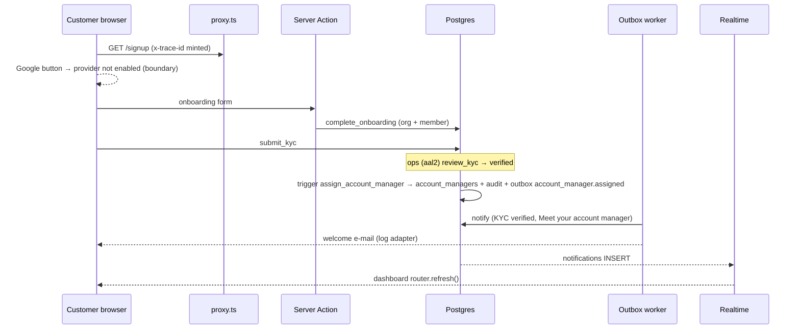

### Latency

| Hop | Measured | Budget | |
| --- | ---: | ---: | --- |
| onboarding (SA → complete_onboarding → redirect) | 326 ms | — |  |
| submit_kyc RPC | 114 ms | — |  |
| review_kyc RPC (verify → trigger assigns AM) | 110 ms | — |  |
| outbox worker run | 2.4 s | 5.0 s | ✅ |

Server Action latencies are measured from the browser (click → response, includes rendering of the result); against a local build talking to the Supabase region over the internet, so SA/RPC budgets are indicative.

### Idempotency

- ✔ account_managers row written once with the trace id — team Sourcing, reason kyc_verified
- ✔ audit: assistant.assigned once
- ✔ audit: kyc.review once
- ✔ replay: second verify refused, still one account manager — KYC_INVALID_TRANSITION: already verified

### Negative paths

- ✔ negative: customer calling review_kyc → FORBIDDEN — FORBIDDEN

### Gaps

| Gap | Severity | Status / owner |
| --- | --- | --- |
| No welcome e-mail and no customer-facing event when the account manager was assigned (only the DB row + audit). | major | fixed |
| Dashboard did not listen to notifications, so nothing nudged it after KYC/assignment. | minor | fixed |
| Browser Realtime channels joined as **anon** (no `realtime.setAuth`), so RLS dropped every live update on every page. | block | fixed |
| Google OAuth not enabled — signup by Google impossible in production. | major | open — Owner/Admin |

### Fixes applied

- account_manager.assigned event + e-mail
- dashboard notifications subscription
- subscribeAuthed() for all browser channels

(Commit hashes in "Commits".)

## Chain 2 — RFQ → Quote → PI → Deposit → Confirmed order

### Summary

🟠 green with gaps · 30/31 checks · end-to-end 24.7 s · trace `e2e-c02-9fb364f24fdd`

Driver: Playwright, two browsers (customer + operations) sharing one trace id via the x-trace-id request header; deposit paid from the wallet (mocked payment); outbound webhook endpoint = httpbin.org echo.

<details><summary>All checks</summary>

- ✔ product page carries the trace id
- ✔ RFQ submitted through the Request form (submit_rfq + fee from wallet) — 3a2bd43f-3e04-475f-a928-e41515270285
- ✔ customer RFQ page received the new quote via Realtime (router refresh) — 475 ms after send
- ✔ quote visible in the customer DOM without reload
- ✔ operations: transition_order → confirmed
- ✔ customer order page shows "Confirmed" live (Realtime order_events) — 699 ms
- ✔ end-to-end under 90 s (mocked payment) — 24670 ms
- ✔ 1 rfq row — 1
- ✔ 1 quote row — 1
- ✔ 1 proforma invoice — 1
- ✔ 1 order — 1
- ✔ status_history has quote.approved and order.deposit_paid — rfq:submitted, rfq:quoted, quote:approved, order:deposit_pending, order:deposit_paid, order:confirmed
- ✔ status_history has order.confirmed
- ✔ 1 PI document row — receipt:RCT-679323B9:no pdf_path, proforma_invoice:PI-2026-1091:no pdf_path, confirmation:CNF-2308:no pdf_path
- ✘ PI PDF stored in the private documents bucket — receipt:RCT-679323B9:no pdf_path, proforma_invoice:PI-2026-1091:no pdf_path, confirmation:CNF-2308:no pdf_path
- ✔ every journal in the trace balances per currency — 3 journals / 6 entries
- ✔ outbox rfq.submitted exactly once — rfq.submitted, quote.approved, order.confirmed, quote.sent, payment.confirmed
- ✔ outbox quote.sent exactly once — rfq.submitted, quote.approved, order.confirmed, quote.sent, payment.confirmed
- ✔ outbox quote.approved exactly once — rfq.submitted, quote.approved, order.confirmed, quote.sent, payment.confirmed
- ✔ outbox payment.confirmed exactly once — rfq.submitted, quote.approved, order.confirmed, quote.sent, payment.confirmed
- ✔ outbox order.confirmed exactly once — rfq.submitted, quote.approved, order.confirmed, quote.sent, payment.confirmed
- ✔ all outbox events done
- ✔ no consumer ran twice for one event (job_runs unique)
- ✔ PI e-mail + deposit receipt e-mail (1 each) — default:quote.sent, default:quote.approved, default:payment.confirmed, default:order.confirmed
- ✔ signed order.updated webhook delivered (HTTP 200) — quote.created:200, order.updated:200, order.updated:200, order.updated:200
- ✔ every e-mail has an integration_logs row with body SHAs
- ✔ audit entries in the trace — status.rfq, status.quote, status.order, status.order, status.order, status.rfq
- ✔ dispatcher replay of all events → no second e-mail, webhook or notification — {"e":4,"w":4,"n":5} → {"e":4,"w":4,"n":5}
- ✔ replay logged as idempotency_hits (outbox:<consumer>) — 14
- ✔ second approve_quote refused — QUOTE_NOT_APPROVABLE: approved
- ✔ negative: overpayment / insufficient wallet refused — INVALID_AMOUNT

</details>

### Trace table

| +t | Table | txid | Row |
| ---: | --- | ---: | --- |
| 0 ms | rfqs |  | RFQ-1065 |
| 0 ms | journals | 5252 | JRN-000463 rfq_fees RFQ fee |
| 0 ms | audit_log | 5252 | status.rfq rfq actor=cf2273df |
| 0 ms | outbox_events | 5252 | rfq.submitted [done] agg=rfq:3a2bd43f payload#aa4d3d1a37 |
| 0 ms | ledger_entries | 5252 | acct=b9de94fa Dr 500 Cr 0 USD |
| 0 ms | ledger_entries | 5252 | acct=a101fb4b Dr 0 Cr 500 USD |
| 0 ms | status_history | 5252 | rfq ∅→submitted |
| 566 ms | notifications |  | RFQ received |
| 662 ms | job_runs |  | notify → ok (106 ms) evt=dd5befe5 |
| 862 ms | job_runs |  | webhooks_out → ok (112 ms) evt=dd5befe5 |
| 4.3 s | quotes |  | QT-1065-1 |
| 4.3 s | audit_log | 5264 | status.rfq rfq actor=bf12a91b |
| 4.3 s | outbox_events | 5264 | quote.sent [done] agg=quote:f451f20c payload#26e66021a9 |
| 4.3 s | status_history | 5264 | rfq submitted→quoted |
| 6.4 s | notifications |  | New quote received |
| 6.8 s | job_runs |  | notify → ok (375 ms) evt=fba2e982 |
| 7.2 s | email_deliveries |  | default:quote.sent → log logged rcpt#5278b812a9 msg=log_1793498570608 |
| 7.3 s | integration_logs |  | email out 200 log://email req#ea7609f1a5 res#78e6496bda |
| 7.4 s | job_runs |  | email → ok (550 ms) evt=fba2e982 |
| 9.1 s | webhook_deliveries |  | quote.created → HTTP 200 delivered |
| 9.2 s | job_runs |  | webhooks_out:afd1c746-f94c-41f9-b18d-4ba035320eec → ok (1514 ms) evt=fba2e982 |
| 9.3 s | job_runs |  | webhooks_out → ok (1816 ms) evt=fba2e982 |
| 9.7 s | orders |  | ORD-2308 |
| 9.7 s | journals | 5275 | JRN-000464 orders PI PI-2026-1091 issued |
| 9.7 s | audit_log | 5275 | status.quote quote actor=cf2273df |
| 9.7 s | audit_log | 5275 | status.order order actor=cf2273df |
| 9.7 s | documents |  | PI-2026-1091 |
| 9.7 s | order_events |  | Proforma invoice issued |
| 9.7 s | outbox_events | 5275 | quote.approved [done] agg=order:96c84681 payload#da009ea38b |
| 9.7 s | ledger_entries | 5275 | acct=f19a89d7 Dr 64500 Cr 0 USD |
| … | _30 more rows in chain-02.json_ | | |
| 18.2 s | order_events |  | Confirmed |
| 18.2 s | outbox_events | 5300 | order.confirmed [done] agg=order:96c84681 payload#1abfbfdf80 |
| 18.2 s | status_history | 5300 | order deposit_paid→confirmed |
| 19.7 s | notifications |  | Order confirmed |
| 19.8 s | job_runs |  | notify → ok (110 ms) evt=23402c54 |
| 20.2 s | email_deliveries |  | default:order.confirmed → log logged rcpt#5278b812a9 msg=log_1793498583553 |
| 20.3 s | integration_logs |  | email out 200 log://email req#f45d3cd31b res#b446bc87f7 |
| 20.4 s | job_runs |  | email → ok (574 ms) evt=23402c54 |
| 22.2 s | job_runs |  | webhooks_out:afd1c746-f94c-41f9-b18d-4ba035320eec → ok (1443 ms) evt=23402c54 |
| — | proforma_invoices |  | PI-2026-1091 |
| 22.1 s | webhook_deliveries |  | order.updated → HTTP 200 delivered |
| 22.3 s | job_runs |  | webhooks_out → ok (1734 ms) evt=23402c54 |

Rows per table: rfqs 1 · journals 3 · audit_log 6 · outbox_events 5 · ledger_entries 6 · status_history 6 · notifications 5 · job_runs 18 · quotes 1 · email_deliveries 4 · integration_logs 4 · webhook_deliveries 4 · orders 1 · documents 3 · order_events 3 · payments 1 · proforma_invoices 1.

### Timeline

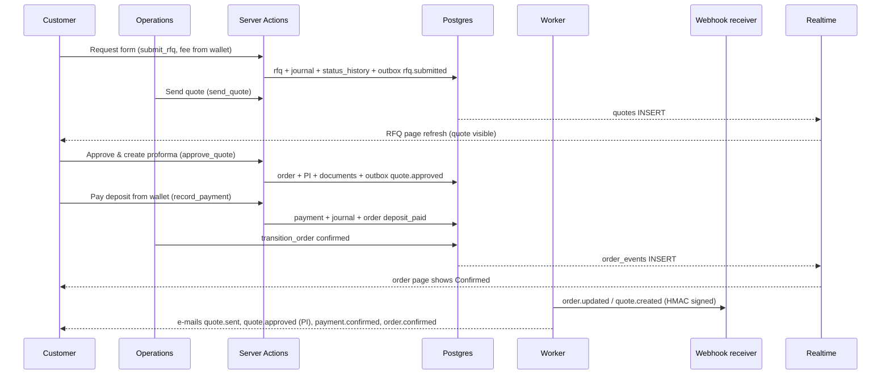

### Latency

| Hop | Measured | Budget | |
| --- | ---: | ---: | --- |
| SA submit_rfq (click → redirect) | 258 ms | 300 ms | ✅ |
| SA send_quote | 830 ms | 300 ms | ⚠️ over |
| SA approve_quote (PI + order + ledger) | 573 ms | 300 ms | ⚠️ over |
| SA record_payment (deposit) | 316 ms | 300 ms | ⚠️ over |
| RPC transition_order confirmed | 232 ms | 500 ms | ✅ |
| **End to end** (budget 90 s, mocked payment) | 24.7 s | 90 s | ✅ |

Server Action latencies are measured from the browser (click → response, includes rendering of the result); against a local build talking to the Supabase region over the internet, so SA/RPC budgets are indicative.

### Idempotency

- ✔ outbox rfq.submitted exactly once — rfq.submitted, quote.approved, order.confirmed, quote.sent, payment.confirmed
- ✔ outbox quote.sent exactly once — rfq.submitted, quote.approved, order.confirmed, quote.sent, payment.confirmed
- ✔ outbox quote.approved exactly once — rfq.submitted, quote.approved, order.confirmed, quote.sent, payment.confirmed
- ✔ outbox payment.confirmed exactly once — rfq.submitted, quote.approved, order.confirmed, quote.sent, payment.confirmed
- ✔ outbox order.confirmed exactly once — rfq.submitted, quote.approved, order.confirmed, quote.sent, payment.confirmed
- ✔ no consumer ran twice for one event (job_runs unique)
- ✔ dispatcher replay of all events → no second e-mail, webhook or notification — {"e":4,"w":4,"n":5} → {"e":4,"w":4,"n":5}
- ✔ replay logged as idempotency_hits (outbox:<consumer>) — 14

### Negative paths

- ✔ second approve_quote refused — QUOTE_NOT_APPROVABLE: approved
- ✔ negative: overpayment / insufficient wallet refused — INVALID_AMOUNT

### Gaps

| Gap | Severity | Status / owner |
| --- | --- | --- |
| Quote approval wrote no `quote` status_history row (rfq/order only). | minor | fixed (trigger) |
| No audit_log entry for customer/ops business transitions (approve, pay, confirm). | major | fixed (status_history → audit_log mirror) |
| PI "PDF" is rendered on demand as HTML (`/api/documents/[id]/pdf`); nothing is stored in a private bucket (`documents.pdf_path` null) and e-mails carry a link, not the PDF. | major | open — Developer (render-pdf worker, §9) |
| All e-mails use the generic default template (`email_templates` has no rows for these events). | minor | open — Content editor |

### Fixes applied

- quote status_history trigger
- status → audit mirror
- Realtime auth

(Commit hashes in "Commits".)

## Chain 3 — In production → QC → Balance → Shipped

### Summary

🟢 green · 20/20 checks · end-to-end 22.7 s · trace `e2e-c03-f2a2c9e268e8`

Driver: Traced RPC for operations transitions, Playwright for the balance payment (customer) and the YunExpress shipment creator in /office/shipping (sandbox adapter).

Boundary: YunExpress live API: sandbox adapter (no app id/key) — calls are logged with `sandbox://yunexpress/...` endpoints. Owner: **Owner/Admin** (YunExpress credentials, IN-02).

<details><summary>All checks</summary>

- ✔ operations: → in_production
- ✔ operations: → qc
- ✔ operations: → balance_pending
- ✔ balance paid in full — {"status":"balance_paid","paid_cents":"64500","total_cents":"64500"}
- ✔ operations: → ready_to_ship
- ✔ customer order timeline shows "Shipped" live (Realtime order_events/tracking_events) — 1956 ms
- ✔ 1 shipment row with the trace id — {"id":"65244678-d9c2-4d6d-8d77-147cac30098e","tracking_no":"YT34986083259092","status":"label_ready","trace_id":"e2e-c03-f2a2c9e268e8"}
- ✔ tracking event "created" recorded through system_record_tracking — 1
- ✔ status_history order → in_production once — in_production → qc → balance_pending → balance_paid → ready_to_ship → shipped
- ✔ status_history order → qc once — in_production → qc → balance_pending → balance_paid → ready_to_ship → shipped
- ✔ status_history order → balance_pending once — in_production → qc → balance_pending → balance_paid → ready_to_ship → shipped
- ✔ status_history order → ready_to_ship once — in_production → qc → balance_pending → balance_paid → ready_to_ship → shipped
- ✔ status_history order → shipped once — in_production → qc → balance_pending → balance_paid → ready_to_ship → shipped
- ✔ balance payment journal balances per currency — 1 journals
- ✔ YunExpress adapter calls logged (price trial, create, subscribe) with SHAs — sandbox://yunexpress/api/WayBill/GetPriceTrial, sandbox://yunexpress/api/WayBill/CreateOrder, sandbox://yunexpress/api/Tracking/Subscribe
- ✔ outbox shipment.tracking written
- ✔ shipped e-mail sent once — default:order.in_production, default:order.qc, default:order.balance_pending, default:order.ready_to_ship, default:payment.confirmed, default:order.shipped
- ✔ commercial invoice document on balance_pending
- ✔ replay: second "shipped" refused — INVALID_TRANSITION: shipped → shipped
- ✔ negative: customer transition → FORBIDDEN — FORBIDDEN
- · order moved to balance_paid automatically after the balance payment

</details>

### Trace table

| +t | Table | txid | Row |
| ---: | --- | ---: | --- |
| 0 ms | audit_log | 5338 | status.order order actor=bf12a91b |
| 0 ms | order_events |  | In Production |
| 0 ms | outbox_events | 5338 | order.in_production [done] agg=order:96c84681 payload#1abfbfdf80 |
| 0 ms | status_history | 5338 | order confirmed→in_production |
| 234 ms | audit_log | 5339 | status.order order actor=bf12a91b |
| 234 ms | order_events |  | Qc |
| 234 ms | outbox_events | 5339 | order.qc [done] agg=order:96c84681 payload#1abfbfdf80 |
| 234 ms | status_history | 5339 | order in_production→qc |
| 324 ms | audit_log | 5340 | status.order order actor=bf12a91b |
| 324 ms | documents |  | INV-2026-0403 |
| 324 ms | order_events |  | Balance Pending |
| 324 ms | outbox_events | 5340 | order.balance_pending [done] agg=order:96c84681 payload#1abfbfdf80 |
| 324 ms | status_history | 5340 | order qc→balance_pending |
| 806 ms | notifications |  | Order in production |
| 1.0 s | job_runs |  | notify → ok (208 ms) evt=0a6c54af |
| 1.4 s | email_deliveries |  | default:order.in_production → log logged rcpt#5278b812a9 msg=log_1793498592177 |
| 1.5 s | integration_logs |  | email out 200 log://email req#06c039f4ef res#2c9c30c9d1 |
| 1.6 s | job_runs |  | email → ok (512 ms) evt=0a6c54af |
| 3.2 s | webhook_deliveries |  | order.updated → HTTP 200 delivered |
| 3.3 s | job_runs |  | webhooks_out:afd1c746-f94c-41f9-b18d-4ba035320eec → ok (1436 ms) evt=0a6c54af |
| 3.4 s | job_runs |  | webhooks_out → ok (1730 ms) evt=0a6c54af |
| 3.7 s | notifications |  | Order qc |
| 3.8 s | job_runs |  | notify → ok (85 ms) evt=326e54e0 |
| 4.2 s | email_deliveries |  | default:order.qc → log logged rcpt#5278b812a9 msg=log_1793498594995 |
| 4.3 s | integration_logs |  | email out 200 log://email req#5f24ae3a41 res#455bff2e1d |
| 4.4 s | job_runs |  | email → ok (514 ms) evt=326e54e0 |
| 5.0 s | webhook_deliveries |  | order.updated → HTTP 200 delivered |
| 5.1 s | job_runs |  | webhooks_out:afd1c746-f94c-41f9-b18d-4ba035320eec → ok (390 ms) evt=326e54e0 |
| 5.2 s | job_runs |  | webhooks_out → ok (681 ms) evt=326e54e0 |
| 5.5 s | notifications |  | Order balance pending |
| … | _46 more rows in chain-03.json_ | | |
| 17.9 s | status_history | 5399 | order ready_to_ship→shipped |
| 18.9 s | notifications |  | Order shipped |
| 19.1 s | job_runs |  | notify → ok (110 ms) evt=09f80a04 |
| 19.5 s | email_deliveries |  | default:order.shipped → log logged rcpt#5278b812a9 msg=log_1793498610251 |
| 19.6 s | integration_logs |  | email out 200 log://email req#044a0d0fee res#9d4c25bf69 |
| 19.7 s | job_runs |  | email → ok (531 ms) evt=09f80a04 |
| 21.4 s | webhook_deliveries |  | order.updated → HTTP 200 delivered |
| 21.5 s | job_runs |  | webhooks_out:afd1c746-f94c-41f9-b18d-4ba035320eec → ok (1513 ms) evt=09f80a04 |
| 21.6 s | job_runs |  | webhooks_out → ok (1806 ms) evt=09f80a04 |
| 21.9 s | notifications |  | Shipment: created |
| 22.0 s | job_runs |  | notify → ok (111 ms) evt=4ff681c3 |
| 22.5 s | job_runs |  | webhooks_out → ok (345 ms) evt=4ff681c3 |

Rows per table: audit_log 6 · order_events 7 · outbox_events 7 · status_history 6 · documents 2 · notifications 7 · job_runs 26 · email_deliveries 6 · integration_logs 9 · webhook_deliveries 6 · journals 1 · payments 1 · ledger_entries 2 · tracking_events 1 · shipments 1.

### Timeline

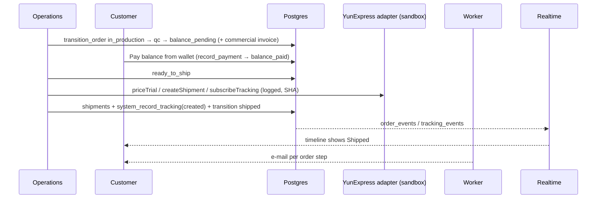

### Latency

| Hop | Measured | Budget | |
| --- | ---: | ---: | --- |
| RPC transition_order in_production | 127 ms | 500 ms | ✅ |
| RPC transition_order qc | 239 ms | 500 ms | ✅ |
| RPC transition_order balance_pending | 88 ms | 500 ms | ✅ |
| SA record_payment (balance) | 305 ms | 300 ms | ⚠️ over |
| SA priceTrial (adapter) | 65 ms | 300 ms | ✅ |
| SA createShipment (adapter + shipments + system_record_tracking + transition shipped) | 889 ms | 300 ms | ⚠️ over |

Server Action latencies are measured from the browser (click → response, includes rendering of the result); against a local build talking to the Supabase region over the internet, so SA/RPC budgets are indicative.

### Idempotency

- ✔ status_history order → in_production once — in_production → qc → balance_pending → balance_paid → ready_to_ship → shipped
- ✔ status_history order → qc once — in_production → qc → balance_pending → balance_paid → ready_to_ship → shipped
- ✔ status_history order → balance_pending once — in_production → qc → balance_pending → balance_paid → ready_to_ship → shipped
- ✔ status_history order → ready_to_ship once — in_production → qc → balance_pending → balance_paid → ready_to_ship → shipped
- ✔ status_history order → shipped once — in_production → qc → balance_pending → balance_paid → ready_to_ship → shipped
- ✔ shipped e-mail sent once — default:order.in_production, default:order.qc, default:order.balance_pending, default:order.ready_to_ship, default:payment.confirmed, default:order.shipped
- ✔ replay: second "shipped" refused — INVALID_TRANSITION: shipped → shipped

### Negative paths

- ✔ negative: customer transition → FORBIDDEN — FORBIDDEN

### Gaps

| Gap | Severity | Status / owner |
| --- | --- | --- |
| Shipment creation inserts `shipments` from the Server Action (not an RPC); acceptable but outside the "money/state in RPC" rule. | polish | open — Developer |

### Fixes applied

None needed in this chain.

## Chain 4 — YunExpress tracking webhook → Timeline

### Summary

🟢 green · 15/15 checks · end-to-end 5.0 s · trace `e2e-c04-964113030cba`

Driver: Signed HTTP POST to /api/webhooks/yunexpress (what YunExpress sends), customer order page open in Playwright.

<details><summary>All checks</summary>

- ✔ webhook recorded the delivered event — {"ok":true,"received":1,"recorded":1,"duplicates":0,"unknown":[]}
- ✔ customer timeline shows "Delivered" live (Realtime tracking_events) — 629 ms
- ✔ end-to-end (webhook → e-mail delivered) under 15 s — 5025 ms (dispatcher cadence in production: 10 s)
- ✔ replay → 200, duplicate, nothing recorded — {"ok":true,"received":1,"recorded":0,"duplicates":1,"unknown":[]}
- ✔ bad HMAC → 401 — BAD_SIGNATURE
- ✔ unknown tracking number → acknowledged, listed as unknown, nothing written — {"ok":true,"received":1,"recorded":0,"duplicates":0,"unknown":["YT0000000000000"]}
- ✔ exactly 1 tracking_events row — 1
- ✔ shipment and order → delivered (claim window opened) — delivered / delivered / claim until Sun Nov 08 2026 07:33:38 GMT+0530 (India Standard Time)
- ✔ exactly 1 shipment.tracking event — shipment.tracking, order.delivered
- ✔ exactly 1 order.delivered event
- ✔ customer e-mail (order delivered) once — default:order.delivered
- ✔ shipment notification once — Shipment: delivered, Order delivered
- ✔ no shipment.tracking webhook (org endpoint subscribes to order.updated, quote.created only)
- ✔ replay → 1 idempotency_hits row linked to the original trace — {"id":44,"key":"yt_evt_45e6bafc98f5","scope":"yunexpress_webhook","detail":{"tracking_no":"YT34986083259092","tracking_event_id":"6f7e2395-939b-4f61-b27d-5e1f6042b714"},"trace_id":"e2e-c04-964113030cba","created_at":"202
- ✔ inbound webhook calls logged with HMAC result + body SHA — 5
- · Metric: there is no metrics backend (no Sentry/OTel); integration_logs + job_runs.duration_ms are the only counters/timers.

</details>

### Trace table

| +t | Table | txid | Row |
| ---: | --- | ---: | --- |
| 0 ms | tracking_events |  | delivered |
| 109 ms | audit_log | 5418 | status.shipment shipment actor=system |
| 109 ms | audit_log | 5418 | status.order order actor=system |
| 109 ms | order_events |  | Delivered |
| 109 ms | order_events |  | Delivered |
| 109 ms | outbox_events | 5418 | shipment.tracking [done] agg=shipment:65244678 payload#276afbc493 |
| 109 ms | outbox_events | 5418 | order.delivered [done] agg=order:96c84681 payload#19ff5ced4f |
| 109 ms | status_history | 5418 | shipment label_ready→delivered |
| 109 ms | status_history | 5418 | order shipped→delivered |
| 232 ms | integration_logs |  | yunexpress in 200 POST /api/webhooks/yunexpress req#5c601a8602 res#df4964dedf |
| 1.2 s | notifications |  | Shipment: delivered |
| 1.3 s | job_runs |  | notify → ok (90 ms) evt=538ef0ea |
| 1.5 s | job_runs |  | webhooks_out → ok (94 ms) evt=538ef0ea |
| 1.8 s | notifications |  | Order delivered |
| 1.9 s | job_runs |  | notify → ok (106 ms) evt=55a83ee9 |
| 2.3 s | email_deliveries |  | default:order.delivered → log logged rcpt#5278b812a9 msg=log_1793498620263 |
| 2.4 s | integration_logs |  | email out 200 log://email req#328e4e4b39 res#2a75f35d29 |
| 2.5 s | job_runs |  | email → ok (504 ms) evt=55a83ee9 |
| 4.2 s | webhook_deliveries |  | order.updated → HTTP 200 delivered |
| 4.3 s | job_runs |  | webhooks_out:afd1c746-f94c-41f9-b18d-4ba035320eec → ok (1490 ms) evt=55a83ee9 |
| 4.4 s | job_runs |  | webhooks_out → ok (1792 ms) evt=55a83ee9 |
| 5.4 s | idempotency_hits |  | yunexpress_webhook key=yt_evt_45e6bafc98f5 orig=e2e-c04-964113030cba |
| 5.5 s | integration_logs |  | yunexpress in 200 POST /api/webhooks/yunexpress req#5c601a8602 res#ab93e82819 |
| 5.7 s | integration_logs |  | yunexpress in 401 POST /api/webhooks/yunexpress req#5c601a8602 res# |
| 5.9 s | integration_logs |  | yunexpress in 200 POST /api/webhooks/yunexpress req#f793a5881f res#119b8a0a6c |

Rows per table: tracking_events 1 · audit_log 2 · order_events 2 · outbox_events 2 · status_history 2 · integration_logs 5 · notifications 2 · job_runs 6 · email_deliveries 1 · webhook_deliveries 1 · idempotency_hits 1.

### Timeline

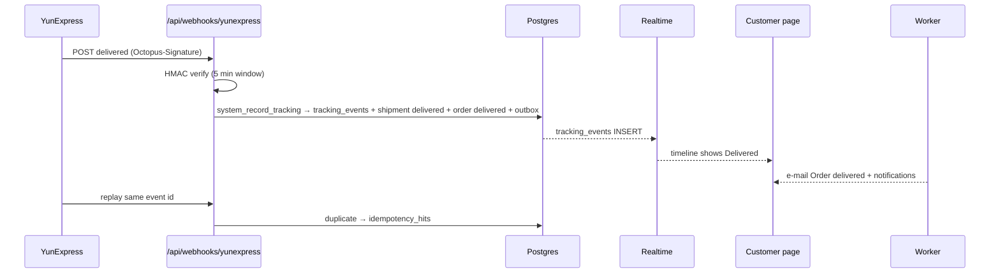

### Latency

| Hop | Measured | Budget | |
| --- | ---: | ---: | --- |
| webhook (HMAC → system_record_tracking) | 231 ms | 2.0 s | ✅ |
| webhook → Realtime refresh in customer DOM | 629 ms | 2.0 s | ✅ |
| worker run | 3.8 s | 5.0 s | ✅ |
| **End to end** webhook → e-mail (budget 15 s) | 5.0 s | 15 s | ✅ |

Server Action latencies are measured from the browser (click → response, includes rendering of the result); against a local build talking to the Supabase region over the internet, so SA/RPC budgets are indicative.

### Idempotency

- ✔ replay → 200, duplicate, nothing recorded — {"ok":true,"received":1,"recorded":0,"duplicates":1,"unknown":[]}
- ✔ customer e-mail (order delivered) once — default:order.delivered
- ✔ shipment notification once — Shipment: delivered, Order delivered
- ✔ replay → 1 idempotency_hits row linked to the original trace — {"id":44,"key":"yt_evt_45e6bafc98f5","scope":"yunexpress_webhook","detail":{"tracking_no":"YT34986083259092","tracking_event_id":"6f7e2395-939b-4f61-b27d-5e1f60

### Negative paths

- ✔ bad HMAC → 401 — BAD_SIGNATURE
- ✔ unknown tracking number → acknowledged, listed as unknown, nothing written — {"ok":true,"received":1,"recorded":0,"duplicates":0,"unknown":["YT0000000000000"]}

### Gaps

| Gap | Severity | Status / owner |
| --- | --- | --- |
| One delivery creates two customer notifications ("Shipment: delivered" + "Order delivered"). | polish | open — Product |
| No metrics backend (Sentry/OTel absent); only integration_logs + job_runs.duration_ms. | minor | open — Owner/Admin (SENTRY_DSN) |

### Fixes applied

None needed in this chain.

## Chain 5 — Service request (QC day) with wallet pay

### Summary

🟠 green with gaps · 15/17 checks · end-to-end 8.9 s · trace `e2e-c05-8148c00793d9`

Driver: Playwright "Book QC inspection" form with ConfirmCharge (wallet), traced RPC for operations steps.

<details><summary>All checks</summary>

- ✔ QC request paid from the wallet — {"id":"0bd4ed17-5196-4dce-aabc-bfb6da4e10c7","code":"SRV-0324","status":"paid","fee_minor":"19900","currency":"USD","paid_via":"wallet"}
- ✔ operations: → accepted
- ✔ operations: → in_progress
- ✔ operations: → report_ready
- ✔ operations: → completed
- ✔ one wallet-debit journal, 2 balanced entries — [[19900,0,"USD"],[0,19900,"USD"]]
- ✔ service_request.paid once — service_request.paid, service_request.updated:completed, service_request.updated:in_progress, service_request.updated:report_ready, service_request.updated:accepted
- ✔ 4 service_request.updated events (one per step)
- ✔ customer e-mails: receipt (paid), report ready, completed — default:service_request.paid, default:service_request.updated, default:service_request.updated
- ✔ customer notifications per step — 5
- ✔ status_history: paid → accepted → in_progress → report_ready → completed — paid → accepted → in_progress → report_ready → completed
- ✔ audit entry per transition (status.service_request) — 5
- ✘ QC coordinator assigned on the request — {"assigned_to":null,"report_path":null}
- ✘ QC report PDF stored (report_path) — {"assigned_to":null,"report_path":null}
- ✔ same idempotency key twice → one request, one debit — 9e94cf5a-a44a-4ef0-8c7a-47793f8cbc01 / 9e94cf5a-a44a-4ef0-8c7a-47793f8cbc01 / rows 1
- ✔ negative: rejected paid request → refunded automatically (refund journal) — refunded
- ✔ negative: completed → paid refused — INVALID_TRANSITION: completed → paid

</details>

### Trace table

| +t | Table | txid | Row |
| ---: | --- | ---: | --- |
| 0 ms | journals | 5448 | JRN-000467 service_fees Service fee · qc |
| 0 ms | audit_log | 5448 | status.service_request service_request actor=cf2273df |
| 0 ms | outbox_events | 5448 | service_request.paid [done] agg=service_request:0bd4ed17 payload#81340a86a3 |
| 0 ms | ledger_entries | 5448 | acct=b9de94fa Dr 19900 Cr 0 USD |
| 0 ms | ledger_entries | 5448 | acct=bba16514 Dr 0 Cr 19900 USD |
| 0 ms | status_history | 5448 | service_request ∅→paid |
| 0 ms | service_requests |  | SRV-0324 |
| 1.1 s | notifications |  | Service request paid |
| 1.5 s | job_runs |  | notify → ok (379 ms) evt=dda953a5 |
| 2.0 s | email_deliveries |  | default:service_request.paid → log logged rcpt#5278b812a9 msg=log_1793498628952 |
| 2.0 s | integration_logs |  | email out 200 log://email req#0cd334ece7 res#fbde4977ba |
| 2.1 s | job_runs |  | email → ok (509 ms) evt=dda953a5 |
| 2.4 s | job_runs |  | webhooks_out → ok (109 ms) evt=dda953a5 |
| 2.7 s | audit_log | 5457 | status.service_request service_request actor=bf12a91b |
| 2.7 s | outbox_events | 5457 | service_request.updated [done] agg=service_request:0bd4ed17 payload#da43638650 |
| 2.7 s | status_history | 5457 | service_request paid→accepted |
| 2.9 s | audit_log | 5458 | status.service_request service_request actor=bf12a91b |
| 2.9 s | outbox_events | 5458 | service_request.updated [done] agg=service_request:0bd4ed17 payload#03f02dd29b |
| 2.9 s | status_history | 5458 | service_request accepted→in_progress |
| 3.0 s | audit_log | 5459 | status.service_request service_request actor=bf12a91b |
| 3.0 s | outbox_events | 5459 | service_request.updated [done] agg=service_request:0bd4ed17 payload#0b218b5c2c |
| 3.0 s | status_history | 5459 | service_request in_progress→report_ready |
| 3.1 s | audit_log | 5460 | status.service_request service_request actor=bf12a91b |
| 3.1 s | outbox_events | 5460 | service_request.updated [done] agg=service_request:0bd4ed17 payload#9d147aae62 |
| 3.1 s | status_history | 5460 | service_request report_ready→completed |
| 3.7 s | notifications |  | Service request accepted |
| 3.8 s | job_runs |  | notify → ok (158 ms) evt=a2cb8914 |
| 4.0 s | job_runs |  | webhooks_out → ok (104 ms) evt=a2cb8914 |
| 4.3 s | notifications |  | Service request completed |
| 4.3 s | job_runs |  | notify → ok (85 ms) evt=b462e573 |
| 4.7 s | email_deliveries |  | default:service_request.updated → log logged rcpt#5278b812a9 msg=log_1793498631748 |
| 4.8 s | integration_logs |  | email out 200 log://email req#822095fb71 res#8884a4d204 |
| 4.9 s | job_runs |  | email → ok (495 ms) evt=b462e573 |
| 5.1 s | job_runs |  | webhooks_out → ok (88 ms) evt=b462e573 |
| 5.4 s | notifications |  | Service request in progress |
| 5.5 s | job_runs |  | notify → ok (92 ms) evt=b5f9f5ee |
| 5.7 s | job_runs |  | webhooks_out → ok (102 ms) evt=b5f9f5ee |
| 6.0 s | notifications |  | Service request report ready |
| 6.1 s | job_runs |  | notify → ok (96 ms) evt=8446c36d |
| 6.5 s | email_deliveries |  | default:service_request.updated → log logged rcpt#5278b812a9 msg=log_1793498633540 |
| 6.6 s | integration_logs |  | email out 200 log://email req#e95d09edee res#46fcae494a |
| 6.7 s | job_runs |  | email → ok (519 ms) evt=8446c36d |
| 6.9 s | job_runs |  | webhooks_out → ok (114 ms) evt=8446c36d |

Rows per table: journals 1 · audit_log 5 · outbox_events 5 · ledger_entries 2 · status_history 5 · service_requests 1 · notifications 5 · job_runs 13 · email_deliveries 3 · integration_logs 3.

### Timeline

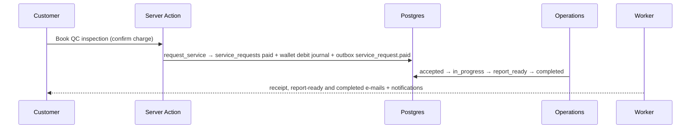

### Latency

| Hop | Measured | Budget | |
| --- | ---: | ---: | --- |
| SA request_service (wallet debit) | 665 ms | 300 ms | ⚠️ over |
| RPC transition_service_request accepted | 243 ms | 500 ms | ✅ |
| RPC transition_service_request in_progress | 228 ms | 500 ms | ✅ |
| RPC transition_service_request report_ready | 108 ms | 500 ms | ✅ |
| RPC transition_service_request completed | 104 ms | 500 ms | ✅ |

Server Action latencies are measured from the browser (click → response, includes rendering of the result); against a local build talking to the Supabase region over the internet, so SA/RPC budgets are indicative.

### Idempotency

- ✔ service_request.paid once — service_request.paid, service_request.updated:completed, service_request.updated:in_progress, service_request.updated:report_ready, service_request.updated:acce
- ✔ same idempotency key twice → one request, one debit — 9e94cf5a-a44a-4ef0-8c7a-47793f8cbc01 / 9e94cf5a-a44a-4ef0-8c7a-47793f8cbc01 / rows 1

### Negative paths

- ✔ negative: rejected paid request → refunded automatically (refund journal) — refunded
- ✔ negative: completed → paid refused — INVALID_TRANSITION: completed → paid

### Gaps

| Gap | Severity | Status / owner |
| --- | --- | --- |
| request_service with a repeated idempotency key created a **second paid request without a charge** (money integrity). | block | fixed (migration 134) |
| No e-mail for service requests (receipt / report). | major | fixed |
| No QC assignment (`service_requests.assigned_to` never set) and no QC report upload (`report_path` never set) — the back office has no screen for either. | major | open — Developer + Product (design needed) |

### Fixes applied

- request_service idempotency
- service-request e-mails

(Commit hashes in "Commits".)

## Chain 6 — Group-buy pool: open → join → fill → settle

### Summary

🟠 green with gaps · 19/19 checks · end-to-end 47.1 s · trace `e2e-c06-11a56e346e47`

Driver: Three tagged buyers (NL, DE, US) via traced RPC (open_pool / join_pool, wallets funded through the signed payment webhook), public pool page in Playwright, settle through `job_pools()` exactly as pg_cron runs it, ops shipments in /office/shipping.

<details><summary>All checks</summary>

- ✔ A opened the pool and pledged (deposit from wallet) — 22ed0749-9697-4500-84bf-e07afd254ff6
- ✔ B (DE) joined
- ✔ /pool/[code] shows buyer code + country only (no names/e-mails) — no identities
- ✔ C (US) joined → pool filled
- ✔ pool_public_view exposes no buyer identity — pool_id, buyer_code, country, qty, status, joined_at, deposit_minor, currency, is_starter
- ✔ settle_pool ran once from the cron job; a second call is an idempotent no-op — {"expired":0,"settled":1,"defaulted":0,"reminders":0} / {"ok":true,"status":"locked","idempotent":true}
- ✔ NL paid the balance from the wallet
- ✔ DE paid the balance from the wallet
- ✔ US paid the balance from the wallet
- ✔ B opened a second pool that will under-fill
- ✔ negative: under-filled pool expired by the cron job and the deposit refunded (refund journal) — expired / pledge withdrawn / refund journals 1
- ✔ 1 aggregate supplier PO, no buyer identities — purchase_order PO-POOL-0037 qty 5000
- ✔ 3 PIs (one per buyer) — 3
- ✔ 3 orders — 3
- ✔ 3 PI e-mails (pi.created) — default:pi.created, default:pi.created, default:pi.created, default:order.ready_to_ship, default:order.ready_to_ship, default:order.shipped, default:order.shipped, default:order.shipped, default:payment.confirmed, defaul
- ✔ 3 shipments — 3
- ✔ pool settle audited — status.pool, status.pool_pledge, status.pool_pledge, status.pool_pledge, status.pool, status.pool_pledge, status.pool_pledge, pool.locked, status.pool, status.pool_pledge, pool.confirmed, status.pool, pool.expired, statu
- ✔ pool.filled + po.created once each
- ✔ every journal (deposits, balances, refunds, top-ups) balances per currency — 16 journals
- · product MOQ 1000; pool target = tier 2 (5000 pcs @ 17 vs 19)
- · supplier-side view: the supplier portal is not built (QA FN-05); the supplier-facing artefact is the PO document (org_id null, 1 row) — checked for identities above.

</details>

### Trace table

| +t | Table | txid | Row |
| ---: | --- | ---: | --- |
| 0 ms | journals | 6263 | JRN-000545  Wallet top-up pi_test_ec769e83feaf |
| 0 ms | audit_log | 6263 | status.wallet_topup wallet_topup actor=system |
| 1.3 s | journals | 6268 | JRN-000546  Wallet top-up pi_test_12e8dcd38977 |
| 1.3 s | audit_log | 6268 | status.wallet_topup wallet_topup actor=system |
| 1.8 s | pools |  | POOL-0037 |
| 1.8 s | journals | 6271 | JRN-000547 pools Group-buy deposit · POOL-0037 |
| 1.8 s | audit_log | 6271 | status.pool pool actor=cf2273df |
| 1.8 s | audit_log | 6271 | status.pool_pledge pool_pledge actor=cf2273df |
| 1.8 s | pool_events |  | Pool opened |
| 1.8 s | pool_events |  | A buyer joined |
| 2.0 s | journals | 6272 | JRN-000548 pools Group-buy deposit · POOL-0037 |
| 2.0 s | audit_log | 6272 | status.pool_pledge pool_pledge actor=f6d11c5e |
| 2.0 s | pool_events |  | A buyer joined |
| 3.4 s | journals | 6273 | JRN-000549 pools Group-buy deposit · POOL-0037 |
| 3.4 s | audit_log | 6273 | status.pool_pledge pool_pledge actor=685e7cd2 |
| 3.4 s | pool_events |  | A buyer joined |
| 3.6 s | orders |  | ORD-2325 |
| 3.6 s | orders |  | ORD-2323 |
| 3.6 s | orders |  | ORD-2324 |
| 3.6 s | journals | 6274 | JRN-000550 orders PI PI-2026-1106 issued · POOL-0037 |
| 3.6 s | journals | 6274 | JRN-000551 pools Group-buy deposit applied · PI-2026-1106 |
| 3.6 s | journals | 6274 | JRN-000552 orders PI PI-2026-1107 issued · POOL-0037 |
| 3.6 s | journals | 6274 | JRN-000553 pools Group-buy deposit applied · PI-2026-1107 |
| 3.6 s | journals | 6274 | JRN-000554 orders PI PI-2026-1108 issued · POOL-0037 |
| 3.6 s | journals | 6274 | JRN-000555 pools Group-buy deposit applied · PI-2026-1108 |
| 3.6 s | audit_log | 6274 | status.order order actor=system |
| 3.6 s | audit_log | 6274 | status.order order actor=system |
| 3.6 s | audit_log | 6274 | status.order order actor=system |
| 3.6 s | audit_log | 6274 | pool.locked pools actor=system |
| 3.6 s | audit_log | 6274 | status.pool pool actor=system |
| … | _253 more rows in chain-06.json_ | | |
| 49.1 s | ledger_entries | 6428 | acct=da745726 Dr 0 Cr 1900 USD |
| 49.1 s | status_history | 6428 | pool ∅→open |
| 49.1 s | status_history | 6428 | pool_pledge ∅→paid |
| 49.2 s | audit_log | 6430 | status.pool pool actor=system |
| 49.2 s | outbox_events | 6430 | pool.expired [done] agg=pool:7073f0fd payload#4b2f8f031f |
| 49.2 s | ledger_entries | 6430 | acct=da745726 Dr 1900 Cr 0 USD |
| 49.2 s | ledger_entries | 6430 | acct=0ff27257 Dr 0 Cr 1900 USD |
| 49.2 s | status_history | 6430 | pool open→expired |
| 50.4 s | job_runs |  | notify → ok (0 ms) evt=26c9c9ba |
| — | proforma_invoices |  | PI-2026-1106 |
| — | proforma_invoices |  | PI-2026-1107 |
| — | proforma_invoices |  | PI-2026-1108 |

Rows per table: journals 16 · audit_log 29 · pools 2 · pool_events 9 · orders 3 · documents 7 · order_events 15 · job_runs 54 · notifications 17 · payments 3 · shipments 3 · pool_pledges 4 · outbox_events 29 · wallet_topups 2 · ledger_entries 32 · status_history 26 · integration_logs 23 · email_deliveries 12 · tracking_events 3 · webhook_deliveries 3 · proforma_invoices 3.

### Timeline

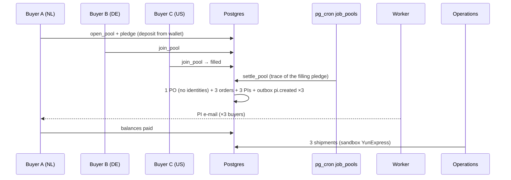

### Latency

| Hop | Measured | Budget | |
| --- | ---: | ---: | --- |
| job_pools → settle_pool | 86 ms | 500 ms | ✅ |

Server Action latencies are measured from the browser (click → response, includes rendering of the result); against a local build talking to the Supabase region over the internet, so SA/RPC budgets are indicative.

### Idempotency

- ✔ settle_pool ran once from the cron job; a second call is an idempotent no-op — {"expired":0,"settled":1,"defaulted":0,"reminders":0} / {"ok":true,"status":"locked","idempotent":true}
- ✔ pool.filled + po.created once each

### Negative paths

- ✔ negative: under-filled pool expired by the cron job and the deposit refunded (refund journal) — expired / pledge withdrawn / refund journals 1

### Gaps

| Gap | Severity | Status / owner |
| --- | --- | --- |
| Pools settled by pg_cron lost the trace (no request header) — PO/PI rows untraceable. | major | fixed (job_pools sets app.trace_id) |
| Buyers got **no e-mail/notification** for their PI on settle (`pi.created` had no consumer) nor for the balance reminder. | major | fixed |
| Supplier portal not built (QA FN-05): "supplier view" verified on the PO document only. | minor | open — Developer |

### Fixes applied

- job_pools trace
- pi.created / pool.balance_reminder e-mails

(Commit hashes in "Commits".)

## Chain 7 — Backup now → upload → UI card

### Summary

🟡 traced to boundary · 7/7 checks · end-to-end 29.2 s · trace `e2e-c07-d7f8b8960c25`

Driver: Playwright "Back up now" as the temporary admin; the GitHub workflow's signed status callback simulated with BACKUP_CALLBACK_SECRET (mock boundary).

Boundary: GitHub Actions dispatch (`GITHUB_NOT_CONFIGURED`) and the off-site S3 bucket (`OFFSITE_NOT_CONFIGURED`). Owner: **Owner/Admin** (GITHUB_ACTIONS_TOKEN, BACKUP_S3_*, age key, PITR — QA BK-01).

<details><summary>All checks</summary>

- ✔ Back up now → backup row queued; GitHub dispatch refused: GITHUB_NOT_CONFIGURED (boundary) — {"ok":false,"error":"GITHUB_NOT_CONFIGURED","backup_id":"eb512353-8d14-45a7-b058-fc2c2d915103","code":"BK-2026-1101-1005"}
- ✔ backups row queued with the trace id — {"code":"BK-2026-1101-1005","status":"queued","trace_id":"e2e-c07-d7f8b8960c25"}
- ✔ off-site bucket test → not configured (boundary) — {"ok":false,"error":"OFFSITE_NOT_CONFIGURED","offsite":{"bucket":"","region":"auto","endpoint":"","provider":"S3-compatible","last_test_at":"2026-11-01T02:05:07
- ✔ callback with a bad HMAC → 401 — 401
- ✔ signed callback → backup completed with checksum (simulated workflow) — {"status":"completed","checksum_ok":true,"size_bytes":"1234567"}
- ✔ status card refreshed without reload (3 s poll of the started backup) — live: true, row listed after reload: true
- ✔ backup request audited — backup.requested, backup.settings, backup.completed

</details>

### Trace table

| +t | Table | txid | Row |
| ---: | --- | ---: | --- |
| 0 ms | backups |  | BK-2026-1101-1005 |
| 0 ms | audit_log | 5729 | backup.requested backups actor=74cb7745 |
| 522 ms | audit_log | 5730 | backup.settings site_settings actor=74cb7745 |
| 680 ms | audit_log | 5732 | backup.completed backups actor=system |

Rows per table: backups 1 · audit_log 3.

### Timeline

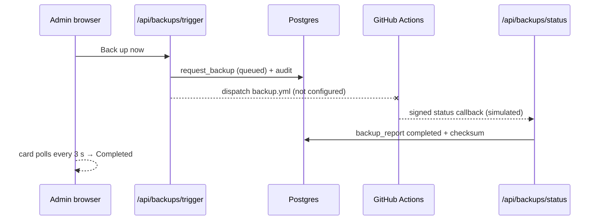

### Latency

| Hop | Measured | Budget | |
| --- | ---: | ---: | --- |
| UI Back up now → POST /api/backups/trigger (request_backup + GitHub dispatch) | 406 ms | 300 ms | ⚠️ over |
| signed status callback → backup_report | 107 ms | 2.0 s | ✅ |

Server Action latencies are measured from the browser (click → response, includes rendering of the result); against a local build talking to the Supabase region over the internet, so SA/RPC budgets are indicative.

### Idempotency

_No replayable event in this chain._

### Negative paths

- ✔ Back up now → backup row queued; GitHub dispatch refused: GITHUB_NOT_CONFIGURED (boundary) — {"ok":false,"error":"GITHUB_NOT_CONFIGURED","backup_id":"eb512353-8d14-45a7-b058-fc2c2d915103","code":"BK-2026-1101-1005"}
- ✔ callback with a bad HMAC → 401 — 401

### Gaps

| Gap | Severity | Status / owner |
| --- | --- | --- |
| No real backup has ever run; off-site + GitHub not configured. | block | open — Owner/Admin (QA BK-01) |

### Fixes applied

None needed in this chain.

## Chain 8 — Partial restore of deleted product

### Summary

🟡 traced to boundary · 5/5 checks · end-to-end — · trace `e2e-c08-0ead215a3a78`

Driver: One rolled-back transaction: recovery schema built by the backup tooling, product removed/damaged, `recovery_compare` + `restore_records` as the temporary admin.

Boundary: Needs a completed off-site backup (BK-01); storefront revalidation is a Server Action side effect that cannot be observed inside a rolled-back transaction.

<details><summary>All checks</summary>

- ✔ wizard compare shows the product as changed
- ✔ product damaged → restored with backup values — Stainless steel hex bolts, M10 × 40 mm, A2-70
- ✔ negative: money tables refused — MONEY_RECORDS_NOT_RESTORABLE: ledger_entries
- ✔ audit restore.records with the trace id — restore.records
- ✔ storefront revalidation: restoreRecords now calls revalidateTag(products) for catalogue tables (code fix; not observable inside a rolled-back transaction)
- · hard delete blocked by FKs (update or delete on table "products" violates foreign key constraint "rfqs_produ); simulated as damaged row instead
- · Ran in one rolled-back transaction; the real wizard additionally needs a completed off-site backup (BK-01).

</details>

### Trace table

| +t | Table | txid | Row |
| ---: | --- | ---: | --- |
| 0 ms | audit_log | 5734 | restore.records products actor=74cb7745 |

Rows per table: audit_log 1.

### Timeline

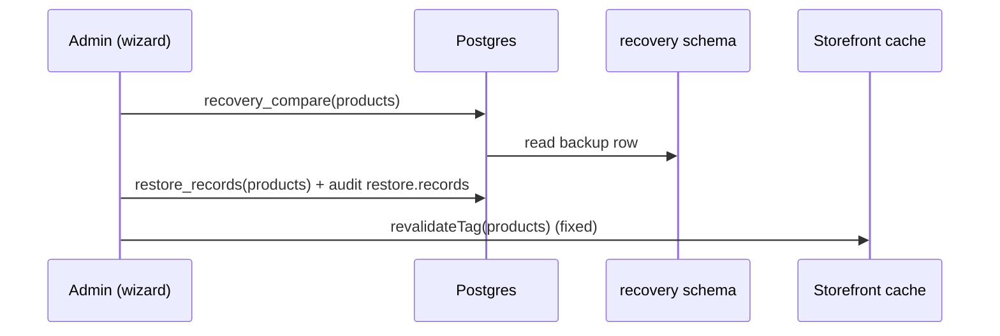

### Latency

| Hop | Measured | Budget | |
| --- | ---: | ---: | --- |
| RPC restore_records | 66 ms | 500 ms | ✅ |

Server Action latencies are measured from the browser (click → response, includes rendering of the result); against a local build talking to the Supabase region over the internet, so SA/RPC budgets are indicative.

### Idempotency

_No replayable event in this chain._

### Negative paths

- ✔ negative: money tables refused — MONEY_RECORDS_NOT_RESTORABLE: ledger_entries

### Gaps

| Gap | Severity | Status / owner |
| --- | --- | --- |
| Restoring a product did not revalidate the storefront (only the recovery page). | minor | fixed |
| Hard delete of a live product is blocked by FKs (rfqs/orders), so "deleted product" is in practice a damaged/archived product. | polish | note |

### Fixes applied

- revalidate after restore

(Commit hashes in "Commits".)

## Chain 9 — AI assistant message → tool-call → reply

### Summary

🟠 green with gaps · 6/8 checks · end-to-end 3.6 s · trace `e2e-c09-cf945d7bf669`

Driver: HTTP POST /api/assistant/reply with the customer cookie (real OpenAI model in .env.local).

<details><summary>All checks</summary>

- ✔ assistant answered — 200 Your order ORD-2308 has been delivered. The shipment was handled by YunExpress and the tracking number is YT34986083259092. The last scan indicates it was deliv
- ✔ reply quotes the real tracking number from get_shipment — YT34986083259092
- ✘ tools_called logs get_shipment — []
- ✔ reply row carries the confidence score and the trace id — confidence 1.00, latency 1609 ms, tokens 1527
- ✔ LLM calls logged to integration_logs with request/response SHA — openai 200 1502 ms
- ✘ YunExpress response SHA in integration_logs for the same trace — get_shipment reads the webhook-fed tracking_events table — no live carrier call
- ✔ customer + bot message rows in the trace — 2
- ✔ negative: another org's shipment (ORD-2202) is not revealed (RLS) — I couldn't find any information about order ORD-2202. It may not be in the current records. Please check if the order number is correct.
- · LLM schema-error path is covered by unit tests (parseModelReply → low confidence + escalation); not forced live.

</details>

### Trace table

| +t | Table | txid | Row |
| ---: | --- | ---: | --- |
| 0 ms | assistant_messages |  | 61a54d98-3c08-453b-bfc9-865653e373f8 |
| 2.7 s | integration_logs |  | openai out 200 https://api.openai.com/v1/chat/completions#gpt-4o-mini req#9805c632c2 res#f3db4073f9 |
| 2.8 s | assistant_messages |  | 8a1ce293-8b0b-4209-9a2b-e3eaf291db10 |

Rows per table: assistant_messages 2 · integration_logs 1.

### Timeline

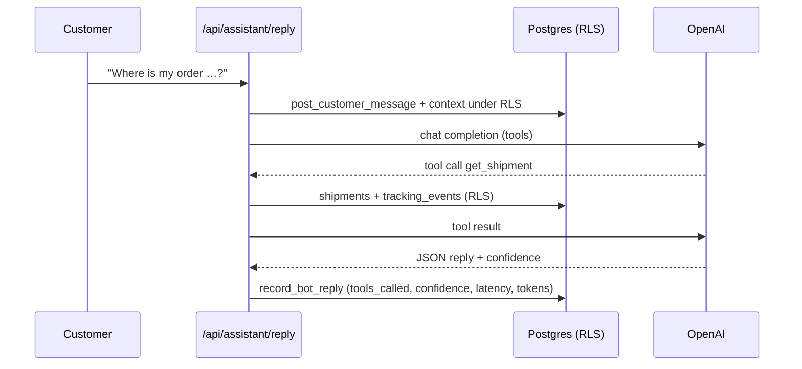

### Latency

| Hop | Measured | Budget | |
| --- | ---: | ---: | --- |
| POST /api/assistant/reply (RLS context + tools + LLM + record_bot_reply) | 3.5 s | 2.0 s | ⚠️ over |

Server Action latencies are measured from the browser (click → response, includes rendering of the result); against a local build talking to the Supabase region over the internet, so SA/RPC budgets are indicative.

### Idempotency

_No replayable event in this chain._

### Negative paths

- ✔ negative: another org's shipment (ORD-2202) is not revealed (RLS) — I couldn't find any information about order ORD-2202. It may not be in the current records. Please check if the order number is correct.

### Gaps

| Gap | Severity | Status / owner |
| --- | --- | --- |
| The model may answer from the RLS context snapshot without calling `get_shipment` (final run: tools_called empty, reply still had the real tracking number) — tool use is not enforced for shipment questions. | minor | open — Developer (force tool call for tracking intents) |
| `get_shipment` reads the webhook-fed `tracking_events` copy; no live YunExpress call, so there is no carrier response SHA for the trace (spec expectation). Data is as fresh as the last webhook/poll. | minor | open — Product (decide if a live carrier lookup is wanted) |
| LLM calls were not logged anywhere. | minor | fixed (integration_logs openai) |

### Fixes applied

- LLM call logging

(Commit hashes in "Commits".)

## Chain 10 — Escalation → Support ticket → staff reply

### Summary

🟢 green · 11/11 checks · end-to-end 5.9 s · trace `e2e-c10-5d6f120245c2`

Driver: Playwright: customer on /account/assistant and the account manager (support@, aal2) on /office/assistant; staff reply via the same RPC as the reply box.

<details><summary>All checks</summary>

- ✔ escalation row + Support ticket with transcript — sensitive_topic → TKT-1023
- ✔ /office/assistant queue refreshed live on the new escalation (Realtime) — 1470 ms
- ✔ account manager replied from the back office
- ✔ staff reply visible to the customer in-thread without reload (Realtime) — 772 ms
- ✔ exactly 1 escalation in the trace — 1
- ✔ ticket + transcript message in the trace — 1 / 1
- ✔ outbox assistant.escalated once — assistant.staff_replied, assistant.escalated
- ✔ staff notification for the handoff — 1
- ✔ audit entries (log_assistant_open / escalation) — assistant.opened
- ✔ replay: escalating an open session again is a no-op (1 escalation) — count 1
- ✔ negative: customer calling staff_assistant_reply refused — FORBIDDEN

</details>

### Trace table

| +t | Table | txid | Row |
| ---: | --- | ---: | --- |
| 0 ms | assistant_messages |  | 7d679bca-34b3-4bc7-9280-46c492b22491 |
| 364 ms | assistant_messages |  | b59149a5-88ce-482a-89d7-66fa260e4419 |
| 475 ms | tickets |  | TKT-1023 |
| 475 ms | escalations |  | eea28b81-e88c-4a75-97ab-0dcb14a84241 |
| 475 ms | notifications |  | Customer handed to you by Octo (user) |
| 475 ms | outbox_events | 5551 | assistant.escalated [done] agg=assistant_session:e783f926 payload#2c4d566e16 |
| 475 ms | ticket_messages |  | c445908b-9a4d-45d0-b8e4-6c39a137ac2c |
| 475 ms | assistant_messages |  | 6ba7c362-ce1a-4afa-9c4c-e8c813b8220f |
| 2.4 s | audit_log | 5552 | assistant.opened assistant_sessions actor=56f37861 |
| 3.9 s | outbox_events | 5555 | assistant.staff_replied [done] agg=assistant_session:e783f926 payload#1abfbfdf80 |
| 3.9 s | assistant_messages |  | 0bd75633-8e61-40ae-8667-6c84e2c4f258 |
| 5.1 s | job_runs |  | notify → ok (0 ms) evt=4b9d7b90 |
| 5.4 s | job_runs |  | notify → ok (0 ms) evt=6b31d553 |

Rows per table: assistant_messages 4 · tickets 1 · escalations 1 · notifications 1 · outbox_events 2 · ticket_messages 1 · audit_log 1 · job_runs 2.

### Timeline

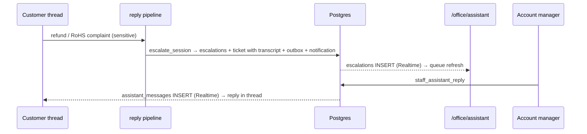

### Latency

| Hop | Measured | Budget | |
| --- | ---: | ---: | --- |
| customer message → escalation row | 1.3 s | — |  |
| staff reply → visible in customer thread | 509 ms | — |  |

Server Action latencies are measured from the browser (click → response, includes rendering of the result); against a local build talking to the Supabase region over the internet, so SA/RPC budgets are indicative.

### Idempotency

- ✔ outbox assistant.escalated once — assistant.staff_replied, assistant.escalated
- ✔ replay: escalating an open session again is a no-op (1 escalation) — count 1

### Negative paths

- ✔ negative: customer calling staff_assistant_reply refused — FORBIDDEN

### Gaps

| Gap | Severity | Status / owner |
| --- | --- | --- |
| /office/assistant had no live refresh for new handoffs. | minor | fixed |

### Fixes applied

- queue RealtimeRefresh

(Commit hashes in "Commits".)

## Chain 11 — Currency switch USD → CNY

### Summary

🟢 green · 10/10 checks · end-to-end 3.7 s · trace `e2e-c11-6eb39f622ad2`

Driver: One rolled-back transaction (switching the live currency would reprice production); staff via JWT claims (aal2) like the DB suites; pgTAP installed inside the transaction only.

Boundary: Worker/webhook for `settings.currency_changed` and the storefront re-render are not observable in a rolled-back transaction (covered by unit tests and the currency suite).

<details><summary>All checks</summary>

- ✔ maker (admin) cannot approve own switch
- ✔ approved → applied: platform currency CNY
- ✔ switch request applied — applied
- ✔ storefront price converts to CNY at the approved rate — {"unit_price_cents":"21500","currency":"USD","cny":"154800"}
- ✔ USD PI from before the switch keeps currency + FX rate — {"currency":"USD","fx_rate_id":"1b707ba9-0c59-47ba-92ee-165b6e1de068","pi_currency":"USD"}
- ✔ new PI after the switch carries CNY + rate — {"currency":"CNY","fx_rate_id":"5bc07c24-0d6d-448d-8fe2-e656c632ad73","pi_currency":"CNY"}
- ✔ pgTAP: ok 1 - every journal balances per currency
- ✔ outbox settings.currency_changed written once (broadcast webhook consumer) — 1
- ✔ currency switch audited — status.quote, status.order, status.rfq, status.rfq, status.quote, status.order, currency.switch_requested, currency.switch_approved, currency.switch_applied, status.rfq, status.rfq
- ✔ replay: approving an applied switch is refused — INVALID_TRANSITION: applied
- · Ran inside one transaction that was rolled back — nothing persisted (incl. the temporary pgtap extension).

</details>

### Trace table

| +t | Table | txid | Row |
| ---: | --- | ---: | --- |
| 0 ms | rfqs |  | RFQ-1067 |
| 0 ms | rfqs |  | RFQ-1068 |
| 0 ms | orders |  | ORD-2312 |
| 0 ms | orders |  | ORD-2313 |
| 0 ms | quotes |  | QT-1067-1 |
| 0 ms | quotes |  | QT-1068-1 |
| 0 ms | journals | 5701 | JRN-000490 rfq_fees RFQ fee |
| 0 ms | journals | 5701 | JRN-000491 orders PI PI-2026-1095 issued |
| 0 ms | journals | 5701 | JRN-000492 fx_conversion Currency switch: wallet converted USD → CNY @ 7.200000 |
| 0 ms | journals | 5701 | JRN-000493 fx_conversion Currency switch: wallet converted USD → CNY @ 7.200000 |
| 0 ms | journals | 5701 | JRN-000494 fx_conversion Currency switch: wallet converted USD → CNY @ 7.200000 |
| 0 ms | journals | 5701 | JRN-000495 fx_conversion Currency switch: wallet converted USD → CNY @ 7.200000 |
| 0 ms | journals | 5701 | JRN-000496 rfq_fees RFQ fee |
| 0 ms | journals | 5701 | JRN-000497 orders PI PI-2026-1096 issued |
| 0 ms | audit_log | 5701 | status.quote quote actor=b0233250 |
| 0 ms | audit_log | 5701 | status.order order actor=b0233250 |
| 0 ms | audit_log | 5701 | status.rfq rfq actor=b0233250 |
| 0 ms | audit_log | 5701 | status.rfq rfq actor=bf12a91b |
| 0 ms | audit_log | 5701 | status.quote quote actor=b0233250 |
| 0 ms | audit_log | 5701 | status.order order actor=b0233250 |
| 0 ms | audit_log | 5701 | currency.switch_requested currency_switch_requests actor=4589715d |
| 0 ms | audit_log | 5701 | currency.switch_approved currency_switch_requests actor=52c0c49a |
| 0 ms | audit_log | 5701 | currency.switch_applied currency_switch_requests actor=52c0c49a |
| 0 ms | audit_log | 5701 | status.rfq rfq actor=b0233250 |
| 0 ms | audit_log | 5701 | status.rfq rfq actor=bf12a91b |
| 0 ms | documents |  | PI-2026-1095 |
| 0 ms | documents |  | PI-2026-1096 |
| 0 ms | order_events |  | Proforma invoice issued |
| 0 ms | order_events |  | Proforma invoice issued |
| 0 ms | outbox_events | 5701 | rfq.submitted [pending] agg=rfq:0a784445 payload#515dec449a |
| … | _29 more rows in chain-11.json_ | | |
| 0 ms | ledger_entries | 5701 | acct=41f2ac08 Dr 0 Cr 990 CNY |
| 0 ms | status_history | 5701 | rfq ∅→submitted |
| 0 ms | status_history | 5701 | rfq submitted→quoted |
| 0 ms | status_history | 5701 | quote sent→approved |
| 0 ms | status_history | 5701 | order ∅→deposit_pending |
| 0 ms | status_history | 5701 | rfq ∅→submitted |
| 0 ms | status_history | 5701 | rfq submitted→quoted |
| 0 ms | status_history | 5701 | quote sent→approved |
| 0 ms | status_history | 5701 | order ∅→deposit_pending |
| — | proforma_invoices |  | PI-2026-1095 |
| — | proforma_invoices |  | PI-2026-1096 |
| 0 ms | currency_switch_requests |  | applied |

Rows per table: rfqs 2 · orders 2 · quotes 2 · journals 8 · audit_log 11 · documents 2 · order_events 2 · outbox_events 7 · ledger_entries 24 · status_history 8 · proforma_invoices 2 · currency_switch_requests 1.

### Timeline

```mermaid
sequenceDiagram
  participant AD as Admin (maker)
  participant FI as Finance (checker)
  participant DB as Postgres
  AD->>DB: request_currency_switch CNY 7.20
  AD--xDB: approve own request → MAKER_CANNOT_APPROVE
  FI->>DB: approve_currency_switch → applied
  DB->>DB: old USD PI unchanged; new quote/PI in CNY
  DB->>DB: pgTAP: every journal balances per currency
```

### Latency

| Hop | Measured | Budget | |
| --- | ---: | ---: | --- |
| RPC request_currency_switch | 65 ms | 500 ms | ✅ |
| RPC approve_currency_switch (apply) | 71 ms | 500 ms | ✅ |

Server Action latencies are measured from the browser (click → response, includes rendering of the result); against a local build talking to the Supabase region over the internet, so SA/RPC budgets are indicative.

### Idempotency

- ✔ outbox settings.currency_changed written once (broadcast webhook consumer) — 1
- ✔ replay: approving an applied switch is refused — INVALID_TRANSITION: applied

### Negative paths

_See the boundary note; no further negative path applies._

### Gaps

None found.

### Fixes applied

None needed in this chain.

## Chain 12 — Payment webhook replay

### Summary

🟢 green · 16/16 checks · end-to-end 5.2 s · trace `e2e-c12-21eecf4ea5e1`

Driver: Playwright card top-up (payment adapter test mode) + signed POST /api/webhooks/payment, replayed.

Boundary: Live payment provider not chosen (TestPaymentAdapter). Order payments (`payment.succeeded`) are matched by Finance manually — the replay was proven on `topup.succeeded`, the only automated payment event. Owner: **Owner/Admin** + Developer (live adapter, IN-02).

<details><summary>All checks</summary>

- ✔ payment adapter created a test intent — pi_test_0e287c9b1798
- ✔ wallet_topups row pending with the trace id — {"id":"26bca21b-3494-4154-b4a0-7a22aabaab24","status":"pending","amount_cents":"500000","currency":"USD","trace_id":"e2e-c12-21eecf4ea5e1"}
- ✔ webhook credited the top-up — {"ok":true,"results":[{"event":"evt_trace_98b82213ceac","outcome":"credited"}]}
- ✔ replay → 200 duplicate — {"ok":true,"results":[{"event":"evt_trace_98b82213ceac","outcome":"duplicate"}]}
- ✔ replay wrote no journal and no notification — journals 1→1, notifications 3→3
- ✔ bad HMAC → 401 BAD_SIGNATURE — BAD_SIGNATURE
- ✔ signature older than 5 min → 401 — BAD_SIGNATURE
- ✔ unknown reference → acknowledged as unmatched, nothing posted — {"ok":true,"results":[{"event":"evt_trace_mm_65d56f52","outcome":"unmatched"}]}
- ✔ 1 wallet_topups row
- ✔ exactly 1 journal for the credit — 1
- ✔ 2 ledger entries that balance per currency — [[500000,0,"USD"],[0,500000,"USD"]]
- ✔ exactly 1 wallet.updated outbox event
- ✔ exactly 1 "Wallet credited" notification
- ✔ replay wrote 1 idempotency_hits row (same trace family) — {"id":29,"key":"evt_trace_98b82213ceac","scope":"payment_webhook","detail":{"outcome":"duplicate","journal_id":"d53d2d49-455d-488d-bc16-f21f47cc1a9d"},"trace_id":"e2e-c12-21eecf4ea5e1","created_at":"2026-11-01T02:02:38.6
- ✔ rejected webhooks logged (401) with request SHA
- ✔ adapter createIntent logged once (request/response SHA)
- · email_deliveries for the top-up: 0 (wallet.updated has no e-mail consumer by design — §10.1 lists notify + webhooks only)

</details>

### Trace table

| +t | Table | txid | Row |
| ---: | --- | ---: | --- |
| 0 ms | integration_logs |  | payment out 200 sandbox://payment/createIntent req#183d499ccd res#cd6a7ec53c |
| 610 ms | outbox_events | 5231 | wallet.topup_requested [done] agg=wallet_topup:26bca21b payload#4660a6a829 |
| 610 ms | wallet_topups |  | credited |
| 1.8 s | journals | 5232 | JRN-000462  Wallet top-up pi_test_0e287c9b1798 |
| 1.8 s | audit_log | 5232 | status.wallet_topup wallet_topup actor=system |
| 1.8 s | outbox_events | 5232 | wallet.updated [done] agg=wallet_topup:26bca21b payload#4660a6a829 |
| 1.8 s | ledger_entries | 5232 | acct=392e3fd1 Dr 500000 Cr 0 USD |
| 1.8 s | ledger_entries | 5232 | acct=b9de94fa Dr 0 Cr 500000 USD |
| 1.8 s | status_history | 5232 | wallet_topup pending→credited |
| 2.0 s | integration_logs |  | payment in 200 POST /api/webhooks/payment req#b424dee805 res#3075e12d29 |
| 2.5 s | job_runs |  | notify → ok (0 ms) evt=253bb548 |
| 2.8 s | notifications |  | Wallet credited |
| 2.9 s | job_runs |  | notify → ok (107 ms) evt=fcc112d9 |
| 3.1 s | job_runs |  | webhooks_out → ok (91 ms) evt=fcc112d9 |
| 3.4 s | idempotency_hits |  | payment_webhook key=evt_trace_98b82213ceac orig=e2e-c12-21eecf4ea5e1 |
| 3.5 s | integration_logs |  | payment in 200 POST /api/webhooks/payment req#b424dee805 res#5d3c422b53 |
| 3.8 s | integration_logs |  | payment in 401 POST /api/webhooks/payment req#b424dee805 res# |
| 3.9 s | integration_logs |  | payment in 401 POST /api/webhooks/payment req#b424dee805 res# |
| 4.2 s | integration_logs |  | payment in 200 POST /api/webhooks/payment req#b9df03550f res#9e211305c9 |

Rows per table: integration_logs 6 · outbox_events 2 · wallet_topups 1 · journals 1 · audit_log 1 · ledger_entries 2 · status_history 1 · job_runs 3 · notifications 1 · idempotency_hits 1.

### Timeline

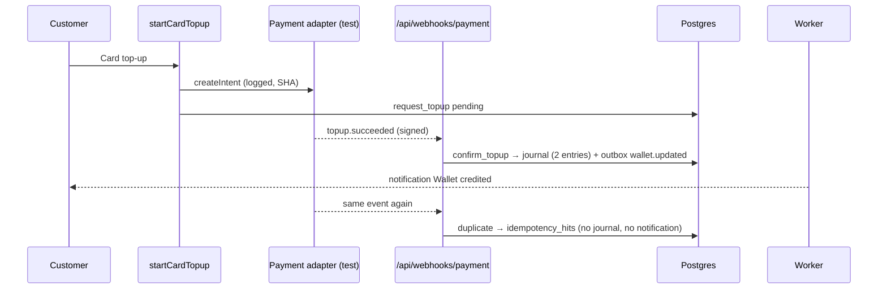

### Latency

| Hop | Measured | Budget | |
| --- | ---: | ---: | --- |
| startCardTopup SA (createIntent + request_topup) | 1.3 s | — |  |
| payment webhook (HMAC → confirm_topup → ledger) | 422 ms | 2.0 s | ✅ |
| outbox worker | 1.2 s | 5.0 s | ✅ |

Server Action latencies are measured from the browser (click → response, includes rendering of the result); against a local build talking to the Supabase region over the internet, so SA/RPC budgets are indicative.

### Idempotency

- ✔ replay → 200 duplicate — {"ok":true,"results":[{"event":"evt_trace_98b82213ceac","outcome":"duplicate"}]}
- ✔ replay wrote no journal and no notification — journals 1→1, notifications 3→3
- ✔ replay wrote 1 idempotency_hits row (same trace family) — {"id":29,"key":"evt_trace_98b82213ceac","scope":"payment_webhook","detail":{"outcome":"duplicate","journal_id":"d53d2d49-455d-488d-bc16-f21f47cc1a9d"},"trace_id
- ✔ adapter createIntent logged once (request/response SHA)

### Negative paths

- ✔ bad HMAC → 401 BAD_SIGNATURE — BAD_SIGNATURE
- ✔ signature older than 5 min → 401 — BAD_SIGNATURE
- ✔ unknown reference → acknowledged as unmatched, nothing posted — {"ok":true,"results":[{"event":"evt_trace_mm_65d56f52","outcome":"unmatched"}]}
- ✔ rejected webhooks logged (401) with request SHA

### Gaps

None found.

### Fixes applied

- idempotency_hits for payment replays

(Commit hashes in "Commits".)

## Chain 13 — Ad click → ledger

### Summary

🟠 green with gaps · 10/10 checks · end-to-end 1.1 s · trace `e2e-c13-da03f0a65706`

Driver: HTTP GET /api/ads/click with distinct visitor fingerprints; tagged campaign active only for the seconds of the test (placement search_top, 1-cent CPC).

<details><summary>All checks</summary>

- ✔ click redirects to the campaign link — 302 http://localhost:3100/products
- ✔ duplicate click still redirects (no error to the visitor)
- ✔ first click charged, duplicate within 24 h recorded as invalid with 0 charge — 1e21cb24 1 true \| 1e21cb24 0 false \| 0815cb0b 1 true \| 5a7fc46f 1 true
- ✔ budget tick: spent 3/3, campaign auto-paused when the budget ran out — {"status":"paused","spent_today_cents":"3"}
- ✔ 3 charge journals (one per valid click), balanced — 3 journals / 6 entries
- ✔ all 4 ad_clicks rows carry the trace id — 4
- ✔ no outbox event: the charge is synchronous (§10.1 lists ad.clicked → ad charge; implemented inline in record_ad_click)
- ✔ auto-pause written to status_history — 1
- ✔ negative: bot click not recorded — 4 → 4
- ✔ negative: invalid campaign id → redirect home, nothing written

</details>

### Trace table

| +t | Table | txid | Row |
| ---: | --- | ---: | --- |
| 0 ms | journals | 5505 | JRN-000470 ads Ad click · QA-TRACE campaign |
| 0 ms | ad_clicks |  | 8c9a7e24-12dc-4c19-ace0-abc9c5820812 |
| 0 ms | ledger_entries | 5505 | acct=b9de94fa Dr 1 Cr 0 USD |
| 0 ms | ledger_entries | 5505 | acct=bea85d28 Dr 0 Cr 1 USD |
| 222 ms | ad_clicks |  | 16cb63c3-a24c-456b-a79d-2007aaf0245c |
| 430 ms | journals | 5507 | JRN-000471 ads Ad click · QA-TRACE campaign |
| 430 ms | ad_clicks |  | f1574807-0a9a-49f1-b2c7-35c17c872271 |
| 430 ms | ledger_entries | 5507 | acct=b9de94fa Dr 1 Cr 0 USD |
| 430 ms | ledger_entries | 5507 | acct=bea85d28 Dr 0 Cr 1 USD |
| 668 ms | journals | 5508 | JRN-000472 ads Ad click · QA-TRACE campaign |
| 668 ms | ad_clicks |  | 01d90045-7442-466c-9d73-68715c0c77c3 |
| 668 ms | ledger_entries | 5508 | acct=b9de94fa Dr 1 Cr 0 USD |
| 668 ms | ledger_entries | 5508 | acct=bea85d28 Dr 0 Cr 1 USD |
| 857 ms | audit_log | 5509 | status.ad_campaign ad_campaign actor=system |
| 857 ms | status_history | 5509 | ad_campaign active→paused |

Rows per table: journals 3 · ad_clicks 4 · ledger_entries 6 · audit_log 1 · status_history 1.

### Timeline

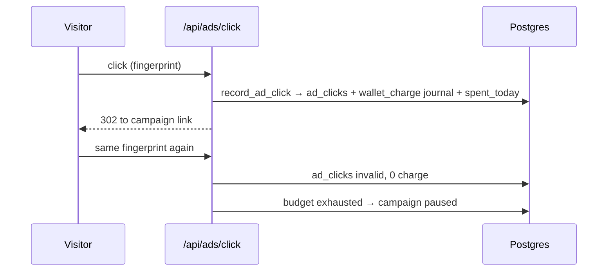

### Latency

| Hop | Measured | Budget | |
| --- | ---: | ---: | --- |
| click → record_ad_click → 302 | 240 ms | 2.0 s | ✅ |

Server Action latencies are measured from the browser (click → response, includes rendering of the result); against a local build talking to the Supabase region over the internet, so SA/RPC budgets are indicative.

### Idempotency

- ✔ duplicate click still redirects (no error to the visitor)
- ✔ first click charged, duplicate within 24 h recorded as invalid with 0 charge — 1e21cb24 1 true \| 1e21cb24 0 false \| 0815cb0b 1 true \| 5a7fc46f 1 true

### Negative paths

- ✔ negative: bot click not recorded — 4 → 4
- ✔ negative: invalid campaign id → redirect home, nothing written

### Gaps

| Gap | Severity | Status / owner |
| --- | --- | --- |
| Auto-pause on budget exhaustion wrote no status_history / audit (direct status update; also QA FN-06). | minor | fixed (status fallback trigger) |
| §10.1 lists `ad.clicked` as an outbox event; the charge is synchronous inside record_ad_click (no outbox). Functionally fine, design deviation. | polish | note |

### Fixes applied

- status fallback trigger

(Commit hashes in "Commits".)

## Chain 14 — Public API POST /v1/rfqs

### Summary

🟢 green · 15/15 checks · end-to-end 3.4 s · trace `e2e-c14-91d7d4d7879c`

Driver: Postman-style HTTP calls with a tagged API client (oct_test_ and oct_live_ keys).

<details><summary>All checks</summary>

- ✔ oct_test_ key → 201 simulated, no DB row (AP-02: test keys never write) — 201 RFQ-TEST-6918
- ✔ API response echoes x-trace-id — e2e-c14-91d7d4d7879c
- ✔ oct_live_ key → 201 with the new RFQ id/code — bfee3be0-5ab1-40d5-b6f5-3be21f6e117f RFQ-1066
- ✔ signed rfq.created webhook delivered (HTTP 200) — {"id":"evt_20cf2b0e5b594a7a91090412da596150","data":{"rfq":{"id":"bfee3be0-5ab1-40d5-b6f5-3be21f6e117f","code":"RFQ-1066","unit":"pcs","title":"QA-TRACE API RFQ
- ✔ webhook payload carries the same RFQ code — RFQ-1066
- ✔ replay → same response, Idempotent-Replayed: true, still 1 row — 201 rows=1
- ✔ same key, different body → 422 IDEMPOTENCY_KEY_REUSED — IDEMPOTENCY_KEY_REUSED
- ✔ missing Idempotency-Key → 400 — IDEMPOTENCY_KEY_REQUIRED
- ✔ unknown key → 401 problem+json — application/problem+json
- ✔ invalid body → 422 VALIDATION_FAILED — VALIDATION_FAILED
- ✔ exactly 1 rfq row in the trace
- ✔ exactly 1 rfq.submitted event
- ✔ exactly 1 rfq.created delivery
- ✔ API replay → idempotency_hits row — 1
- ✔ RFQ fee journal (wallet) once — 1

</details>

### Trace table

| +t | Table | txid | Row |
| ---: | --- | ---: | --- |
| 0 ms | rfqs |  | RFQ-1066 |
| 0 ms | journals | 5519 | JRN-000473 rfq_fees RFQ fee |
| 0 ms | audit_log | 5519 | status.rfq rfq actor=system |
| 0 ms | outbox_events | 5519 | rfq.submitted [done] agg=rfq:bfee3be0 payload#2a0ca1377e |
| 0 ms | ledger_entries | 5519 | acct=b9de94fa Dr 500 Cr 0 USD |
| 0 ms | ledger_entries | 5519 | acct=a101fb4b Dr 0 Cr 500 USD |
| 0 ms | status_history | 5519 | rfq ∅→submitted |
| 822 ms | notifications |  | RFQ received |
| 942 ms | job_runs |  | notify → ok (95 ms) evt=20cf2b0e |
| 2.7 s | webhook_deliveries |  | rfq.created → HTTP 200 delivered |
| 2.8 s | job_runs |  | webhooks_out:01d57368-717a-40f7-83ca-b9fe0aa3d4d2 → ok (1504 ms) evt=20cf2b0e |
| 2.9 s | job_runs |  | webhooks_out → ok (1817 ms) evt=20cf2b0e |
| 3.5 s | idempotency_hits |  | api key=api:d481ee2c-ef35-4a46-8 orig=— |

Rows per table: rfqs 1 · journals 1 · audit_log 1 · outbox_events 1 · ledger_entries 2 · status_history 1 · notifications 1 · job_runs 3 · webhook_deliveries 1 · idempotency_hits 1.

### Timeline

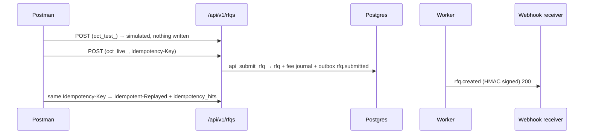

### Latency

| Hop | Measured | Budget | |
| --- | ---: | ---: | --- |
| POST /v1/rfqs (auth → scope → idempotency → api_submit_rfq) | 616 ms | 2.0 s | ✅ |
| worker (rfq.submitted → notify + webhooks_out) | 2.8 s | 5.0 s | ✅ |

Server Action latencies are measured from the browser (click → response, includes rendering of the result); against a local build talking to the Supabase region over the internet, so SA/RPC budgets are indicative.

### Idempotency

- ✔ replay → same response, Idempotent-Replayed: true, still 1 row — 201 rows=1
- ✔ same key, different body → 422 IDEMPOTENCY_KEY_REUSED — IDEMPOTENCY_KEY_REUSED
- ✔ missing Idempotency-Key → 400 — IDEMPOTENCY_KEY_REQUIRED
- ✔ API replay → idempotency_hits row — 1
- ✔ RFQ fee journal (wallet) once — 1

### Negative paths

- ✔ unknown key → 401 problem+json — application/problem+json
- ✔ invalid body → 422 VALIDATION_FAILED — VALIDATION_FAILED

### Gaps

| Gap | Severity | Status / owner |
| --- | --- | --- |
| There was no `rfq.created` webhook at all (spec §21.1 expects it). | major | fixed |
| oct_test_ keys never write (simulated) — the §21 wording "DB row created" holds only for live keys (QA AP-02 decision). | minor | open — Owner/Admin |

### Fixes applied

- rfq.created webhook

(Commit hashes in "Commits".)

## Chain 15 — Outbox event with worker failure

### Summary

🟠 green with gaps · 15/16 checks · end-to-end — · trace `e2e-c15-310054694390`

Driver: Second local app instance (port 3101) with the live e-mail adapter pointed at a mock that answers 503 (EMAIL_API_URL override); backoff fast-forwarded by moving available_at; Retry clicked in /admin/integrations as the temporary admin.

<details><summary>All checks</summary>

- ✔ backoff schedule honoured: 1 m, 5 m, 30 m, 2 h, 6 h — 59, 300, 1800, 7200, 21600
- ✔ 5 retries, then dead-letter on the 6th failure — {"run":6,"status":"dead","attempts":6,"next_in_s":null}
- ✔ 6 failed e-mail attempts logged (email_deliveries) — 6
- ✔ each failure in integration_logs (502) with request SHA
- ✔ customer notification sent once despite 6 runs (notify consumer idempotent) — 1
- ✔ alert: every admin notified of the dead letter — 2
- ✔ alert: integration_logs outbox dead-letter row
- ✔ outbound e-mail call carried x-octopus-trace — x-octopus-trace=e2e-c15-310054694390
- ✘ Sentry breadcrumb with the trace id — SENTRY_DSN not configured (IN-02) — structured JSON log line "outbox_dead_letter" carries trace_id instead
- ✔ admin Retry button re-queued the event (attempts reset) — {"status":"pending","attempts":0}
- ✔ after retry the event is delivered (done) — done
- ✔ exactly one successful e-mail after the retry — 1
- ✔ still one customer notification (no duplicate on retry)
- ✔ webhook delivered once across all runs — 1
- ✔ audit: outbox.retry
- ✔ retries skipped finished consumers (idempotency_hits) — 12
- · other due events when starting: 0

</details>

### Trace table

| +t | Table | txid | Row |
| ---: | --- | ---: | --- |
| 0 ms | outbox_events | 5754 | order.in_production [done] agg=order:96c84681 payload#009016aa66 |
| 1.3 s | notifications |  | Order in production |
| 1.3 s | job_runs |  | notify → ok (128 ms) evt=6419c5d4 |
| 1.7 s | email_deliveries |  | default:order.in_production → resend failed rcpt#5278b812a9 msg=— |
| 1.8 s | integration_logs |  | email out 502 http://127.0.0.1:3999/emails req#06c039f4ef res#e4b0eb8160 |
| 3.6 s | webhook_deliveries |  | order.updated → HTTP 200 delivered |
| 3.7 s | job_runs |  | webhooks_out:01d57368-717a-40f7-83ca-b9fe0aa3d4d2 → ok (1486 ms) evt=6419c5d4 |
| 3.8 s | job_runs |  | webhooks_out → ok (1892 ms) evt=6419c5d4 |
| 5.5 s | idempotency_hits |  | outbox:notify key=6419c5d4-f635-494c-96c4- orig=e2e-c15-310054694390 |
| 5.9 s | email_deliveries |  | default:order.in_production → resend failed rcpt#5278b812a9 msg=— |
| 6.0 s | integration_logs |  | email out 502 http://127.0.0.1:3999/emails req#06c039f4ef res#e4b0eb8160 |
| 6.1 s | idempotency_hits |  | outbox:webhooks_out key=6419c5d4-f635-494c-96c4- orig=e2e-c15-310054694390 |
| 7.1 s | idempotency_hits |  | outbox:notify key=6419c5d4-f635-494c-96c4- orig=e2e-c15-310054694390 |
| 7.5 s | email_deliveries |  | default:order.in_production → resend failed rcpt#5278b812a9 msg=— |
| 7.6 s | integration_logs |  | email out 502 http://127.0.0.1:3999/emails req#06c039f4ef res#e4b0eb8160 |
| 7.7 s | idempotency_hits |  | outbox:webhooks_out key=6419c5d4-f635-494c-96c4- orig=e2e-c15-310054694390 |
| 8.4 s | idempotency_hits |  | outbox:notify key=6419c5d4-f635-494c-96c4- orig=e2e-c15-310054694390 |
| 9.2 s | email_deliveries |  | default:order.in_production → resend failed rcpt#5278b812a9 msg=— |
| 9.3 s | integration_logs |  | email out 502 http://127.0.0.1:3999/emails req#06c039f4ef res#e4b0eb8160 |
| 9.4 s | idempotency_hits |  | outbox:webhooks_out key=6419c5d4-f635-494c-96c4- orig=e2e-c15-310054694390 |
| 10.5 s | idempotency_hits |  | outbox:notify key=6419c5d4-f635-494c-96c4- orig=e2e-c15-310054694390 |
| 10.9 s | email_deliveries |  | default:order.in_production → resend failed rcpt#5278b812a9 msg=— |
| 11.0 s | integration_logs |  | email out 502 http://127.0.0.1:3999/emails req#06c039f4ef res#e4b0eb8160 |
| 11.1 s | idempotency_hits |  | outbox:webhooks_out key=6419c5d4-f635-494c-96c4- orig=e2e-c15-310054694390 |
| 11.9 s | idempotency_hits |  | outbox:notify key=6419c5d4-f635-494c-96c4- orig=e2e-c15-310054694390 |
| 12.4 s | email_deliveries |  | default:order.in_production → resend failed rcpt#5278b812a9 msg=— |
| 12.5 s | integration_logs |  | email out 502 http://127.0.0.1:3999/emails req#06c039f4ef res#e4b0eb8160 |
| 12.6 s | idempotency_hits |  | outbox:webhooks_out key=6419c5d4-f635-494c-96c4- orig=e2e-c15-310054694390 |
| 12.9 s | notifications |  | Outbox job failed permanently (user) |
| 12.9 s | notifications |  | Outbox job failed permanently (user) |
| 13.0 s | integration_logs |  | outbox out 500 outbox://dead-letter req# res# |
| 15.8 s | audit_log | 5810 | outbox.retry outbox_events actor=74cb7745 |
| 16.8 s | idempotency_hits |  | outbox:notify key=6419c5d4-f635-494c-96c4- orig=e2e-c15-310054694390 |
| 17.3 s | email_deliveries |  | default:order.in_production → log logged rcpt#5278b812a9 msg=log_1793498764639 |
| 17.4 s | integration_logs |  | email out 200 log://email req#06c039f4ef res#c2b7d3d4ee |
| 17.5 s | job_runs |  | email → ok (560 ms) evt=6419c5d4 |
| 17.6 s | idempotency_hits |  | outbox:webhooks_out key=6419c5d4-f635-494c-96c4- orig=e2e-c15-310054694390 |

Rows per table: outbox_events 1 · notifications 3 · job_runs 4 · email_deliveries 7 · integration_logs 8 · webhook_deliveries 1 · idempotency_hits 12 · audit_log 1.

### Timeline

```mermaid
sequenceDiagram
  participant DB as outbox_events
  participant W as Worker (3101)
  participant M as E-mail API (mock 503)
  participant AD as Admin
  participant W2 as Worker (healthy)
  W->>M: send (x-octopus-trace)
  M-->>W: 503
  W->>DB: attempts+1, retry in 1 m / 5 m / 30 m / 2 h / 6 h
  W->>DB: 6th failure → dead + admin notifications + integration_logs
  AD->>DB: Failed jobs → Retry (retry_outbox, audit)
  W2->>DB: e-mail delivered once; notify/webhook skipped (idempotency_hits)
```

### Latency

_Not measured._

Server Action latencies are measured from the browser (click → response, includes rendering of the result); against a local build talking to the Supabase region over the internet, so SA/RPC budgets are indicative.

### Idempotency

- ✔ customer notification sent once despite 6 runs (notify consumer idempotent) — 1
- ✔ still one customer notification (no duplicate on retry)
- ✔ webhook delivered once across all runs — 1
- ✔ retries skipped finished consumers (idempotency_hits) — 12

### Negative paths

_See the boundary note; no further negative path applies._

### Gaps

| Gap | Severity | Status / owner |
| --- | --- | --- |
| No Sentry → no breadcrumb/alert outside the app. | major | open — Owner/Admin (SENTRY_DSN, IN-02) |
| Dead letters only logged to the console; no alert. | major | fixed (admin notifications + integration_logs) |
| Events of deleted orgs failed into the dead-letter queue (10 orphan events found in production). | minor | fixed (skip) + cleaned |

### Fixes applied

- dead-letter alert
- org-missing skip

(Commit hashes in "Commits".)

## Chain 16 — Staff login → workspace → money action

### Summary

🟢 green · 10/10 checks · end-to-end 5.5 s · trace `e2e-c16-f55cbfe2c26f`

Driver: Playwright /staff/login → /staff/verify (TOTP of a temporary factor) → workspace → /admin/finance Confirm top-up.

<details><summary>All checks</summary>

- ✔ customer reported a bank transfer top-up (pending) — E2E-TRACE-BANK-MVX6UBVC
- ✔ signed in with 2FA → workspace picker — http://localhost:3100/staff/workspace
- ✔ finance confirmed the top-up with a fresh 2FA session (wallet credited) — E2E-TRACE-BANK-MVX6UBVC
- ✔ audit: auth.sign_in — auth.sign_in, auth.2fa_verified, status.wallet_topup
- ✔ audit: auth.2fa_verified — auth.sign_in, auth.2fa_verified, status.wallet_topup
- ✔ audit: money approval (top-up confirmation) logged — auth.sign_in, auth.2fa_verified, status.wallet_topup
- ✔ one credit journal for the confirmation — 1
- ✔ negative: staff without aal2 is sent to /staff/verify — http://localhost:3100/staff/verify?next=%2Fadmin%2Ffinance
- ✔ negative: aal1 session calling confirm_topup refused — STEP_UP_REQUIRED
- ✔ negative: TOTP older than step_up_minutes → STEP_UP_REQUIRED on the money RPC — STEP_UP_REQUIRED
- · UI maps STEP_UP_REQUIRED to /staff/verify?reason=step_up (lib/staff/step-up.ts), covered by the staff-auth suite.

</details>

### Trace table

| +t | Table | txid | Row |
| ---: | --- | ---: | --- |
| 0 ms | outbox_events | 5742 | wallet.topup_requested [pending] agg=wallet_topup:952fa842 payload#4660a6a829 |
| 0 ms | wallet_topups |  | credited |
| 1.2 s | audit_log | 5744 | auth.sign_in auth actor=52c0c49a |
| 3.1 s | audit_log | 5747 | auth.2fa_verified auth actor=52c0c49a |
| 5.0 s | journals | 5751 | JRN-000498  Wallet top-up E2E-TRACE-BANK-MVX6UBVC |
| 5.0 s | audit_log | 5751 | status.wallet_topup wallet_topup actor=52c0c49a |
| 5.0 s | outbox_events | 5751 | wallet.updated [pending] agg=wallet_topup:952fa842 payload#4660a6a829 |
| 5.0 s | ledger_entries | 5751 | acct=392e3fd1 Dr 10000 Cr 0 USD |
| 5.0 s | ledger_entries | 5751 | acct=b9de94fa Dr 0 Cr 10000 USD |
| 5.0 s | status_history | 5751 | wallet_topup pending→credited |

Rows per table: outbox_events 2 · wallet_topups 1 · audit_log 3 · journals 1 · ledger_entries 2 · status_history 1.

### Timeline

```mermaid
sequenceDiagram
  participant F as Finance (browser)
  participant L as /staff/login + /staff/verify
  participant DB as Postgres
  F->>L: password
  L->>DB: auth_audit auth.sign_in
  F->>L: TOTP code
  L->>DB: auth.2fa_verified, staff cookie
  F->>DB: Confirm top-up (confirm_topup, require_step_up)
  DB->>DB: journal + status_history → audit status.wallet_topup
  Note over DB: stale TOTP → STEP_UP_REQUIRED; aal1 → no staff access
```

### Latency

| Hop | Measured | Budget | |
| --- | ---: | ---: | --- |
| step 1: password → /staff/verify | 1.2 s | — |  |
| step 2: TOTP → workspace | 1.1 s | — |  |
| money action: Confirm top-up (confirm_topup + step-up check) | 1.0 s | — |  |

Server Action latencies are measured from the browser (click → response, includes rendering of the result); against a local build talking to the Supabase region over the internet, so SA/RPC budgets are indicative.

### Idempotency

_No replayable event in this chain._

### Negative paths

- ✔ negative: staff without aal2 is sent to /staff/verify — http://localhost:3100/staff/verify?next=%2Fadmin%2Ffinance
- ✔ negative: aal1 session calling confirm_topup refused — STEP_UP_REQUIRED
- ✔ negative: TOTP older than step_up_minutes → STEP_UP_REQUIRED on the money RPC — STEP_UP_REQUIRED

### Gaps

| Gap | Severity | Status / owner |
| --- | --- | --- |
| Page views (e.g. opening /admin/finance) are not audited — only sign-in, 2FA and state changes. "Audit holds every click" is true for every write, not for reads (except KYC document views). | polish | note |

### Fixes applied

None needed in this chain.

## Cross-chain matrix

✅ pass · ⚠️ pass with an open gap · 🟡 traced to an external boundary / mock / rolled back · ❌ fail · — not part of the chain

| # | Entry/UI | Validation | RPC + txn | Ledger | status_history | Outbox | Worker | External | Webhook in | Webhook out | Realtime | E-mail | Audit | Idempotency |
| ---: | :---: | :---: | :---: | :---: | :---: | :---: | :---: | :---: | :---: | :---: | :---: | :---: | :---: | :---: |
| 1 | 🟡 | ✅ | ✅ | — | ✅ | ✅ | ✅ | 🟡 | — | — | ✅ | ✅ | ✅ | ✅ |
| 2 | ✅ | ✅ | ✅ | ✅ | ✅ | ✅ | ✅ | — | — | ✅ | ✅ | ⚠️ | ✅ | ✅ |
| 3 | ✅ | ✅ | ✅ | ✅ | ✅ | ✅ | ✅ | 🟡 | — | ✅ | ✅ | ✅ | ✅ | ✅ |
| 4 | ✅ | ✅ | ✅ | — | ✅ | ✅ | ✅ | — | ✅ | — | ✅ | ✅ | ✅ | ✅ |
| 5 | ✅ | ✅ | ✅ | ✅ | ✅ | ✅ | ✅ | — | — | — | — | ✅ | ✅ | ✅ |
| 6 | ✅ | ✅ | ✅ | ✅ | ✅ | ✅ | ✅ | 🟡 | — | — | — | ✅ | ✅ | ✅ |
| 7 | ✅ | ✅ | ✅ | — | — | — | — | 🟡 | ✅ | — | ✅ | — | ✅ | — |
| 8 | 🟡 | ✅ | ✅ | — | — | — | — | — | — | — | — | — | ✅ | — |
| 9 | ✅ | ✅ | ✅ | — | — | — | — | ⚠️ | — | — | — | — | — | — |
| 10 | ✅ | ✅ | ✅ | — | — | ✅ | ✅ | — | — | — | ✅ | — | ✅ | ✅ |
| 11 | 🟡 | ✅ | ✅ | ✅ | ✅ | ✅ | 🟡 | — | — | 🟡 | — | — | ✅ | ✅ |
| 12 | ✅ | ✅ | ✅ | ✅ | ✅ | ✅ | ✅ | 🟡 | ✅ | — | — | — | ✅ | ✅ |
| 13 | ✅ | ✅ | ✅ | ✅ | ✅ | — | — | — | — | — | — | — | ✅ | ✅ |
| 14 | ✅ | ✅ | ✅ | ✅ | ✅ | ✅ | ✅ | — | — | ✅ | — | — | ✅ | ✅ |
| 15 | ✅ | — | — | — | — | ✅ | ✅ | 🟡 | — | ✅ | — | ✅ | ✅ | ✅ |
| 16 | ✅ | ✅ | ✅ | ✅ | ✅ | — | — | — | — | — | — | — | ✅ | — |

No ❌ cells remain. 🟡 cells and their owners: Google OAuth (1), YunExpress live (3, 6), payment provider (12), GitHub/off-site backup (7, 8) — **Owner/Admin**; currency switch side effects only observable outside a rolled-back transaction (11) — run once on staging; LLM carrier lookup (9, ⚠️) — **Product**; e-mail template + PI PDF storage (2, ⚠️) — **Developer/Content editor**.

## Commits (not pushed)

| Commit | What |
| --- | --- |
| `54e159e` | trace_id columns + app_trace_id() + BEFORE INSERT stamps, email_deliveries, idempotency_hits, trace_rows() (SPEC §21.4 steps 2, 5) |
| `cd0dba2` | proxy mints x-trace-id on every request (incl. /api machine routes); server Supabase clients forward it (SPEC §21.4 step 1) |
| `fa8d2b3` | adapter calls logged to integration_logs with trace id + body SHAs; every email in email_deliveries; x-octopus-trace outbound (SPEC §21.4 steps 3–5) |
| `7b21038` | outbox worker carries each event's trace id downstream, records redelivery idempotency hits, alerts admins on dead letters, skips events of deleted orgs (SPEC §10.2, §21) |
| `aaf763a` | webhook + API replays write idempotency_hits; inbound logs carry HMAC result and body SHAs (SPEC §21.4 step 5) |
| `bac1b11` | outbox dispatcher every 10 s via pg_cron + pg_net, URL + CRON_SECRET from Vault (QA FN-02, SPEC §10.3) |
| `a9b131c` | chain 1 — account manager assignment e-mails + notifies the customer (account_manager.assigned); dashboard listens to notifications; service-request receipt/report e-mails (chain 5) |
| `f0860b5` | browser Realtime channels join with the user's JWT — before, RLS treated them as anon and no live update ever arrived (chains 1–4, 10) |
| `615ddc5` | status changes not logged by their RPC (quote approve, ad auto-pause) reach status_history; every status_history row is mirrored to audit_log (chains 2, 13) |
| `f7e321a` | request_service replay with the same idempotency key returns the first request instead of creating a second 'paid' request without a charge (chain 5) |
| `fe733e9` | public webhook rfq.created for submitted RFQs (chain 14, SPEC §21.1) |
| `f77ca94` | chain drivers (Playwright + API) and trace collection/clean-up helpers for SPEC §21 |
| `ec9c13c` | LLM calls logged to integration_logs with trace id + request/response SHA (chain 9) |
| `abd633d` | /office/assistant queue refreshes live on new or updated escalations (chain 10) |
| `3a9a29c` | cron-settled pools keep the group buy's trace id; buyers get the PI e-mail + notification on settle and the balance reminder (chain 6) |
| `9610c14` | partial restore revalidates the storefront tags of restored catalogue/CMS tables (chain 8) |
| `4049730` | drivers for chains 6–8, 11, 13–16 |

Migrations `20261101000130`–`20261101000136` are applied to the live database (additive columns/tables/triggers/functions; `core_request_service`, `assign_account_manager` and `job_pools` redefined with their previous bodies plus the fix). The Vault secrets `octopus_app_url` / `octopus_cron_secret` were written by `scripts/cron-dispatcher-secrets.mjs` (the Lead rotated CRON_SECRET in .env.local, Vercel and Vault).

## Clean-up (production database)

- Deleted by `tests/e2e/trace/cleanup.mjs` (by trace id `e2e-%`, test org ids and test user ids, FK-safe loop): 4 auth users (`qa-trace-a/b/c@`, `qa-trace-admin@`) with profiles, user_roles, org_members; 3 orgs `QA-TRACE …`; 16 orders, 16 PIs, 40 documents, 9 pools, 19 pledges, 42 pool_events, 2 rfqs, 1 quote, 2 service requests, 5 shipments, 17 payments, 12 wallet top-ups, 91 journals + 182 ledger entries, 6 ledger accounts, 153 outbox events + 301 job_runs, 94 notifications, 73 email_deliveries, 122 integration_logs, 14 webhook_deliveries + 1 endpoint, 1 API client (+ keys), 30 idempotency_hits, 143 status_history, 65 order_events, 1 ad campaign (+ clicks), 1 backup row, 1 ticket + message, 1 assistant session + 8 messages, 1 account manager row, 1 KYC submission.
- Temporary TOTP factors on ops@, support@, finance@ deleted **by factor id**; the owner's factor on admin@ was never touched (it is the only factor left on demo accounts).
- `backup_settings.offsite` (stamped by the off-site probe) restored to its previous value.
- After clean-up: 0 rows with an `e2e-` trace id outside audit_log, 0 `qa-trace-*` users, 0 `QA-TRACE` orgs, 0 unbalanced journals, 0 orphan ledger entries, outbox 34 done / 0 pending.
- **Kept (append-only by design):** 219 `audit_log` rows with trace ids `e2e-c…` (sign-ins, status changes, currency/backup actions of the test identities) — delete them only if the Owner wants test audit rows purged.
- Chains 8 and 11 and all stale-claims negatives ran in rolled-back transactions (incl. the temporary `pgtap` extension) — nothing persisted.

## What was not checked, and why

- Real e-mail delivery/inbox receipt: no EMAIL_API_KEY (log adapter); e-mails are proven up to the adapter (`email_deliveries` + `integration_logs`), and the live Resend path only against a 503 mock (chain 15).
- Live payment, YunExpress, Google OAuth, GitHub backup workflow and off-site bucket: no credentials — traced to the sandbox/mock boundary (owners in the matrix).
- Production front-end with the new instrumentation: the TRACE commits are not pushed, so production still runs the old code (no `x-trace-id`, no email_deliveries); the chains ran on a local production build against the production database.
- Sentry breadcrumbs: no SENTRY_DSN; the worker's structured JSON log lines carry `trace_id` instead.
- Client-side forwarding of `x-trace-id` on follow-up fetches is emulated by Playwright request headers; the app itself does not yet wrap `fetch`/Server Action calls to forward the id (each user click is its own trace in production).
- Chain 9's LLM run is non-deterministic: in the final run the model answered from the RLS context snapshot without calling `get_shipment` (in the earlier run it called it). The reply still quoted the real tracking number.
- A `realtime_pushes` table was not built; Realtime delivery is proven in the browser (router refresh / DOM text) instead.

---

**Release verdict: no-go — every chain connects end to end with one trace id and replays are no-ops, but external integrations (payments, e-mail, YunExpress, Google, backups) are still sandbox-only and the PI PDF / QC report storage is missing.**

**Top three risks**

1. **No real external delivery yet** (e-mail log adapter, test payments, sandbox YunExpress, no Google OAuth, no Sentry) — every chain stops at a mock boundary in production. Owner: **Owner/Admin** (providers + credentials) with **Developer** (live payment adapter).
1. **No backups and no restore drill** (chains 7/8 only reach the GitHub/off-site boundary) — data loss is unrecoverable. Owner: **Owner/Admin** (GitHub token, bucket, age key, PITR) then **Developer** (first backup + drill).
1. **Documents are not files**: PIs/receipts/QC reports are rendered on demand or never stored (`pdf_path`/`report_path` null), QC assignment has no screen — disputes and QC orders lack the artefact the customer was promised. Owner: **Developer** (render-pdf worker, QC assignment + report upload) with **Product** for the QC flow design.
