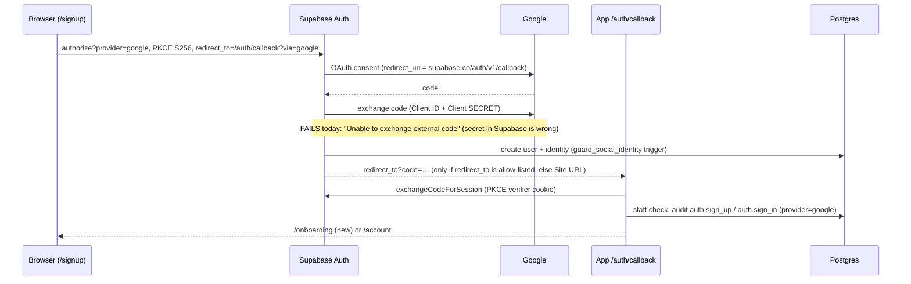

# Google sign-in — flow audit (5 Nov 2026)

**Verdict:** the app side is correct and now hardened. **Two settings outside the code are blocking it**: the Client Secret saved in Supabase is wrong, and Supabase's Site URL / Redirect URLs still point to localhost only.

## The flow, hop by hop

| # | Hop | Checked how | Result |
|---|---|---|---|
| 1 | Button only on customer `/login` + `/signup`, never `/staff/login` | Live site, 360 / 768 / 1440 px | ✅ |
| 2 | Browser starts OAuth with PKCE (S256) and the right `redirect_to` | Captured the `/authorize` request on live + local | ✅ verifier cookie set on the right domain, SameSite=Lax |
| 3 | Google accepts our client + redirect URI | Live click-through to accounts.google.com | ✅ (was `redirect_uri_mismatch`, fixed by you in Google Console) |
| 4 | Supabase exchanges Google's code (needs the Client **Secret**) | Your error URL + checked the secret from your JSON file directly with Google | ❌ **Secret in Supabase is wrong.** The JSON file's secret is valid (Google answers `invalid_grant` for a test code, not `invalid_client`) |
| 5 | Supabase sends the user back to the app | Asked Supabase which return URLs it accepts | ❌ **Site URL = `http://localhost:3000`; no live-site URL is allow-listed** → every live sign-in, sign-up email and password-reset link returns to localhost |
| 6 | Callback: exchange code, staff check, audit, onboarding | Edge cases on live + local (cancel, bad code, provider error, old staff entry, no code) | ✅ all end on a page with a clear message |
| 7 | Staff cannot get in through Google | New database trigger, tested in a rolled-back transaction | ✅ (was a gap — see below) |
| 8 | Audit trail | Callback writes `auth.sign_up` / `auth.sign_in` with `provider=google`, IP, device | ✅ (code path; no real Google user yet because hop 4 fails) |
| 9 | Customer with an existing email account signs in with Google | Supabase links identities with the same verified email | ✅ lands in the same account |

## Gaps found and fixed in code

1. **Staff could bypass the password with Google (security).** Supabase automatically links a Google identity to an existing account with the same verified email. A staff member could have got an (aal1) session for their staff account through the raw Google endpoint, skipping the password. Two-step verification would still have stopped them reaching staff areas.
   - **Fix:** migration `147` adds trigger `guard_social_identity` on `auth.identities`. It refuses any Google/social identity for a staff account or an `@octopusb2b.com` email, and rolls back the whole sign-in or sign-up, so no user is created.
   - **Tested:** staff link blocked ✔ · new staff-domain user blocked ✔ · customer allowed ✔ · staff email logins untouched ✔
2. **Failures landed silently on the home page.** Supabase sends failures to the Site URL (`/?error=…`). The proxy now forwards them to `/login` with the message.
3. **Raw technical errors were shown to users** (PKCE text, "Database error…", Google codes).
   - **Fix:** [`friendlyAuthError`](file:///Users/ashifabdulkhadar/Desktop/octopusb2bapp/lib/auth-errors.ts) maps them to plain language. A staff-email refusal sends the person to the staff login.
   - **Tests:** unit tests added.

## What you need to fix in Supabase (2 minutes)

**A. Client Secret** — Authentication → Providers → Google: clear the **Client Secret** field and paste the `client_secret` from your JSON file again (starts with `GOCSPX-`, no spaces). **Save.**

**B. URLs** — Authentication → URL Configuration:

| Setting | Value |
|---|---|
| Site URL | `https://octopus-b2b.vercel.app` |
| Redirect URLs | `https://octopus-b2b.vercel.app/**` |
| | `http://localhost:3000/**` |

> [!TIP]
> The `/**` wildcard covers `/auth/callback?via=google&next=…`, `/reset-password` and sign-up confirmation links at once. Exact URLs without the wildcard can fail when a query string is added.

> [!WARNING]
> The Google client secret was uploaded to the chat. After sign-in works, use **Reset secret** in Google Console and paste the new one in Supabase.

## After A + B

Tell me, and I'll re-run the URL check (all live URLs should then show **ALLOWED**). Then you sign in once with a personal Google account and I'll confirm the new customer, the Google identity and the audit entries in the database.
