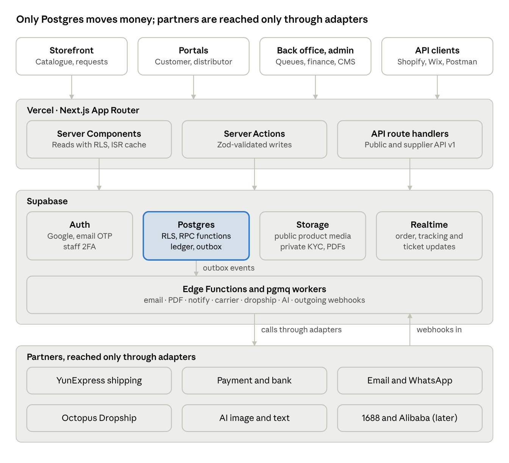
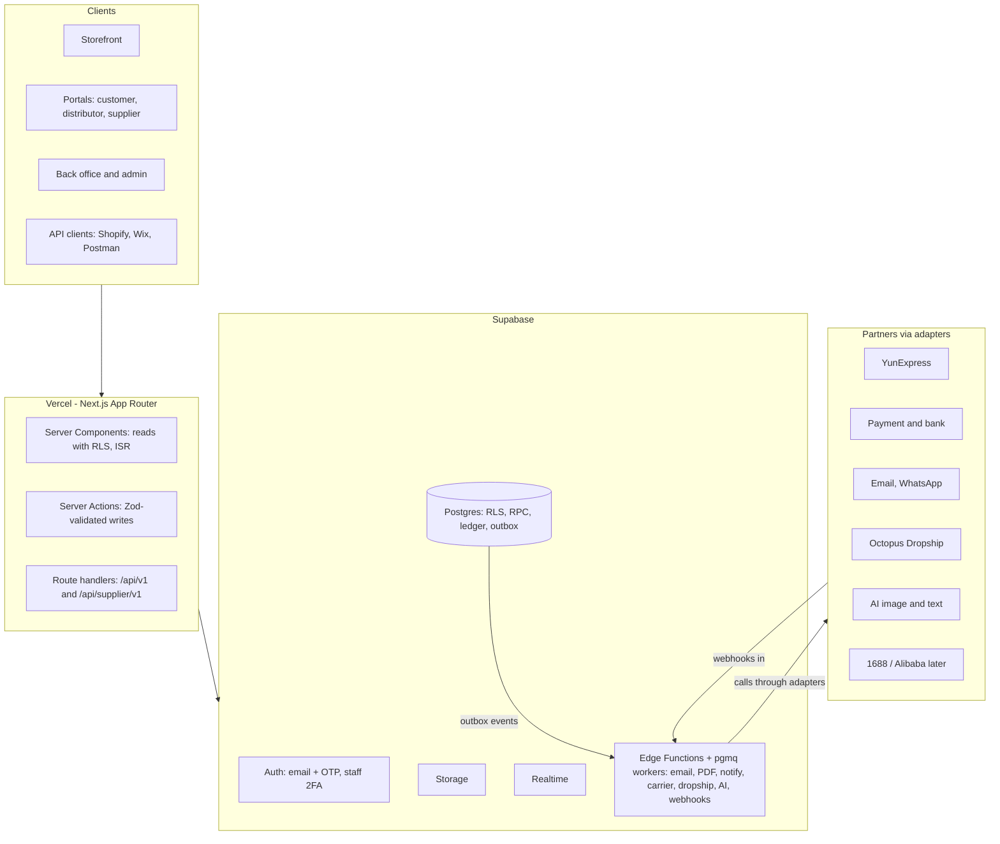
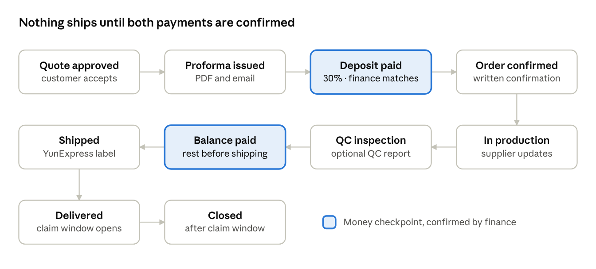
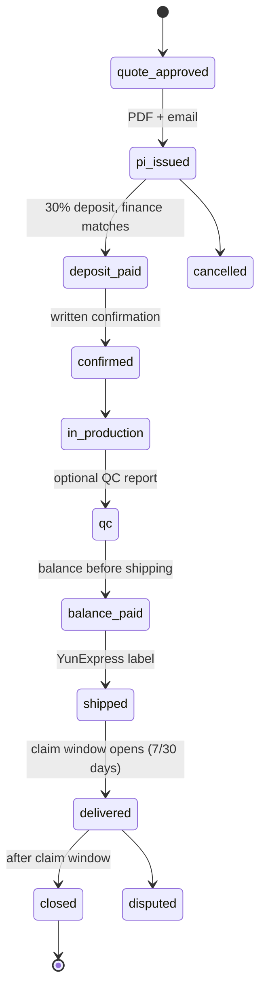

# Octopus B2B – Master Build Spec

Version: 1 Nov 2026 (rev. 9, adds section 21 (end-to-end connection trace)) · Owner: Shenzhen Octopus Trading Co. Ltd.

## 0. How to use this with Antigravity

Keep this document in the code repository as the single source of truth, then build in 11 phases (section 13), one Antigravity prompt per phase. One giant prompt makes agents cut corners; phases with a spec file do not.

1. Export this doc as Markdown and save it as `docs/SPEC.md` in a new, empty Git repository.
2. The design screens are already in `docs/design/` (one PNG per screen, static HTML in `docs/design/html/`, index in `docs/design/README.md`) (design reference: [B2B Marketplace UI canvas](https://claude.ai/artifact/2T29FAYzuDhhecwknxPS3W)).
3. Open the repository folder in Antigravity and use **Planning mode**.
4. Paste the **Phase 0** prompt from section 13. Review the plan Antigravity proposes, then approve it.
5. When a phase is done: run its checks, commit, and let Vercel build a preview. Then paste the next phase.
6. To change a feature later: edit `docs/SPEC.md` first, then ask Antigravity to apply that change.

Rules every phase follows:

- `docs/SPEC.md` wins over anything else, including earlier chat with the agent.
- No prices, fees, texts, contact details or legal wording in code. They live in the database and admin screens.
- Every permission is enforced in the database (Row Level Security) and in server code, never only by hiding buttons.
- Every integration sits behind an adapter so the provider can change without touching business logic.
- Every money movement is a ledger entry written in one database transaction, with an idempotency key.

## 1. Product overview and scope

Octopus B2B is a global wholesale marketplace for industrial supplies, priced in USD by default (admin can switch the whole platform to Chinese yuan, CNY: section 15), where Octopus is the seller on every order. Under the Terms and Conditions the buyer contracts with Shenzhen Octopus Trading Co. Ltd., not with the factory, so invoices, payments and claims all run through Octopus.

**Launch mode:** the supplier self-service portal is switched off. Distributors (Octopus staff or trusted partners) manage suppliers, create and upload products, and answer RFQs for them. The supplier portal is built now and opened later with one admin switch.

**Revenue streams**

| Stream | How it is charged |
| --- | --- |
| Order margin / commission | Difference between supplier cost and buyer price, or a commission % per category |
| Service fees | RFQ fee, sample handling, QC inspection, certification, any new service; set in Services & charges |
| Advertising | Pay per valid click, deducted from the advertiser's wallet |
| Fulfilment | Margin on 3PL and Octopus Dropship orders |

**Company details** (seed data; editable in Site content › Company & branches)

| Field | Value |
| --- | --- |
| Legal entity | Shenzhen Octopus Trading Co. Ltd. |
| Head office | Building 4, West 10th Floor, C103, SEG Science Park, 3012 Huaqiang North Road, Li Village Community, Huaqiang North Street, Futian District, Shenzhen, Guangdong, China |
| Address (Chinese) | 广东省深圳市福田区华强北街道荔村社区华强北路3012号赛格科技园4栋西10层C座C103 |
| Contact person | Shameer Abdul Vahab |
| Phone / WhatsApp | +86 188 2652 7644 |
| Support email | support@octopusb2b.com |
| Website | octopusb2b.com |
| Brand | Octopus B2B, "Global Sourcing, Simplified"; navy #11133C, blue #2A6FD6 (logo blue #337BE1), Lexend + Inter + IBM Plex Mono |

**In version 1:** storefront, sign-up with email (Google sign-in removed 1 Nov 2026), customer KYC, RFQ to order, proforma and commercial invoices, ledger, wallet, services (sample, QC, certification, 3PL request, dropship request), YunExpress shipping and tracking, back office, finance and approvals, distributor panel, categories and tags, product creation with AI tools, Excel bulk upload, CMS with Terms versions and branches, advertising, support desk, public API with Postman collection, all admin settings.

**Built but switched off at launch:** supplier self-service portal, supplier API logins.

**Later phases:** Octopus Dropship live connection, 1688 and Alibaba.com product import, Shopify and Wix apps, marketplace channels, more carriers, Chinese and Arabic languages.

## 2. Tech stack and architecture

One Next.js (React, TypeScript) app on Vercel serves the storefront and every portal; Supabase is the database, auth, storage, realtime and background worker. Next.js is used instead of plain Vite because public product pages must be server-rendered for Google; it is still React.

| Layer | Choice | Used for |
| --- | --- | --- |
| Front end | Next.js App Router, React, TypeScript, Tailwind CSS, shadcn/ui, React Hook Form + Zod, TanStack Table | All pages; server components for public pages, client components for portals |
| Hosting | Vercel (production + preview per pull request), Vercel Cron for light schedules | App, API routes, image optimisation, edge caching |
| Database | Supabase Postgres with Row Level Security, SQL migrations via Supabase CLI | All data, permissions, money ledger |
| Auth | Supabase Auth: email + password with 6-digit OTP, staff two-factor (no Google / social sign-in — owner decision 1 Nov 2026) | All roles |
| Files | Supabase Storage: public bucket (product media), private buckets (KYC, certificates, invoices, tickets) with signed URLs | Photos, PDFs, uploads |
| Server logic | Next.js Route Handlers and Server Actions (user-facing), Supabase Edge Functions (webhooks, integrations, AI, jobs), Postgres functions (money, state changes) | Business rules |
| Background | Supabase Cron (pg\_cron) + Supabase Queues (pgmq) + an outbox table | Events, retries, schedules |
| Realtime | Supabase Realtime | Live quotes, tracking, tickets, approvals |
| Documents | Server-side PDF generation (e.g. @react-pdf/renderer), stored in Storage | Invoices, statements, POs, receipts |
| Email | Transactional email provider on octopusb2b.com (decision open) | Notifications, documents |
| Monitoring | Sentry, Vercel Analytics, Supabase logs, uptime checks | Errors, speed, availability |
| Tests | Vitest, pgTAP for RLS, Playwright end-to-end | Quality gates in CI |

Code layout (monorepo is not needed):

```text
app/(store)/…        public storefront, SEO pages
app/(auth)/…         sign up, log in, onboarding
app/account/…        customer portal
app/distributor/…    distributor panel
app/supplier/…       supplier portal (off at launch)
app/office/…         back office
app/admin/…          admin
app/api/v1/…         public REST API
lib/adapters/…       carrier, payment, bank, email, ai, dropship, source adapters
lib/domain/…         state machines, pricing, permissions
supabase/migrations  schema, RLS, functions
supabase/functions   edge functions (webhooks, workers, ai)
docs/SPEC.md         this document
```





Browsers and API clients reach Next.js on Vercel. Every money or status change runs as one Postgres transaction, and partners are called only by Edge Function workers through adapters.

## 3. Roles and permissions

Permissions are data: each role has a matrix of areas × actions (view, create, edit, delete, approve, export) that Admin edits in Staff & roles, enforced by RLS and server checks.

| Role | Who | Can | Never |
| --- | --- | --- | --- |
| Visitor | Anyone | Browse catalogue, see indicative prices, read pages | RFQ, order, tier prices beyond the first, documents |
| Customer | Buyer company user | Profile + KYC, RFQs, quotes, orders, services, wallet, ledger, support, API keys (live after KYC) | See supplier names, cities, contacts or costs |
| Distributor | Octopus staff or partner | Manage assigned suppliers and their on/off switches, categories and tags, create and bulk-upload products, AI tools, answer RFQs on behalf | See suppliers not assigned to them, finance, customer KYC documents |
| Supplier | Factory or wholesaler (portal off at launch) | Own products, RFQ replies, POs, labels, payouts, customers who ordered from them (contacts after payment), ads | See other suppliers, Octopus margins |
| Operations | Back office | Supplier and customer KYC review, product moderation, request matching, orders and logistics, shipments | Approve money |
| Finance | Back office | Payments, matching, refunds ≤ limit, payouts preparation, statements, reconciliation | Approve their own requests |
| Support | Back office | Support desk, replies, resolutions up to credit note request | Change prices or approve money |
| Sourcing agent | Back office | RFQs, sourcing requests, AI tools | Finance, staff |
| QC coordinator | Back office | Samples, QC inspections, certifications, certificate checks | Finance, staff |
| Content editor | Back office | Pages, templates, Terms drafts, branches | Publish legal pages, products, finance, customer data |
| Admin | Owner | Everything, including master switches, approvals over limits, staff and roles | — |
| Advertiser | Supplier or partner | Campaigns, budgets, ad stats | Anything else |
| API client | Customer's app or platform | Scoped endpoints with OAuth client credentials | Endpoints outside its scopes |

Permission areas: Dashboard & reports, Customers & KYC, Suppliers & verification, Products & moderation, Categories & tags, RFQs & service requests, Orders & logistics, Samples/QC/certification, Wallet & payments, Finance & approvals, Services & charges, Advertising, Integrations & API, Site content, Support desk, Staff & roles, AI product tools, Audit log.

Visibility rules that cross roles:

- Buyers see suppliers only as code + country + verified badge (e.g. "Supplier OCT-1101 · CN").
- Suppliers see buyers by city and country at RFQ stage; full contact details only after the order is paid (admin setting).
- Back office, finance and admin see everything they have a permission for; every view of KYC documents or customer contacts is logged.

## 4. User flows

Each flow names the screens (canvas artboards) it passes through. Build and test them as end-to-end journeys, not page by page.

### 4.1 Buyer: discover → order → deliver (golden path)

1. **Discover.** Home → mega-menu or "All categories" → Products page (50+ items, filters: category, price, MOQ, certifications, Octopus Dropship, ready to ship) → Product detail (tiers, key facts, services row, certificates, 12 recommended products).
2. **Sign up.** Any action (RFQ, sample, add to quote) opens Auth: email + password with OTP → Create profile (name, company, country, phone, business type) is required before anything else.
3. **KYC.** Customer → KYC: company registration, address, contact, ID document. Status: pending → verified. Live API keys and payouts to wallet unlock after verification; browsing and RFQs work before it.
4. **Request.** Request Center (sourcing/RFQ, 3PL, dropship, sample, QC, certification) or the product's service buttons. RFQ fee shown before submit and charged from the wallet (or card if the wallet is off).
5. **Quote.** Back office (or supplier later) sends quotes; customer compares in Orders → RFQ detail; realtime status updates.
6. **Approve.** Customer approves one quote → system creates a proforma invoice (PI, e.g. PI-2026-0998) → PDF + email to customer, finance and the assigned distributor.
7. **Deposit.** Customer pays the 30% deposit (bank transfer reference, card or wallet). Finance matches it → order status "Confirmed" → written confirmation emailed (T&C: contract formed on confirmation).
8. **Production & QC.** Supplier/distributor posts updates; optional QC inspection with a report attached; balance invoice issued before shipment.
9. **Ship.** Balance paid → Shipping creates a YunExpress order, label and tracking number.
10. **Track.** Customer Orders → live tracking timeline (webhook-driven, with a cron fallback); email/WhatsApp notifications at key events.
11. **Deliver & close.** Delivered → claim window starts (7 days visible defects, 30 days hidden defects per T&C) → feedback prompt → ledger shows the order fully settled.
12. **Claim (if needed).** Help & complaints → ticket with photos → Support desk → resolution (credit note, refund, replacement) → approval in Finance if money moves.

### 4.2 Buyer: services and wallet

1. Wallet → top up (bank transfer to virtual account, or card through the payment partner) → pending until confirmed → balance credited.
2. Choose a service (sample, QC, certification, 3PL, dropship, RFQ) → price from the Services & charges table → confirmation dialog showing the deduction → wallet debited in one transaction → service request created.
3. Ledger shows every debit and credit, running balance, downloadable statement (PDF/CSV) and an email copy.
4. If Admin turns the wallet off, the same services are paid by card/invoice and the Wallet page shows a notice.

### 4.3 Distributor

1. Log in → Distributor panel → list of assigned suppliers with switches (portal login, product upload, RFQ replies, listings live, AI tools).
2. Add a product: Create product (title, 4-level category, tags, tiers, specs, certificates, Octopus Dropship tag) → AI tools: enhance photo, make poster, fix SEO → Submit for moderation.
3. Or Bulk upload: download the Excel template → upload → row-by-row validation report → fix errors → import as drafts → submit.
4. Manage categories and tags (create, rename, merge, reorder up to 4 levels).
5. Answer RFQs on behalf of assigned suppliers; see the customer's city and country, and full contacts once the order is paid.

### 4.4 Supplier (when the portal opens)

1. Invite from distributor/admin → set password + 2FA → verification documents.
2. Products (own only, if "product upload" is on) → RFQ inbox → quote → PO received → production updates → print label → payouts.
3. Product import & API: connect a 1688/Alibaba source or push products through the supplier API.
4. Advertise: create a campaign → budget → pay per click from the wallet.

### 4.5 Back office

1. Office dashboard queues: KYC to review, products to moderate, RFQs to assign, service requests, shipments with exceptions, tickets near SLA.
2. Each queue item opens a detail page with actions that move its state (approve, reject with reason, assign, request info).
3. Shipping: create YunExpress orders from paid orders, price trial, print labels, watch exceptions.
4. Support desk: tickets by priority and SLA, macros, internal notes, link to order, escalate to finance.

### 4.6 Finance

1. Incoming payments → match to PI/top-up → confirm.
2. Approvals queue: refunds, credit notes, payouts, manual adjustments. Maker–checker: the requester cannot approve; amounts over the limit need Admin.
3. Revenue dashboard by stream (product margin, service fees, RFQ fees, ads, shipping margin) → export PDF/CSV and email.
4. Monthly: statements generated, reconciliation report, period close.

### 4.7 Admin

1. Overview KPIs → drill down into any panel.
2. Settings: services & charges (edit prices, add services), wallet on/off and price list, supplier portal on/off, contacts visibility rule.
3. Staff & roles: create users, assign roles, edit the permission matrix, force 2FA, deactivate.
4. Site content: pages, banners, T&C (15 sections) with drafts → review → publish/schedule → version history; company details and branches.
5. Integrations: YunExpress credentials and mode, Octopus Dropship, 1688/Alibaba sources, email, payment, webhooks.
6. Customer geography: map and table by country, KYC status, revenue.

### 4.8 Advertiser

1. Ads → new campaign → placement (home banner, category banner, product page side, search top) → target categories/countries → creative upload → daily budget and max CPC.
2. Moderation by back office → live → clicks charged from wallet per click (fraud filtered) → stats per day.
3. Budget exhausted → paused until the next day or top-up.

### 4.9 API client (Shopify, Wix, own systems, Postman)

1. Customer → API credentials → create app → test keys (oct\_test\_…) work in sandbox immediately; live keys (oct\_live\_…) after KYC.
2. Download the OpenAPI file and Postman collection → get a token with client credentials → call products, quotes, orders, tracking, wallet balance.
3. Register a webhook URL → receive signed events (order.updated, shipment.tracking, quote.created) → verify the HMAC signature.

## 5. Workflow design (state machines)

Every business object has a `status` column backed by a Postgres enum and a single transition function `transition_<object>(id, to_status, actor, reason)`. The function checks the allowed transition, the actor's permission and preconditions, writes a row to `status_history`, and inserts an outbox event (§10). The UI never updates `status` directly.

| Object | States (in order) | Who moves it | Side effects |
| --- | --- | --- | --- |
| RFQ | draft → submitted → assigned → quoting → quoted → accepted / expired / cancelled | Customer, sourcing agent, distributor | RFQ fee debited on submit; 48 h reminder; expiry after validity |
| Quote | draft → sent → viewed → approved / rejected / expired / superseded | Sourcing agent, distributor, supplier | Approve creates PI; validity 30 days (setting) |
| Proforma invoice / order | pi\_issued → deposit\_pending → deposit\_paid → confirmed → in\_production → qc → balance\_pending → balance\_paid → ready\_to\_ship → shipped → delivered → closed; cancelled / disputed branches | System, finance, operations | PDFs and emails at each money step; confirmation letter on confirmed; claim window opens on delivered |
| Payment | initiated → pending → matched → confirmed / failed / refunded | Payment partner webhook, finance | Ledger entries only on confirmed |
| Shipment | draft → priced → created → label\_ready → picked\_up → in\_transit → out\_for\_delivery → delivered; exception / returned | Shipping staff, YunExpress webhooks | Tracking events to customer timeline and notifications |
| Service request (sample, QC, certification, 3PL, dropship) | requested → paid → accepted → in\_progress → report\_ready → completed / rejected / refunded | Customer, QC coordinator, operations | Fee from Services & charges; refund on rejection |
| KYC | not\_started → submitted → in\_review → verified / rejected / more\_info | Customer, operations | Unlocks live API keys and wallet withdrawals |
| Product listing | draft → submitted → in\_review → live / rejected → paused / archived | Distributor, supplier, operations | Live only if supplier switch "listings live" is on; ISR revalidate on change |
| Certificate | uploaded → verified → expiring (30 days) → expired / rejected | Uploader, QC coordinator | Tag hidden on product when expired |
| Support ticket | new → open → waiting\_customer → waiting\_internal → resolved → closed; reopened | Customer, support | SLA timers; CSAT survey on resolved |
| Finance approval | requested → approved / rejected → executed | Maker, checker, admin over limit | Executes the ledger entry or payout |
| Payout (supplier) | scheduled → approved → sent → settled / failed | Finance | Bank adapter call; remittance PDF |
| Ad campaign | draft → in\_review → active → paused (budget/manual) → ended / rejected | Advertiser, back office | Daily budget reset; click charges |
| Wallet top-up | initiated → pending → credited / failed | Customer, payment partner, finance | Ledger credit |
| Wallet withdrawal | requested → approved → sent → completed / rejected | Customer, finance | Needs KYC verified; maker–checker |
| T&C / page version | draft → in\_review → scheduled → published → superseded | Content editor, admin | Published version id stored on every order |

Rules:

- Timers (quote validity, SLA, claim windows, certificate expiry) are columns like `expires_at` plus a scheduled job that moves expired items, never a client timer.
- Every money-moving transition calls the ledger function inside the same database transaction.
- Each order stores `terms_version_id` so disputes use the terms the buyer accepted.

The order lifecycle diagram below shows the golden path and the money checkpoints.





The cancelled and disputed branches leave this path from the order states in the table above. Every move runs through `transition_order()`.

## 6. Data model (Supabase Postgres)

Conventions: `uuid` primary keys, `created_at`/`updated_at`, `created_by`; money stored as `amount_minor` (`bigint`: cents for USD, fen for CNY) plus `currency` (`char(3)`), never a column named after one currency (section 15.1); human codes generated by sequences (OCT-1101, RFQ-0998, QT-0998-1, PI-2026-0998, ORD-…, SHP-…, TKT-…); soft delete with `archived_at`; RLS enabled on every table. Generate TypeScript types with `supabase gen types`.

| Group | Tables | Notes |
| --- | --- | --- |
| Identity & orgs | profiles, organizations, org\_members, roles, permissions, role\_permissions, staff\_assignments, kyc\_submissions, kyc\_documents, addresses | profiles.id = auth.users.id; profile row required before app access; KYC docs in private bucket |
| Suppliers | suppliers (code, country, legal name, contacts), supplier\_switches (portal\_login, product\_upload, rfq\_replies, listings\_live, ai\_tools), distributor\_suppliers, supplier\_verifications | `public_suppliers` view exposes only code, country, badge |
| Catalog | categories (parent\_id, level 1–4, slug, sort), tags, product\_tags, products, product\_variants, price\_tiers, product\_media, product\_specs, certificates, product\_certificates, product\_flags (octopus\_dropship, ready\_to\_ship), recommendations | Check constraint level ≤ 4; full-text search column + trigram index |
| Imports & AI | import\_jobs, import\_rows (row errors), source\_connections (1688, Alibaba), source\_products, ai\_jobs (photo\_enhance, poster, seo\_fix), ai\_outputs | Bulk upload and sync write here first, then to products |
| Trade | rfqs, rfq\_items, quotes, quote\_items, proforma\_invoices, orders, order\_items, order\_events, documents (type, number, pdf\_path, emailed\_at) | Approve quote → PI → order; documents table drives PDF download + email for every role |
| Services & fees | services (code, name, active), service\_prices (amount, unit, effective\_from), service\_requests, service\_reports | Admin edits prices; history kept by effective\_from |
| Logistics | carriers, carrier\_accounts, shipments, shipment\_parcels, tracking\_events, rate\_quotes | YunExpress is first carrier row |
| Money | ledger\_accounts, ledger\_entries (double-entry, journal\_id), journals, wallets, wallet\_transactions, payments, payment\_intents, bank\_accounts, virtual\_accounts, refunds, credit\_notes, payouts, finance\_approvals, fx\_rates | Balances computed from entries; no direct updates |
| Content | site\_settings (key/value, feature flags), pages, page\_sections, content\_blocks, content\_versions, terms\_versions (15 sections), company\_profile, branches, email\_templates, banners | Every text on the site comes from here |
| Integrations & API | integrations (type, mode sandbox/live, encrypted config), api\_clients, api\_keys (hashed), api\_scopes, webhook\_endpoints, webhook\_deliveries, idempotency\_keys, rate\_limits | Secrets in Supabase Vault |
| Support | tickets, ticket\_messages, ticket\_attachments, sla\_policies, feedback, csat\_responses | Linked to order/shipment/service |
| Advertising | ad\_campaigns, ad\_creatives, ad\_placements, ad\_impressions, ad\_clicks, ad\_charges, ad\_daily\_budgets | Click charge posts a ledger entry |
| System | outbox\_events, job\_runs, notifications, notification\_preferences, status\_history, audit\_log | Audit log is append-only |

Key RLS policies:

- Customers: `org_id in (select org_id from org_members where user_id = auth.uid())`.
- Distributors: suppliers and products where `supplier_id in distributor_suppliers for auth.uid()`.
- Suppliers: own rows; customer contacts only through the `supplier_customer_view`, which returns contacts when the order is paid and the admin setting allows it.
- Staff: `has_permission(auth.uid(), '<area>', '<action>')` security-definer function.
- Storefront: anonymous `select` only on live products, public categories, `public_suppliers` and published content.

### Wallet credit facility (amended 1 Nov 2026)

- A customer wallet may go below zero, down to minus its **credit limit**. A negative balance is money the customer owes Octopus; the ledger is unchanged (journals still balance).
- **Default limit:** `site_settings.wallet_credit_default` = `{amount_minor, currency, verified_only}` — initially US$ 1,000.00 for KYC-verified customers. 0 = no credit by default.
- **Per-customer override:** `wallet_credit_limits` (org_id, limit_minor, currency, note). 0 = no credit for that customer; removing the override falls back to the default.
- Only an **Admin** changes limits (Admin → Wallets & payments → Credit facility); every change is written to the audit log. Customers can read their own limit only.
- Every wallet spend (service fees, RFQ fees, order payments from wallet, group-buy deposits, ad clicks) checks `wallet_available = balance + credit limit`. The ConfirmCharge dialog shows the credit limit and warns when credit will be used.
- A limit applies only in its currency. A platform currency switch with "convert" moves negative balances (debts) to the new currency too; Admin then re-enters limits in the new currency.

## 7. Integration design

Every outside service sits behind an adapter interface in `packages/integrations`, so a new carrier, marketplace or dropship app is a new adapter plus an `integrations` row, with no changes to business code. Each adapter has a `sandbox` and `live` mode, reads its credentials from Supabase Vault, logs every call to `integration_logs`, and is called only from Edge Functions or queue workers, never from the browser.

```ts
interface CarrierAdapter {
  priceTrial(input: RateRequest): Promise<RateQuote[]>;
  createShipment(input: ShipmentRequest): Promise<ShipmentResult>; // tracking no.
  getLabel(shipmentId: string): Promise<Blob>;
  cancel(shipmentId: string): Promise<void>;
  subscribeTracking(trackingNo: string): Promise<void>;
  parseWebhook(req: Request): Promise<TrackingEvent[]>;
}
interface DropshipAdapter { pushProduct(p): Promise<string>; createOrder(o): Promise<string>; syncStock(ids): Promise<void>; parseWebhook(req): Promise<DropshipEvent[]>; }
interface SourceAdapter  { search(q): Promise<SourceProduct[]>; getProduct(id): Promise<SourceProduct>; syncPrices(ids): Promise<void>; }
interface ChannelAdapter { publish(p): Promise<string>; importOrders(since): Promise<ChannelOrder[]>; }
interface PaymentAdapter { createIntent(i): Promise<Intent>; refund(r): Promise<void>; parseWebhook(req): Promise<PaymentEvent[]>; }
interface BankAdapter    { createVirtualAccount(org): Promise<VA>; listIncoming(since): Promise<BankTxn[]>; sendPayout(p): Promise<PayoutResult>; }
```

| Integration | Adapter | Direction | Phase | Notes |
| --- | --- | --- | --- | --- |
| YunExpress | CarrierAdapter | Out + tracking webhook in | v1 (P6) | App ID/key, sandbox token; price trial, create order, labels, tracking subscription; hourly cron fallback |
| Other carriers (DHL, FedEx, 4PX, Cainiao) | CarrierAdapter | Out + in | Later | Same interface; carrier chosen by rules or cheapest price trial |
| Payment partner (e.g. Stripe, Airwallex) | PaymentAdapter | Out + webhook in | v1 (P5) | Cards, top-ups; the partner holds funds (licensing) |
| Bank / virtual accounts (e.g. Airwallex, Wise Business) | BankAdapter | In + out | v1 manual, API later | Manual matching first; API matching and payouts later |
| Transactional email (e.g. Resend, Postmark) | EmailAdapter | Out | v1 | Templates from CMS; PDF attachments; from support@octopusb2b.com |
| WhatsApp Business | MessageAdapter | Out | Later | Order and tracking notifications, opt-in |
| AI text & image | AiAdapter | Out | v1 (P2) | Photo enhance/background removal, poster generation, SEO title/description fix; usage metered per org |
| Octopus Dropship | DropshipAdapter | Out + webhook in | v1 tag, API later (P9) | "Request dropship" creates a service request now; push products and orders once its API exists |
| 1688 Open Platform | SourceAdapter | In | Later (P9) | Official AppKey only, respect rate limits; no scraping |
| Alibaba.com | SourceAdapter | In | Later | Official partner API only |
| Shopify, Wix, WooCommerce | ChannelAdapter / public API | In + out | Later | Apps built on the public API; customer installs and connects keys |
| Other marketplaces (Amazon, Noon, etc.) | ChannelAdapter | Out | Later | Same pattern |
| Google OAuth | Supabase Auth | — | Removed (1 Nov 2026) | Email + password with OTP only; staff require 2FA |
| Sentry / logging | — | Out | v1 | Frontend + Edge Functions |

### Public API (for customers, Shopify, Wix, Postman)

- Base URL `https://api.octopusb2b.com/v1`; versioned path; JSON; OpenAPI 3.1 file generated from Zod schemas and published with a Postman collection.
- Auth: OAuth 2 client credentials (`client_id` + `client_secret` → bearer token, 1 hour). Keys prefixed `oct_test_` (sandbox data) and `oct_live_` (after KYC). Secrets shown once, stored hashed.
- Scopes: `catalog:read`, `quotes:write`, `orders:read`, `orders:write`, `shipments:read`, `wallet:read`, `webhooks:manage`.
- Endpoints: products and categories (search, detail, tiers), RFQs and quotes, orders (create from quote, status), shipments and tracking, wallet balance and ledger, service requests, webhooks.
- `Idempotency-Key` header required on POST; rate limit per client (e.g. 60/min) with `429` and `Retry-After`; errors in RFC 7807 problem format.
- Webhooks: `order.updated`, `quote.created`, `shipment.tracking`, `service_request.updated`, `wallet.updated`; signed with HMAC-SHA256 header `Octopus-Signature: t=…,v1=…`; retries with backoff for 24 hours; delivery log and "resend" button in the Developer page.

### Supplier API

- Base URL `https://api.octopusb2b.com/supplier/v1`, same auth model, supplier scopes: `products:write`, `inventory:write`, `rfqs:read`, `quotes:write`, `orders:read`.
- Used for bulk product sync, stock and price updates, and quoting from the supplier's own ERP. Writes still pass moderation and the supplier switches.

## 8. UI implementation

The design screens are the visual source of truth: one PNG per screen in `docs/design/` (e.g. `docs/design/Product.png`) and the same screen as static HTML with all its CSS in `docs/design/html/` (e.g. `docs/design/html/Product.html`) for exact spacing, colours and copy. Phase prompts reference them by name.

### 8.1 Design tokens (Tailwind theme + CSS variables)

| Token | Value | Use |
| --- | --- | --- |
| `--navy` | #11133C | Header, sidebars, headings |
| `--blue` | #2A6FD6 | Primary buttons, links, focus ring |
| `--ink` / `--muted` | #1A1D2E / #5B6175 | Body and secondary text |
| `--line` / `--surface` | #E3E6EE / #F6F7FA | Borders, page background |
| Status | green #1F9D55, amber #D98A00, red #D64545 | Badges and alerts (always with a text label) |
| Fonts | Lexend (headings), Inter (body), IBM Plex Mono (codes, amounts, API keys) | `next/font` self-hosted |
| Radius / spacing | 6 px controls, 10 px cards; 4 px grid | shadcn/ui defaults adjusted |

### 8.2 Layouts

- **Storefront layout:** top bar (language, currency USD or CNY from settings, help), header with logo, search with category select, account and quote cart; mega-menu; footer from CMS (company details, branches, links). Ad slots are a reusable `<AdSlot placement="…" />` server component.
- **Portal layout** (customer, supplier, distributor, back office, admin): left sidebar with role-based nav from one config file filtered by permissions; turns into a horizontal scrolling tab bar under 760 px. Content max width 1280 px; sticky summary panels (`.stick`) on detail pages become static on mobile.
- **Shared components:** DataTable (TanStack: server pagination, filters, column picker, CSV export), StatusBadge (driven by the state machine enums), Timeline (order and tracking events), MoneyField (cents in, formatted in the record's currency out), DocumentButton (Download PDF + Email me), ConfirmCharge dialog (shows price and wallet balance before any deduction), FileDrop, EmptyState, PermissionGate.
- **Forms:** React Hook Form + Zod, the same schema shared with the server action; inline errors; autosave drafts for product create and CMS.

### 8.3 Route ↔ artboard inventory

| Route | Artboard | Role |
| --- | --- | --- |
| `/` | Main | Public |
| `/products`, `/c/[...slug]`, `/search` | Products | Public |
| `/p/[slug]` | Product | Public |
| `/request/[type]` | Request | Public → login |
| `/login`, `/signup`, `/onboarding` | Auth | Public |
| `/legal/[slug]`, `/about`, `/contact` | (CMS pages) | Public |
| `/account` | Customer | Customer |
| `/account/orders`, `/account/orders/[id]`, `/account/rfqs/[id]` | CustomerOrders | Customer |
| `/account/kyc` | CustomerKYC | Customer |
| `/account/wallet` | Wallet | Customer |
| `/account/ledger` | Ledger | Customer |
| `/account/developer` | Developer | Customer |
| `/account/support` | Support | Customer |
| `/supplier`, `/supplier/rfqs` | Supplier | Supplier |
| `/supplier/customers` | SupplierCustomers | Supplier |
| `/supplier/integrations` | SupplierAPI | Supplier |
| `/supplier/ads` (planned; `/account/ads` redirects customers to the dashboard — ADDON-23) | AdsCampaign | Advertiser |
| `/distributor` | Distributor | Distributor |
| `/distributor/products/new`, `/products/[id]/edit` | ProductCreate | Distributor, supplier, admin |
| `/distributor/products/import` | BulkUpload | Distributor, supplier, admin |
| `/distributor/catalog`, `/admin/catalog` | Catalog | Distributor, admin |
| `/office` | Office | Back office |
| `/office/shipping` | Shipping | Operations |
| `/office/support` | SupportDesk | Support |
| `/admin` | Admin | Admin |
| `/admin/finance` | Finance | Finance, admin |
| `/admin/ads` | AdsAdmin | Admin |
| `/admin/staff` | Staff | Admin |
| `/admin/geography` | Geo | Admin |
| `/admin/services` | Fees | Admin |
| `/admin/wallet` | WalletAdmin | Admin |
| `/admin/integrations` | Integrations | Admin |
| `/admin/content` | CMS | Content editor, admin |
| PDF template | Invoice | All (documents) |

### 8.4 UI rules

- No hard-coded text, prices, contacts or legal copy in components: read from `site_settings`, `content_blocks`, `service_prices` and `company_profile`.
- Storefront and customer portal render suppliers only through `<SupplierCode />` (code + country + badge).
- Every list has loading skeleton, empty state and error state; every destructive or paid action has a confirm dialog.
- Images through `next/image` with Supabase Storage loader; product images WebP, max 1600 px.

## 9. Front-end ↔ back-end integration

One rule decides where code runs: **reads** in Server Components, **simple writes** in Server Actions, **money and state changes** in Postgres functions (RPC), **outside services and long work** in Edge Functions or queue workers.

| Concern | Where | How |
| --- | --- | --- |
| Page data | Next.js Server Components | `createServerClient` (@supabase/ssr) with the user's cookie, so RLS applies; typed with generated `Database` types |
| Public catalogue pages | Server Components + ISR | `revalidate` 300 s; `revalidateTag('product:<id>')` on publish; anonymous client reads only public views |
| Forms and simple writes | Server Actions | Zod-validate → call Supabase → `revalidatePath` → return a typed result: ok with data, or an error code |
| Money and status changes | Postgres RPC (security definer) | `approve_quote`, `wallet_debit_for_service`, `record_payment`, `transition_order`, `approve_finance_request`: one transaction, ledger + status + outbox event |
| Integrations and webhooks | Supabase Edge Functions | `/functions/v1/yunexpress-webhook`, `payment-webhook`, `dropship-webhook`, `ai-tools`, `send-email`, `render-pdf`; verify signatures; idempotent |
| Public & supplier API | Next.js Route Handlers under `app/api/v1` (deploy as `api.octopusb2b.com`) | Token check → scope check → rate limit → same RPCs the UI uses |
| Live updates | Supabase Realtime | Subscribe to `order_events`, `tracking_events`, `ticket_messages`, `notifications` filtered by org; client components only |
| Files | Supabase Storage | Public bucket: product media, banners. Private buckets: KYC, documents (PDFs), QC reports, tickets; downloads through 60 s signed URLs created server-side |
| PDFs | Edge Function `render-pdf` | HTML template (matches the Invoice artboard) → PDF; stored in `documents`; same file for download and email |
| Settings & flags | `site_settings` table | Cached per request with `unstable_cache` + tag; flags: `wallet_enabled`, `supplier_portal_enabled`, `supplier_sees_contacts_after_paid`, `ads_enabled` |
| Auth & session | Supabase Auth + Next middleware | Middleware refreshes the session, redirects to `/onboarding` if no profile, and guards `/office` and `/admin` by role |
| Errors | Sentry (Next + Edge) | User-facing messages from a code → text map in CMS |

Typed contract between front and back end:

```ts
// packages/contracts/order.ts — shared by form, server action, RPC wrapper and public API
export const ApproveQuote = z.object({ quoteId: z.string().uuid(), acceptTermsVersionId: z.string().uuid() });

// app/(portal)/account/orders/actions.ts
'use server';
export async function approveQuote(input: z.infer<typeof ApproveQuote>) {
  const data = ApproveQuote.parse(input);
  const supabase = await createServerClient();
  const { data: pi, error } = await supabase.rpc('approve_quote', { p_quote_id: data.quoteId, p_terms_version_id: data.acceptTermsVersionId });
  if (error) return { ok: false, error: mapDbError(error) };
  revalidatePath('/account/orders');
  return { ok: true, data: pi }; // PI number + document id; PDF and email happen async via outbox
}
```

Environment variables (Vercel + Supabase secrets): `NEXT_PUBLIC_SUPABASE_URL`, `NEXT_PUBLIC_SUPABASE_ANON_KEY`, `SUPABASE_SERVICE_ROLE_KEY` (server only), `SENTRY_DSN`, `EMAIL_API_KEY`, `PAYMENT_SECRET_KEY`, `PAYMENT_WEBHOOK_SECRET`, `YUNEXPRESS_APP_ID`, `YUNEXPRESS_APP_KEY`, `AI_API_KEY`, `WEBHOOK_SIGNING_SECRET`. Integration credentials entered in Admin → Integrations go to Supabase Vault, not env vars.

## 10. Workflow orchestration

Business transactions never call outside services directly. They write an **outbox event** in the same database transaction; a dispatcher fans it out to queues; workers do the slow or external work and can retry safely.

```
UI / API → Server Action → RPC (one transaction: rows + ledger + status_history + outbox_events)
                                   │
                   pg_cron every 10 s → dispatch_outbox() → pgmq queues
                                   │
      Edge Function workers: email · pdf · notify · carrier · dropship · ai · webhooks_out · search_index
                                   │
                 result rows (documents, shipments, deliveries) + new events if needed
```

### 10.1 Events and consumers

| Event | Consumers (queues) |
| --- | --- |
| `rfq.submitted` | notify (assign queue, customer receipt), webhooks\_out |
| `quote.sent` | email, notify (realtime), webhooks\_out |
| `quote.approved` | pdf (PI), email (PI to customer + finance), notify distributor |
| `payment.confirmed` | ledger already posted; pdf (receipt), email, order transition check |
| `order.confirmed` | pdf (confirmation letter), email, notify supplier/distributor |
| `order.ready_to_ship` | carrier (create YunExpress shipment + label) |
| `shipment.tracking` | notify (email/WhatsApp at key events), webhooks\_out, timeline |
| `service_request.paid` | notify QC/ops queue, email receipt |
| `product.published` | search\_index, revalidate storefront tags, dropship (if tagged and API on) |
| `document.created` | email (if "email me" or automatic rule) |
| `ticket.created` / `ticket.replied` | notify support, SLA timer start, email customer |
| `ad.clicked` | ad charge (dedupe + fraud filter) → ledger, budget check |
| `terms.published` | revalidate legal pages, notify active customers |

### 10.2 Reliability rules

- **Idempotency:** each consumer stores `(event_id, consumer)` in `job_runs`; reprocessing is a no-op. Incoming webhooks dedupe by provider event id; API POSTs by `Idempotency-Key`.
- **Retries:** exponential backoff (1 min, 5 min, 30 min, 2 h, 6 h); after 5 failures the message moves to a dead-letter queue and appears in Admin → Integrations → Failed jobs with a "retry" button.
- **Ordering:** per-aggregate ordering by `aggregate_id` + sequence; consumers ignore stale events.
- **Observability:** every job writes duration and outcome; Sentry alert on dead letters and webhook signature failures.

### 10.3 Scheduled jobs (pg\_cron)

| Job | Schedule | Action |
| --- | --- | --- |
| Outbox dispatcher | every 10 s | Move new events to queues |
| Tracking fallback | hourly | Poll YunExpress for shipments without updates in 12 h |
| FX rates | daily 00:05 UTC | Store a reference USD↔CNY rate for admin to compare; billing uses only the rate admin approved (section 15.1) |
| Quote & RFQ expiry | every 15 min | Expire quotes past validity; RFQ 48 h no-reply reminder |
| SLA timers | every 5 min | Escalate tickets and queue items near or past SLA |
| Certificate expiry | daily | Mark expiring (30 days) / expired; hide tags; notify owners |
| Claim windows | daily | Close orders whose 7/30-day windows ended |
| Monthly statements | 1st of month 02:00 | Generate ledger statements PDF + email |
| Reconciliation | daily 03:00 | Compare payments/bank lines vs ledger; report mismatches to finance |
| Ads budget reset | daily 00:00 UTC | Reset daily spend; reactivate paused-by-budget campaigns |
| T&C scheduled publish | every 5 min | Publish versions whose `publish_at` passed |
| 1688 / source sync | every 6 h (later) | Refresh prices and stock within rate limits |
| Cleanup | daily | Expire signed URLs, old idempotency keys, temp uploads |

## 11. End-to-end integration, testing and deployment

### 11.1 Environments

| Environment | Frontend | Database | Integrations |
| --- | --- | --- | --- |
| Local | `pnpm dev` | `supabase start` (Docker) with `supabase/seed.sql` | All adapters in mock mode |
| Preview | Vercel preview per pull request | Staging Supabase project (or Supabase branching) | Sandbox: YunExpress test token, payment test keys, email to a test inbox |
| Production | Vercel production, domains octopusb2b.com and api.octopusb2b.com | Production Supabase project, PITR backups | Live credentials from Vault |

### 11.2 Pipeline (GitHub Actions)

1. Lint, typecheck, unit tests (Vitest) on every push.
2. `supabase db lint` + pgTAP tests (RLS and RPC rules) against a fresh local database.
3. Playwright E2E on the Vercel preview URL with seeded staging data.
4. On merge to `main`: `supabase db push` to staging, then manual approval → production migration → Vercel promotes the build.
5. Migrations are forward-only SQL files in `supabase/migrations`; never edit the production schema by hand.

### 11.3 What to test

- **pgTAP (database):** a customer cannot read another org's orders; storefront role cannot read `suppliers.legal_name`; supplier sees buyer contacts only after payment; ledger journals always balance; invalid state transitions are rejected; wallet cannot go below minus its credit limit; maker cannot approve own request.
- **Vitest (units):** price tier selection, fee calculation, Zod contracts, adapter mappers (YunExpress payload ↔ internal), webhook signature verification, PDF numbering.
- **Playwright golden paths:**
  1. Visitor → email signup → profile → KYC submit.
  2. Customer RFQ (fee from wallet) → staff quote → approve → PI PDF downloaded and emailed → deposit recorded → confirmed.
  3. Balance paid → YunExpress sandbox shipment → simulated tracking webhook → customer timeline updates live → delivered.
  4. Sample + QC service purchase with wallet on; same with wallet off (card).
  5. Distributor bulk upload Excel with 2 bad rows → error report → fix → publish → product live on storefront with supplier code only.
  6. Admin edits a service price and a T&C section → publish → storefront shows the new values.
  7. Ticket → support reply → refund request → finance approval → ledger credit.
  8. API: Postman/Newman run of the collection with a test key, including webhook delivery and signature check.
- **Contract tests:** run each adapter against its sandbox nightly; alert on schema drift.

### 11.4 Seed data

`seed.sql` creates: one of each role (admin, finance, ops, support, distributor, content editor, customer, supplier), 4-level categories, 60 products across 6 suppliers (OCT-1101…), all services with prices, a published T&C version, company profile and Shenzhen branch, one order in each status, sample tickets and ad campaigns.

### 11.5 Monitoring

Sentry (errors and performance), Vercel Analytics (Core Web Vitals), Supabase logs and advisors, uptime check on `/api/health` and each webhook endpoint, daily digest of dead-letter jobs and reconciliation mismatches to the admin email.

### 11.6 Go-live checklist

- All T&C blanks filled and legal review done; published version linked from checkout.
- Live payment and YunExpress credentials tested with one real small order.
- DNS, SSL, email domain (SPF, DKIM, DMARC) for support@octopusb2b.com.
- RLS advisor clean; service-role key only on server; staff 2FA enforced.
- Backups (PITR) on; restore drill done once.
- Privacy policy, cookie banner, data export/delete flow in place.
- Supplier portal flag off; wallet flag set as decided; ad slots filled with house ads.

## 12. Security, performance, SEO and accessibility

| Area | Requirement |
| --- | --- |
| Access control | RLS on every table; `has_permission()` for staff; service-role key only in server code and Edge Functions; storefront reads only public views |
| Authentication | Email + password with OTP for customers (no Google sign-in); staff and finance require TOTP 2FA; session refresh in middleware; lock after 5 failed attempts |
| Secrets | Vercel env vars for platform keys; integration credentials in Supabase Vault; API secrets hashed; keys rotatable from the UI |
| Money safety | Double-entry ledger; amounts in integer cents; maker–checker approvals; limits per role; daily reconciliation; no card data stored (payment partner handles PCI) |
| Audit | Append-only `audit_log` for logins, permission changes, price changes, money approvals, KYC document views, customer contact views, content publishes |
| API protection | Rate limits per key and IP, input validation with Zod, CORS allow-list, webhook HMAC verification, replay window 5 minutes |
| Uploads | Type and size limits, image re-encode, virus scan hook for documents, private buckets with signed URLs |
| Privacy | Privacy policy and cookie consent; data export and account deletion request; KYC retention period setting; GDPR/PIPL-aware processing records |
| Performance | LCP < 2.5 s, INP < 200 ms, CLS < 0.1 on 4G; ISR for catalogue; image CDN; paginated tables (server side); indexes on all foreign keys and filter columns; search with Postgres full-text + trigram |
| SEO | Server-rendered product and category pages; clean slugs; `generateMetadata` from product SEO fields; Product, Offer, BreadcrumbList and Organization JSON-LD; sitemap.xml and robots.txt generated; canonical URLs; hreflang when languages are added |
| Accessibility | WCAG 2.2 AA: contrast ≥ 4.5:1, keyboard navigation, visible focus, labels on every input, status never by colour alone, tap targets ≥ 24 px, reduced-motion respected |
| Resilience | PITR backups, tested restore, dead-letter queues, feature flags to switch off a failing integration, status page for incidents |

## 13. Build phases with Antigravity prompts

Run one phase at a time in Planning mode. Paste the prompt, review the plan Antigravity proposes, let it build, then check every "Done when" item before moving on. Each prompt assumes this spec is saved as `docs/SPEC.md` and the artboard PNGs are in `docs/design/`.

### P0 — Project setup and design system

```
Read docs/SPEC.md sections 2, 8 and 11. Set up a pnpm monorepo: apps/web (Next.js App Router, TypeScript strict, Tailwind, shadcn/ui), packages/contracts (Zod), packages/integrations (adapter interfaces only), supabase/ (CLI project with migrations and seed.sql). Add the design tokens from section 8.1 as CSS variables and Tailwind theme, fonts Lexend/Inter/IBM Plex Mono with next/font. Build the Storefront layout and Portal layout from section 8.2 (sidebar becomes horizontal tabs under 760px) and the shared components: DataTable, StatusBadge, Timeline, MoneyField, DocumentButton, ConfirmCharge, FileDrop, EmptyState, PermissionGate. Add Sentry, ESLint, Prettier, Vitest, Playwright and a GitHub Actions workflow as in section 11.2. Do not build features yet.
```

Done when: `pnpm dev` and `supabase start` run; a component gallery page shows every shared component; CI passes on an empty PR; preview deploys on Vercel.

### P1 — Auth, profiles, roles, KYC

```
Read docs/SPEC.md sections 3, 4.1 steps 2–3, 6 (Identity & orgs) and 12. Create migrations for profiles, organizations, org_members, roles, permissions, role_permissions, staff_assignments, kyc_submissions, kyc_documents, addresses, audit_log, with RLS. Add has_permission(user, area, action). Implement Supabase Auth with email + password and email OTP (no Google sign-in); middleware that refreshes the session and sends users without a profile to /onboarding (create profile: name, company, country, phone, business type). Build /account/kyc (match docs/design/CustomerKYC.png) with uploads to a private bucket and the KYC state machine from section 5. Staff 2FA (TOTP) required for /office and /admin. Write pgTAP tests for the RLS rules in section 11.3.
```

Done when: email signup works; no profile → forced onboarding; KYC submit → reviewer approves in a basic queue; pgTAP RLS tests pass.

### P2 — Catalog, product creation, AI tools, bulk upload, certificates

```
Read docs/SPEC.md sections 4.3, 5 (Product listing, Certificate), 6 (Suppliers, Catalog, Imports & AI) and 7 (AI). Create the tables with RLS, including categories with 4 levels (check constraint), tags, price_tiers, certificates, product_flags (octopus_dropship, ready_to_ship), supplier_switches and the public_suppliers view (code, country, badge only). Build: /distributor (match Distributor.png) with supplier list and on/off switches; /distributor/products/new (ProductCreate.png) with tiers, specs, certificates, Octopus Dropship tag, autosave, and AI buttons Enhance photo, Make poster, Fix SEO calling an Edge Function ai-tools via AiAdapter; /distributor/products/import (BulkUpload.png) with an Excel template download, upload, row validation report and import as drafts; /distributor/catalog and /admin/catalog (Catalog.png) for categories and tags. Moderation queue for back office. Respect supplier switches everywhere.
```

Done when: a distributor creates a product with AI-fixed SEO, bulk-imports 50 rows with an error report, and moderation publishes it; a switched-off supplier cannot upload.

### P3 — Storefront, CMS and SEO

```
Read docs/SPEC.md sections 4.1 step 1, 8.3, 8.4 and 12 (SEO, Performance). Build / (Main.png), /products and /c/[...slug] (Products.png: 50+ items, filters for category, price, MOQ, certifications, Octopus Dropship, ready to ship; server pagination), /p/[slug] (Product.png: tiers, key facts card, full-width services row with Sourcing, 3PL, Dropship, Sample, QC, Certification buttons, certificate tags, Octopus Dropship tag, 12 recommended products), /request/[type] (Request.png). Show suppliers only with <SupplierCode/>. Build site_settings, pages, content_blocks, content_versions, terms_versions (15 sections), company_profile and branches, and /admin/content (CMS.png) with draft → review → publish/schedule and version history. All text, contacts and the footer come from CMS. Add ISR with revalidateTag, generateMetadata, JSON-LD, sitemap and robots.
```

Done when: Lighthouse ≥ 90 on home and product pages; editing a T&C section or a branch in CMS updates the site after publish; no supplier names appear in storefront HTML.

### P4 — RFQ → quote → proforma → order, ledger and documents

```
Read docs/SPEC.md sections 4.1 steps 4–8, 5 (RFQ, Quote, Order, Payment), 6 (Trade, Money), 9 and 10. Create trade and ledger tables. Implement Postgres functions submit_rfq, send_quote, approve_quote (creates PI with number PI-YYYY-####, stores terms_version_id), record_payment, transition_order, all writing status_history, double-entry ledger entries and outbox_events in one transaction. Build the outbox dispatcher (pg_cron + pgmq) and Edge Function workers for pdf (render the Invoice.png layout) and email. Build /account/orders and RFQ/quote detail (CustomerOrders.png) with realtime updates, /account/ledger (Ledger.png) with statement PDF/CSV, and DocumentButton (download PDF or email me) for every document type and every role. Deposit 30% and balance amounts come from settings.
```

Done when: Playwright golden path 2 passes; PI PDF matches the Invoice artboard; ledger journals balance in pgTAP; replaying an outbox event sends no duplicate email.

### P5 — Services, charges, wallet and payments

```
Read docs/SPEC.md sections 4.2, 5 (Service request, Wallet), 6 (Services & fees, Money) and 7 (Payment, Bank). Build services and service_prices with /admin/services (Fees.png: edit price per service, add new services, effective dates). Build wallets with wallet_debit_for_service RPC (never below minus the credit limit — see "Wallet credit facility" in section 6 — ConfirmCharge dialog first), top-ups through PaymentAdapter (test mode) and manual bank transfer matching, /account/wallet (Wallet.png), and /admin/wallet (WalletAdmin.png) with the wallet ON/OFF switch and price list. When wallet_enabled is false, services are paid by card/invoice. RFQ fee, sample, QC, certification, 3PL and dropship requests all use this path. Payment webhook Edge Function with signature check and idempotency.
```

Done when: golden path 4 passes with wallet on and off; changing a price in Admin changes the next charge; payment webhook replay is ignored.

### P6 — YunExpress shipping and live tracking

```
Read docs/SPEC.md sections 4.1 steps 9–10, 5 (Shipment), 7 (CarrierAdapter, YunExpress) and 10.3. Implement YunExpressAdapter (price trial, create order, label, cancel, tracking subscription, webhook parse) in sandbox mode with credentials from Vault. Build /office/shipping (Shipping.png): create shipment from ready_to_ship orders, compare rates, print labels, exceptions list. Edge Function yunexpress-webhook writes tracking_events; hourly fallback poll. Customer order page shows a live Timeline via Realtime and sends notifications at key events.
```

Done when: golden path 3 passes in sandbox; a second carrier can be added by writing only a new adapter class.

### P7 — Back office, support desk, finance approvals and payouts

```
Read docs/SPEC.md sections 4.5, 4.6, 5 (Ticket, Finance approval, Payout) and 10.3. Build /office (Office.png) with queues for KYC, moderation, RFQ assignment, service requests, shipment exceptions and tickets near SLA. Build /account/support (Support.png: complaints and feedback with photos, linked to order) and /office/support (SupportDesk.png: priority, SLA, macros, internal notes, escalate to finance, CSAT). Build /admin/finance (Finance.png): incoming payments matching, approvals with maker–checker and limits, refunds, credit notes, supplier payouts via BankAdapter (manual mode), revenue by stream, exports PDF/CSV and email, reconciliation report.
```

Done when: golden path 7 passes; a maker cannot approve their own request; SLA escalation fires in a test with a shortened timer.

### P8 — Admin: overview, staff, geography, integrations, advertising

```
Read docs/SPEC.md sections 3, 4.7, 4.8, 6 (Advertising) and 7. Build /admin (Admin.png) KPIs; /admin/staff (Staff.png) with user creation, role assignment and an editable permission matrix including Distributor and Content editor roles; /admin/geography (Geo.png) map and table by country, KYC status and revenue; /admin/integrations (Integrations.png) for YunExpress, payment, email, Octopus Dropship, 1688/Alibaba sources and webhooks with sandbox/live mode, test connection and failed jobs retry. Build advertising: AdSlot placements on every page type, /account/ads and /supplier/ads (AdsCampaign.png), /admin/ads (AdsAdmin.png) with moderation, CPC pricing, daily budgets, click dedupe and charges to wallet and ledger.
```

Done when: a new staff user with the Content editor role can edit but not publish legal pages; an ad click charges once and stops at the daily budget.

### P9 — Public API, supplier API, webhooks, Octopus Dropship, sources

```
Read docs/SPEC.md sections 4.9 and 7 (Public API, Supplier API, Dropship, Source). Build route handlers under app/api/v1 and app/api/supplier/v1 with OAuth client credentials, oct_test_/oct_live_ keys, scopes, rate limits, Idempotency-Key and RFC 7807 errors, reusing the same RPCs as the UI. Generate OpenAPI 3.1 from Zod and a Postman collection. Build /account/developer (Developer.png) for apps, keys, webhook endpoints, delivery log and resend; outbound webhooks signed with HMAC-SHA256. Build /supplier/integrations (SupplierAPI.png). Add OctopusDropshipAdapter (request dropship creates a service request; push product/order when the API is configured) and a 1688 SourceAdapter stub using the official Open Platform only. Supplier portal stays behind supplier_portal_enabled.
```

Done when: the Postman collection runs green with Newman in CI; a webhook receiver verifies signatures; turning the supplier portal flag on exposes /supplier for invited suppliers only.

### P10 — Hardening, E2E and go-live

```
Read docs/SPEC.md sections 11 and 12. Complete all Playwright golden paths, pgTAP tests and adapter contract tests. Run Supabase security and performance advisors and fix every finding. Add rate limits, upload scanning hook, audit log coverage, cookie consent, data export/delete, uptime checks and dead-letter alerts. Check WCAG 2.2 AA with axe on every route in section 8.3 and Core Web Vitals targets. Produce a go-live checklist report against section 11.6.
```

Done when: every item in section 11.6 is ticked; one real small order runs end to end in production.

## 14. Open decisions

These do not block P0–P3. Decide them before the phase shown, then update the setting or adapter. The code reads all of them from configuration.

| # | Decision | Options | Needed by |
| --- | --- | --- | --- |
| 1 | Payment provider (cards, top-ups) | Stripe, Airwallex, other HK-licensed partner | P5 |
| 2 | Bank / virtual account provider and who holds wallet funds (licensing) | Airwallex, Wise Business, HK bank with API; or keep wallet as prepaid service credit only | P5 |
| 3 | Transactional email provider and sending domain | Resend, Postmark, Amazon SES | P4 |
| 4 | Billing email for documents (separate from support@octopusb2b.com?) | e.g. billing@ or accounts@octopusb2b.com | P4 |
| 5 | T&C blanks (company registration no., bank details, liability cap, insurance, governing details) and legal review | Fill in CMS → Terms | Before go-live |
| 6 | Deposit, quote validity and claim windows | T&C values: 30% deposit, 30-day validity, 7/30-day claims (the sample quotation used 100% advance and 7 days) | P4 |
| 7 | Octopus Dropship API (endpoints, auth, events) | Share its docs; until then "Request dropship" is a manual service request | P9 |
| 8 | YunExpress account: live app ID/key, products/channels, pickup or drop-off | Apply with YunExpress Shenzhen | P6 |
| 9 | Distributors: internal staff only, or external partners with commission | Affects permissions, payouts and contracts | P2 |
| 10 | Supplier sees buyer contacts after payment: default on or off | Admin setting | P4 |
| 11 | AI provider for image and text tools, and monthly usage limits per org | Image model + LLM; cost per use or free quota | P2 |
| 12 | Languages beyond English (e.g. Arabic, Spanish, Chinese) | Adds i18n routing and RTL | After launch |
| 13 | 1688 / Alibaba access | Apply for official Open Platform AppKey and partner access | P9 / later |

Also decide: (14) payment and bank partners that can collect and pay out in CNY, needed before the first switch to CNY; (15) the Postman account, workspace and plan for Shenzhen Octopus Trading. Both are covered in section 15.

## 15. Addendum: Postman API partner and USD ↔ CNY currency

Added 1 Nov 2026. Where this section conflicts with earlier text ("USD only"), this section wins.

### 15.1 Platform currency: USD or Chinese yuan (CNY)

Admin can switch the whole platform between US dollars and Chinese yuan. One currency is active at a time; USD is the default.

| Area | Rule |
| --- | --- |
| Setting | `site_settings.platform_currency` = `USD` or `CNY`. Only Admin can request a change; Finance approves (maker–checker); every change goes in the audit log |
| Storage | Every amount is `amount_minor` (bigint) + `currency` (char(3)). No column is named after a currency |
| Exchange rate | Admin sets the rate in `fx_rates` (base USD, quote CNY, `rate numeric(12,6)`, `effective_from`, `set_by`, `source` manual or reference). The daily job only fetches a reference rate to compare; billing uses only the approved rate |
| Documents | Quotes, PIs, invoices, orders, service requests and ad campaigns lock their currency and rate when created. A later switch never changes them; they are paid in their own currency |
| Catalogue | Price tiers keep the currency they were entered in (1688 suppliers often quote CNY). The storefront converts to the platform currency at the approved rate with rounding settings; the quote locks the converted amount |
| Service prices | `service_prices` holds a price per currency. With no CNY price set, the system converts from USD and marks it "converted" in Services & charges |
| Wallet | One wallet per organisation per currency (`wallets (org_id, currency)` unique). Charges use the wallet in the platform currency. On a switch, admin chooses: keep old balances spendable, or convert all balances at the switch rate through a conversion journal shown on each customer's ledger |
| Ledger | Each journal balances per currency; cross-currency moves post both legs through an `fx_conversion` account with the rate |
| Payments | The switch is blocked unless the active payment and bank adapters support CNY; Integrations shows "CNY supported" per adapter |
| Display | Code + symbol to avoid confusion with Japanese yen: "US$ 190.00", "CN¥ 1,368.00", via `Intl.NumberFormat`. Texts such as "All prices in USD" on the designs come from CMS with a `{currency}` variable |
| Reports | Finance shows each currency separately, plus a total converted at the approved rate and labelled as converted |
| API and webhooks | Amounts are `{ "amount_minor": 19000, "currency": "USD" }`; `GET /v1/settings/currency` returns the currency and current rate; webhook `settings.currency_changed` |

Switch workflow (`currency_switch_requests`: draft → pending\_approval → scheduled → applied / cancelled):

1. Admin → Settings → Currency: choose CNY, enter the rate, choose the wallet option, choose the effective time.
2. Impact preview: open quotes and PIs (they stay in USD), wallet balances, active ad budgets, services without a CNY price, payment adapter support.
3. Finance approves (the requester cannot).
4. At the effective time a job applies it: updates the setting, converts wallets if chosen, revalidates storefront caches, shows a site banner, emails customers, sends the webhook.
5. Switching back to USD uses the same flow.

UI: new screen `/admin/currency`, built in the style of `docs/design/WalletAdmin.png`; storefront top bar shows the active currency.

### 15.2 Postman as the API partner

Postman is where customers, Shopify and Wix app builders, and our own team discover, try and test the Octopus B2B API.

- **Public workspace** "Octopus B2B API" on the Postman API Network with the OpenAPI 3.1 definition, the collection "Octopus B2B API v1" (folders: Auth, Catalog, RFQs & quotes, Orders, Shipments, Wallet & ledger, Service requests, Webhooks, Settings), a separate supplier API collection, and environments Sandbox and Live (variables `base_url`, `client_id`, `client_secret`, `access_token`, `currency`, shipped empty).
- **Auth built in:** a collection-level pre-request script fetches and caches the OAuth client-credentials token; each request has tests for status code, response schema and that every amount carries a currency.
- **Examples:** saved example responses for every endpoint, generated from seed data.
- **Developer page:** "Run in Postman" button, link to the public workspace, and a download fallback on `/account/developer`.
- **Repository is the source:** on every release, CI regenerates OpenAPI from the Zod contracts and pushes the definition and collections to the workspace through the Postman API (`POSTMAN_API_KEY`, workspace and collection IDs as secrets). Nobody edits the collections by hand in Postman.
- **Testing:** the Postman CLI (or Newman) runs the collection against every Vercel preview in CI; a Postman monitor runs the sandbox collection on a schedule and alerts on failure.
- **Webhooks:** an example request and mock server show how to verify the `Octopus-Signature` header.
- **Admin:** a Postman card in Admin → Integrations with workspace and collection IDs, API key (in Vault), last sync time and result, "Sync now", and monitor status.
- **Safety:** real customer keys never go into shared Postman environments.

### 15.3 Antigravity prompts for this addendum

When to run them: if P4 and P5 are not built yet, add "Also apply docs/SPEC.md section 15.1" to the P4 and P5 prompts, then run 15-A after P5 to finish the admin screen and tests. If they are already built, run 15-A now. Run 15-B with or right after P9.

**Prompt 15-A — Admin currency switch (USD ↔ CNY)**

```
Read docs/SPEC.md section 15.1 (it overrides earlier "USD only" text) and sections 5, 6 (Money) and 9. Make the platform currency switchable between USD and CNY:
1. Migration: replace every amount_usd_cents column with amount_minor bigint + currency char(3) (backfill 'USD'); add currency and fx_rate_id to quotes, proforma_invoices, orders, service_requests and ad_campaigns; make wallets unique on (org_id, currency); create fx_rates and currency_switch_requests; add site_settings platform_currency and currency_rounding; add an fx_conversion ledger account and a check that every journal balances per currency.
2. Postgres functions: current_platform_currency(), convert_amount(amount_minor, from_currency, to_currency, fx_rate_id), request/approve/apply for currency_switch_requests (draft -> pending_approval -> scheduled -> applied/cancelled) with maker-checker approval, audit log and a pg_cron job that applies scheduled switches.
3. Update approve_quote, wallet_debit_for_service, record_payment and ad click charges to lock currency and rate and to use the wallet in the platform currency. Block a switch when the active payment adapter does not support CNY.
4. Build /admin/currency in the style of docs/design/WalletAdmin.png: current currency, rate history, new-rate form, switch wizard with impact preview (open quotes and PIs, wallet balances, ad budgets, services without CNY price), wallet option keep or convert, effective time, approval status.
5. MoneyField and every price use Intl.NumberFormat with the record's currency (US$ / CN¥). Replace "All prices in USD" texts with CMS text using a {currency} variable. Show the active currency in the storefront top bar and a banner after a switch.
6. PDFs, statements, emails, finance reports (per currency plus a labelled converted total) and the public API ({amount_minor, currency}, GET /v1/settings/currency, webhook settings.currency_changed) follow these rules.
Tests: pgTAP that journals balance per currency, old documents keep their currency after a switch, and a maker cannot approve their own switch. Playwright on staging: switch USD -> CNY and check storefront prices, a new quote and PI, a wallet charge, a PDF, then switch back.
```

Done when: after a switch to CNY, new quotes and invoices are in CNY at the approved rate; an older USD PI can still be paid in USD; ledger and statements balance per currency; switching back to USD works.

**Prompt 15-B — Postman API partner**

```
Read docs/SPEC.md sections 7 (Public API, Supplier API) and 15.2. Make Postman our official API partner:
1. Generate OpenAPI 3.1 from the Zod contracts in packages/contracts and, from it, two Postman collections (public v1 and supplier v1) with the folders in 15.2, saved examples from seed data, a collection-level pre-request script that fetches and caches the OAuth client-credentials token, and tests for status, schema and a currency on every amount. Add Sandbox and Live environments with empty secret values.
2. Add scripts/postman-sync.ts and a GitHub Actions job that, on each release, pushes the OpenAPI definition and both collections to our Postman workspace through the Postman API using POSTMAN_API_KEY, POSTMAN_WORKSPACE_ID and the collection IDs from repository secrets.
3. Run the public collection with the Postman CLI (or Newman) against every Vercel preview and fail the build on errors.
4. Add a webhook-verification example request and a mock-server example for the Octopus-Signature header.
5. On /account/developer (docs/design/Developer.png) add a "Run in Postman" button, a link to the public workspace and a download fallback. On /admin/integrations (docs/design/Integrations.png) add a Postman card: workspace and collection IDs, API key stored in Supabase Vault, last sync time and result, Sync now, monitor status.
The repository is the source of truth: never edit the collections by hand in Postman.
```

Done when: a release updates the public Postman workspace automatically; a new developer can fork the collection, add sandbox keys and list products within 5 minutes; CI fails when an endpoint breaks its schema.

## 16. Addendum: data backup and restore

Added 1 Nov 2026. Admin can back up all data on demand or on a schedule, download it, and restore ("reinstall") all of it or only selected records. This section extends sections 11 and 12.

### 16.1 Three layers of backup

| Layer | What it covers | How often | Where it is kept | Used for |
| --- | --- | --- | --- | --- |
| 1. Supabase managed backups + point-in-time recovery (PITR add-on) | The whole Postgres database | Continuous (PITR) and daily | Inside Supabase | Fast rollback of the production database to a minute in the past |
| 2. Octopus own backups | Database dump (schema, data, roles) + every Storage bucket (product media, KYC, PDFs, QC reports, ticket files) | Nightly 02:00 China time, plus "Back up now" | Off-site object storage at a different provider (e.g. Cloudflare R2, AWS S3 or Backblaze B2), encrypted | Full restore to a new project, disaster recovery, downloads, partial restores |
| 3. Business data exports | Readable files per module: customers and KYC status, suppliers, products and categories, orders, invoices, ledger, wallet, services, tickets, CMS content | On demand, and monthly | Download (signed URL) and off-site storage | Accounting, audits, moving data, re-importing records |

Why layer 2 matters: Supabase database backups do not include the files in Storage, and depending only on the hosting provider is a single point of failure.

Retention (admin setting): 14 daily, 8 weekly, 12 monthly backups; exports 12 months. Targets: lose at most 24 hours of data from layer 2 (minutes with PITR); be back online within 4 hours.

### 16.2 How backups run

- A GitHub Actions workflow `backup.yml` (scheduled and `workflow_dispatch`) runs `supabase db dump` for roles, schema and data, and syncs every Storage bucket with `rclone`. It compresses and encrypts each file with a public key (the private key is held offline by the owner), uploads to the off-site bucket, and writes a manifest: file list, sizes, SHA-256 checksums, row counts per table, ledger totals per currency, and the migration version.
- "Back up now" in the admin panel calls an Edge Function that starts the workflow through the GitHub API. The workflow reports progress back to the `backups` table.
- Integration secrets in Supabase Vault are encrypted with the project's own key and cannot be decrypted in another project. After a full restore to a new project, admin re-enters integration credentials. The restore checklist shows which ones.

### 16.3 Restore ("reinstall all the data")

| Type | When | How |
| --- | --- | --- |
| Point-in-time rollback | Bad change in the last days (e.g. wrong bulk update) | Supabase PITR to a chosen minute, run by the owner from the Supabase dashboard following the runbook |
| Full restore | Disaster, move to a new Supabase project or region, rebuild staging | Workflow `restore.yml` restores the chosen backup into a target project, re-applies newer migrations, restores Storage, runs checks, then the app is pointed at it |
| Partial restore | A product, customer, order or CMS page was deleted or damaged | The backup is loaded into a separate `recovery` schema; admin compares records side by side and restores selected rows through an RPC that writes the audit log. Money records are never overwritten; corrections go through finance adjustments |
| Re-import from exports | Load customers, products or categories into a fresh system, or from another system | Upload the export file; reuses the bulk-upload validation and row-error report |

Restore workflow (`restore_requests`: draft → verifying → verified → pending\_approval → approved → running → completed / failed / cancelled):

1. Admin picks a backup and the restore type, and writes a reason.
2. **Verify first:** the backup is restored into a scratch project. Checks: checksums match the manifest, row counts match, every ledger journal balances per currency, the migration version is known.
3. Second approver: Finance for anything touching money, otherwise another Admin. The requester cannot approve. Both re-enter 2FA.
4. For a full restore to production: maintenance mode on (storefront shows a notice, API returns `503` with `Retry-After`, queues pause), restore runs in a GitHub protected environment that also needs manual approval, migrations are re-applied, caches revalidated, the search index rebuilt, queues resumed, then maintenance mode off.
5. After the restore: compare checks again, email admins the report, and record everything in the audit log.

### 16.4 Admin screen: Backup & restore (`/admin/backups`)

- **Status:** last successful backup, next scheduled run, off-site storage used, PITR on/off, the last restore drill and its result.
- **Backups table:** time, type (scheduled/manual), what is included (database, storage), size, checksum check, status. Actions: download (admin only, 2FA re-check, link valid 10 minutes), verify, restore.
- **Back up now** button with a progress bar.
- **Restore wizard:** choose backup → choose type (full / partial by module and records / to staging) → verification results → approval → run → report.
- **Data exports:** choose modules, date range, format (Excel, CSV, JSON), then download, and optionally email the link to the admin.
- **Settings:** schedule, retention, off-site storage connection (test connection), encryption key fingerprint, alert email.
- Permission area "Backups & restore" in the roles matrix: view, back up, download, export, request restore, approve restore. Admin only by default.

Data model additions: `backups` (kind, trigger, status, started\_at, finished\_at, size\_bytes, location, manifest jsonb, migration\_version, created\_by), `backup_files`, `restore_requests`, `restore_checks`, `data_exports`, `recovery` schema, `site_settings.maintenance_mode`.

Monitoring: alert the admin email and Sentry if a nightly backup is missing or fails; a monthly automatic restore drill restores the latest backup into a scratch project and posts the checks to the admin panel.

### 16.5 Antigravity prompt

Run this after P7 (finance approvals exist) and before P10. If the app is already live, run it now.

**Prompt 16-A — Backup and restore**

```
Read docs/SPEC.md section 16 (backup and restore) and sections 6, 10, 11 and 12. Build the backup and restore system:
1. Migrations: backups, backup_files, restore_requests (draft -> verifying -> verified -> pending_approval -> approved -> running -> completed/failed/cancelled), restore_checks, data_exports, a recovery schema, site_settings.maintenance_mode and backup settings (schedule, retention). Add the permission area "Backups & restore" with actions view, backup, download, export, request_restore, approve_restore. Everything admin-only by default, with RLS and audit log.
2. GitHub Actions backup.yml (cron 18:00 UTC = 02:00 China time, plus workflow_dispatch): supabase db dump for roles, schema and data; rclone sync of every Storage bucket; compress; encrypt with the public key from secrets (age); upload to the off-site S3-compatible bucket; write a manifest with SHA-256 checksums, row counts per table, ledger totals per currency and the migration version; report status to the backups table through a secured Edge Function. Apply retention (14 daily, 8 weekly, 12 monthly).
3. GitHub Actions restore.yml (workflow_dispatch, GitHub protected environment needing manual approval): restore a chosen backup into a target project, re-apply newer migrations, restore Storage, run checks (checksums, row counts, ledger balanced per currency), and post results to restore_checks. Support target = scratch, staging or production. For production: turn maintenance mode on first, pause queues, then revalidate caches, rebuild search, resume queues and turn maintenance mode off.
4. Edge Functions: backup-trigger and restore-trigger (start the workflows through the GitHub API; admin role and a recent 2FA check required), backup-status (signed callback from the workflows), backup-download (10-minute signed URL, audited).
5. Partial restore: load the chosen tables from a backup into the recovery schema; a side-by-side compare screen; RPC restore_records(table, ids, reason) that copies selected rows back, never overwrites ledger or payment rows, and writes the audit log.
6. Data exports: per module (customers, suppliers, products, categories, orders, invoices, ledger, wallet, services, tickets, CMS) as Excel, CSV or JSON, built by a queue worker, stored privately, downloadable by signed URL and optionally emailed. Re-import uses the existing bulk-upload validation.
7. Maintenance mode: storefront and portals show a CMS notice; API returns 503 with Retry-After; outbox dispatcher pauses.
8. Build /admin/backups to match docs/design/Backups.png and docs/design/html/Backups.html: status cards, backups table with download/verify/restore, Back up now with progress, restore wizard with verification results and approvals, data exports, and settings (schedule, retention, off-site storage test, key fingerprint, alert email).
9. Monitoring: alert if no successful backup in 26 hours; monthly restore drill into a scratch project with results shown in the panel.
10. Write docs/RUNBOOK-restore.md: full disaster recovery step by step (new Supabase project, migrations, restore, Storage, re-enter Vault secrets for each integration, Vercel env vars, DNS, checks).
Tests: pgTAP for permissions and that restore_records refuses ledger rows; a CI job that backs up the staging database and restores it into a scratch database and compares counts and ledger totals.
```

Done when: the nightly backup appears in the panel with a valid checksum; "Back up now" works; a restore drill into scratch passes all checks; a deleted product is recovered through partial restore; the runbook rebuilds staging from a backup without help.

## 17. Addendum: staff and back-office login

Added 1 Nov 2026. Staff do not use the customer login. They have their own sign-in page at `/staff/login` (design: `docs/design/StaffLogin.png`, steps `StaffLogin-2-verify.png` and `StaffLogin-3-workspace.png`, HTML `docs/design/html/StaffLogin.html`). Links to it sit at the bottom of the customer login page ("Octopus staff? Back office login") and in the storefront footer ("Staff login").

### 17.1 Who signs in here

Operations, Finance, Support, Sourcing agent, QC coordinator, Content editor, Distributor and Admin (section 3). Suppliers keep their own portal login when the supplier portal opens. Customers use `/login`.

### 17.2 Sign-in flow

1. **Sign in:** work email and password only (Google sign-in removed 1 Nov 2026). No self sign-up: accounts exist only after Admin invites them in Staff & roles.
2. **Two-step verification (required):** a 6-digit code from an authenticator app (TOTP through Supabase Auth MFA). On first sign-in the staff member scans a QR code and saves 10 backup codes. "Trust this computer for 12 hours" is optional.
3. **Choose workspace:** cards for only the areas the person's role allows (Back office, Shipping, Support desk, Finance, Admin, Distributor panel, Site content). If a person has only one area, they go straight to it. A workspace switcher sits in the top bar of every staff page.

### 17.3 Rules

| Rule | Detail |
| --- | --- |
| Invitation only | Admin creates the staff user, sets role(s) and office; the invite email has a 24-hour link to set a password. Deactivating a user ends all their sessions at once |
| Separate from customers | A staff email cannot hold a customer account. Middleware sends anyone without a staff role away from `/office`, `/admin`, `/distributor` and `/staff` |
| 2FA everywhere | Every staff session must reach Supabase assurance level `aal2`. RLS policies for staff tables check `auth.jwt()->>'aal' = 'aal2'` as well as `has_permission()` |
| Lockout | 5 wrong passwords or codes lock the account for 15 minutes and notify Admin |
| Sessions | Idle timeout 30 minutes, maximum 12 hours. Sensitive actions (money approvals, restore, KYC document download, role changes) ask for the code again if it is older than 10 minutes |
| Reset | Forgot password sends a reset link. Lost phone: only an Admin can reset someone's 2FA, and that is logged |
| Optional IP rule | Admin can limit Admin and Finance sign-ins to office IP addresses (setting) |
| Audit | Every sign-in, failure, lockout, 2FA reset and workspace switch goes in the audit log with IP and device |

Admin screen changes: Staff & roles gets columns for 2FA status, last sign-in and active sessions, with actions Invite, Resend invite, Reset 2FA, End sessions and Deactivate. A "Security" panel holds the lockout, session and IP settings.

### 17.4 Antigravity prompt

Run this together with P1 (auth), or now if P1 is already built.

**Prompt 17-A — Staff and back-office login**

```
Read docs/SPEC.md sections 3, 12 and 17. Build a separate staff sign-in for the back office:
1. Route /staff/login matching docs/design/StaffLogin.png, StaffLogin-2-verify.png and StaffLogin-3-workspace.png (exact styles in docs/design/html/StaffLogin.html). Step 1: email + password (no Google sign-in). Step 2: TOTP code with Supabase Auth MFA (enrol with QR code and 10 backup codes on first sign-in; optional trust this computer for 12 hours). Step 3: workspace cards built from the user's roles and permissions; skip this step when only one area is allowed.
2. Staff are invitation-only: from /admin/staff (docs/design/Staff.png) Admin invites a user, sets roles and office; the invite email has a 24-hour set-password link. Add columns 2FA status, last sign-in, active sessions and actions Resend invite, Reset 2FA, End sessions, Deactivate. Add a Security panel: lockout (5 attempts, 15 minutes), idle timeout 30 minutes, maximum session 12 hours, optional office IP allow-list for Admin and Finance.
3. Middleware: /office, /admin, /distributor and /staff/* require a staff role and aal2; otherwise redirect to /staff/login. Customers who open these paths go to /login. A staff email cannot create a customer account.
4. RLS: staff policies check has_permission() and auth.jwt()->>'aal' = 'aal2'. Add a step-up check that asks for a fresh code (older than 10 minutes) before money approvals, restores, KYC document downloads and role changes.
5. Add a workspace switcher and the user menu (profile, change password, 2FA devices, sign out) to the portal top bar for staff.
6. Link to /staff/login from the customer login page ("Octopus staff? Back office login") and the storefront footer ("Staff login"), as in docs/design/Auth.png and Main.png.
7. Audit log entries for sign-in, failure, lockout, 2FA reset, session end and workspace switch, with IP and device.
Tests: Playwright for invite -> set password -> enrol 2FA -> choose workspace; a customer cannot open /office; staff without aal2 cannot read staff tables (pgTAP); lockout after 5 failures.
```

Done when: an invited staff member can sign in with password and code and land in their workspace; a customer is turned away from `/office` and `/admin`; resetting 2FA and ending sessions works from Staff & roles.

## 18. Addendum: group buying (MOQ pools)

Added 1 Nov 2026. Buyers who cannot afford the full MOQ on their own can share it. A buyer opens a pool on a product, other buyers join by pledging a quantity and paying a 10% deposit; when the pool fills, Octopus places one order with the supplier and ships each buyer separately. If it does not fill by the deadline, deposits are refunded. Octopus is still the merchant of record (T&C §1.1).

Design: `docs/design/Pool.png` + `html/Pool.html`. Entry points on `docs/design/Main.png` ("Group buying pools" section with 4 cards) and `docs/design/Product.png` (card "MOQ too big? Join a group buy" after the Request quote button).

### 18.1 Rules

| Rule | Value (admin setting) |
| --- | --- |
| Who can start a pool | Any customer with a verified profile; KYC not required to join, but required to withdraw refunds to bank |
| Deposit | 10% of the pool-price value of your pledge, held by Octopus in escrow (service credit on the ledger) |
| Minimum pledge | 100 pcs (per product; override per product) |
| Pool size | Capped at 25 buyers to keep logistics simple |
| Deadline | 7 days default, 3–30 days range, chosen by starter |
| Starter rate | No special rate; starter opens the pool for others |
| Target quantity | The product's base MOQ by default. A pool starter may raise it to reach a lower tier (e.g. 2 × MOQ to unlock tier 2) |
| Pool price | The tier price at the current filled quantity, recomputed on every join. Everyone pays the final tier price when the pool fills |
| Backing out before fill | Allowed; deposit refunded in full to wallet. Logged |
| Backing out after fill | Not allowed: deposit forfeited and used to cover the shortfall |
| Supplier anonymity | Supplier sees pool as a single order with aggregate quantity. Other pool members see each other only by buyer code and country |
| Shipping | Each buyer gets their own shipment to their own address via YunExpress. Freight charged per buyer at balance time |
| QC | One shared QC inspection; report shared with every buyer |
| Claims | Each buyer has their own 7/30-day claim window on their own shipment (T&C) |
| Terms | Separate "Group Buy Terms" (CMS, versioned). Every pool stores the version joined |

### 18.2 State machine

`pools`: `open → locked (waiting for balance payments) → confirmed (one order placed) → shipped → completed`; branches `expired` (deadline passed, below target) and `cancelled` (admin). `pool_pledges`: `pending (deposit) → paid → confirmed (balance paid) → shipped → delivered`; branches `withdrawn` (before fill), `defaulted` (balance unpaid in 48 h, deposit forfeited to cover shortfall). Transitions are RPCs that write `status_history`, ledger entries and outbox events.

### 18.3 Data model

- `pools` (id, code `POOL-####`, product\_id, variant\_id, starter\_user\_id, target\_qty, filled\_qty, deadline\_at, status, pool\_price\_minor, currency, qc\_included, terms\_version\_id)
- `pool_pledges` (id, pool\_id, buyer\_user\_id, qty, deposit\_minor, balance\_minor, address\_id, status, joined\_at, confirmed\_at)
- `pool_events` (append-only timeline for the detail page)
- Views: `pool_public_view` (buyer codes + countries only), `pool_pledge_mine_view`.

When a pool fills, `settle_pool(pool_id)` RPC: creates one PI per pledge at the final pool price, consumes the deposit, moves pledge to `confirmed`, creates one supplier PO for the aggregate, posts ledger entries, writes outbox events (`pool.filled`, `pi.created×N`, `po.created`). If deadline passes under target, `expire_pool` refunds every deposit to the buyer's wallet.

### 18.4 UI

- **Home page** `docs/design/Main.png`: new section "MOQ too big? Pool with other buyers" with 4 open-pool cards (name, progress bar, filled/need, closes-in, per-piece price, saving) and a "See all open pools" link to `/pools`.
- **Pools listing** `docs/design/Pools.png` + `html/Pools.html` at route `/pools`: dedicated page with hero (headline + saving stats), filters (category, closes-in, fill status, supplier country, minimum pledge), sort (closing soonest, highest saving, most filled, newest, buyers joined), grid/list toggle, pool cards with photo, status badge, progress bar, filled/target, buyers joined, pool price, saving, countdown, Join button, and a 4-step How-it-works explainer. The page is linked from the main nav, the home page section, the storefront footer and the product-detail pool card.
- **Product detail** `docs/design/Product.png`: card after the quote CTA. If a pool is open, shows progress + "Join this pool"; else "Start a pool".
- **Pool detail** `docs/design/Pool.png` route `/pool/[code]`: hero, progress with tier markers, participants, how it works, join form (pledge, address, deposit, pay from wallet or card), pool starter card, safeguards.
- **Customer portal** `/account/pools`: My pledges with status, deposit paid, balance due, countdown; reuse CustomerOrders table.
- **Admin** `/admin/pools`: list all pools with status, filled %, deposit held; actions cancel, extend deadline, force-settle; a global "Group buy" ON/OFF switch and the rules in §18.1 as settings.

### 18.5 Antigravity prompt

Run after P4 (quote → PI → order) and P5 (wallet) are built.

**Prompt 18-A — Group buying (MOQ pools)**

```
Read docs/SPEC.md sections 4, 5, 6, 10 and 18. Build group buying (MOQ pools):
1. Migrations: pools, pool_pledges, pool_events; status enums; add `pool_id` to proforma_invoices and orders; add `pool_minimum_pledge` to products; create pool_public_view (buyer_code + country only) and pool_pledge_mine_view with RLS. Add site_settings pool_enabled, pool_deposit_pct (default 10), pool_min_pledge_default (100), pool_max_buyers (25), pool_min_days (3), pool_max_days (30), pool_default_days (7). Admin-only toggles.
2. Postgres functions and transitions: open_pool(product_id, target_qty, deadline, min_pledge, address_id), join_pool(pool_id, qty, address_id, pay_source), withdraw_pledge(pledge_id), settle_pool(pool_id) that is called by cron when filled_qty >= target_qty — creates one PI per pledge at the final pool price (uses section 15 currency), consumes the escrow deposit, creates one aggregate PO to the supplier with status confirmed-after-balance-paid, posts double-entry ledger entries, writes outbox events pool.filled, pi.created×N, po.created, with 48h balance timer; expire_pool refunds every deposit. All inside one transaction, idempotent.
3. Cron: pool-close-watcher every 5 minutes to call settle_pool or expire_pool; pool-balance-reminder at T+24h and T+36h.
4. Build /pool/[code] matching docs/design/Pool.png and html/Pool.html — hero, progress bar with tier markers, participants table from pool_public_view (codes + country only), How it works, join form with Zod validation, ConfirmCharge dialog for the deposit.
5. Build /pools matching docs/design/Pools.png and html/Pools.html — dedicated listing of all open pools with hero stats (open-pool count, deposit %, max buyers, typical deadline, max saving), left-side filters (category, closes-in, fill status, supplier country, minimum pledge), sort control (closing soonest, highest saving, most filled, newest, buyers joined), server-paginated grid cards with photo, category chip, status badge (hot/warm/cool), progress bar, filled/target, buyers joined, pool price, saving, countdown, Join button. Add a "How group buying works" explainer section with the 4 steps. Add /pools to the main nav and storefront footer.
6. Edit /p/[slug] (docs/design/Product.png) to add the "MOQ too big? Join a group buy" card after the Request quote CTA, showing the top open pool if any, else a "Start a pool" button.
7. Edit / (docs/design/Main.png) to add the "MOQ too big? Pool with other buyers" section with 4 open-pool cards and a link to /pools.
8. Build /account/pools (My pledges) listing status, countdowns and "Pay balance" when due; include in the Customer sidebar.
9. Build /admin/pools with the ON/OFF switch, rule settings, pool list with filters, and admin actions (cancel with refund, extend deadline, force-settle, manually mark defaulted).
10. Add Group Buy Terms as a new CMS terms section (versioned, acceptance recorded on every pledge). Supplier anonymity holds: supplier sees the aggregate PO only; the pool detail page shows other buyers only by code and country.
11. SEO: /pools gets its own metadata and a `CollectionPage` JSON-LD; each /pool/[code] gets `Product` + `Offer` JSON-LD. Both are server-rendered with ISR and `revalidateTag('pools')` on any pool change.
Tests: pgTAP that two pledges in a currency-mismatched pool are rejected, that settle_pool is idempotent, and that a defaulted buyer's deposit is applied to shortfall before refund to remaining buyers. Playwright golden path: user A opens a pool, users B and C join from /pools after filtering by category, the pool fills, all three receive PI emails, pay balances, one aggregate PO goes to the supplier and three separate shipments go out.
```

Done when: a pool opens from `/p/[slug]`, three users from different countries join, the pool fills, each user receives a PI at the lower tier price, balances are paid, and the supplier side shows one PO with the aggregate quantity but no customer identities.

## 19. Addendum: full QA cross-check

Added 1 Nov 2026. One deep review pass that walks every feature in the spec against the running app and the design files, finds every gap, fixes what can be fixed and reports the rest. Run it after any sizeable block of work and always before go-live. It is not a replacement for P10 hardening; it is the audit that produces the punch list.

### 19.1 What the pass covers

| Area | Must verify |
| --- | --- |
| **Functional** | Every role flow in §4 end to end; every state machine in §5 transitions in the right direction and refuses the wrong ones; every RPC in §9 is idempotent and runs in one transaction; every outbox event (§10) has a consumer and a retry path; scheduled jobs (§10.3) all fire |
| **Data** | Row Level Security on every table (§6 and 12); `has_permission()` guards staff endpoints; `aal=aal2` enforced on staff tables (§17); ledger journals balance per currency (§15); no column named after one currency; no orphan rows, no unused foreign keys; soft-delete respected everywhere |
| **Integrations** | Each adapter in §7 has sandbox + live modes, HMAC signature checks on every inbound webhook, 24-hour retry window, dead-letter queue surfaced in `/admin/integrations`, idempotency keys honoured, replay of a webhook event changes nothing |
| **Money** | Deposit %, balance %, service prices, claim windows, quote validity, group-buy minimums all read from settings, never hard-coded; wallet never below minus its credit limit (section 6, Wallet credit facility); maker–checker enforced (checker cannot be requester); refund paths exist for every failure branch; FX rate on each document is locked |
| **UI vs design** | Every route in §8.3 renders the matching `docs/design/*.png` and matches the HTML snapshot (`docs/design/html/*.html`) in colour, spacing, font sizes and copy; portal sidebars collapse to a horizontal tab bar under 760 px; all CTAs reachable without horizontal scroll on a 360 px viewport; empty, loading and error states exist for every list |
| **Copy and CMS** | No hard-coded prices, contacts or legal text in components; every string comes from CMS, `site_settings`, `service_prices`, `company_profile` or product data; T&C version id is written on every order and pledge |
| **Accessibility** | WCAG 2.2 AA on every route: colour contrast ≥ 4.5:1, keyboard flow follows reading order, visible focus ring, labels on every input, status never by colour alone, tap targets ≥ 24 px, reduced-motion respected, lang attribute set, headings in order |
| **SEO** | Server-rendered product, category and pool pages; clean slugs; `generateMetadata` from product/pool data; Product, Offer, BreadcrumbList, Organization and CollectionPage JSON-LD; `sitemap.xml` and `robots.txt` generated; canonical URLs |
| **Performance** | LCP < 2.5 s, INP < 200 ms, CLS < 0.1 on 4G throttled; images through `next/image`; no N+1 queries; `EXPLAIN` on list queries uses indexes; ISR tags revalidate on publish |
| **Security** | RLS advisor clean; staff 2FA enforced; service role key only on server; webhook signatures verified; rate limits per key and IP; `Idempotency-Key` on POST; audit log entries for logins, KYC document views, money approvals, role changes, pool settles, restore requests, price changes |
| **API** | OpenAPI 3.1 matches reality; Postman collection runs green with Newman; `oct_test_` and `oct_live_` scopes behave; `GET /v1/settings/currency` returns the active currency and rate; webhook signatures verify; `429` with `Retry-After` |
| **Group buy (§18)** | `/pools` lists only open pools, filters and sort work; `/pool/[code]` shows participants from the public view (code + country only); `settle_pool` creates one PI per pledge, one aggregate PO, three shipments; `expire_pool` refunds every deposit; supplier never sees buyer identities |
| **Backup & restore (§16)** | Nightly backup present, checksum verified, off-site; "Back up now" works; partial restore refuses ledger rows; monthly restore drill into scratch passes; export files are deterministic byte-wise |
| **Content and branches** | Branches, company details, services and charges, Terms (15 sections + Group Buy), banners all editable in CMS and reflected on the storefront; publish schedules fire |

### 19.2 Severity levels

- **block** — breaks a flow, loses money, exposes data, or ships wrong legal text. Stop until fixed.
- **major** — wrong behaviour that users will hit, but not a safety or money issue.
- **minor** — small defect or inconsistency: wrong icon, copy drift, misaligned spacing.
- **polish** — nice-to-have refinement; may be scheduled.

Every finding gets: id, severity, area, route or table, spec reference (section number), what was expected, what was found, screenshot or log, suggested fix.

### 19.3 Deliverable

`docs/QA_REPORT.md`: a dated report with a one-page summary table, then one section per area with findings grouped by severity, then a punch list ordered by severity. The report is committed to the repo; previous reports are kept so trends are visible.

### 19.4 Antigravity prompt

Run whenever you need a thorough audit; always run after P10 and after any addendum (sections 15–18).

**Prompt 19-A — Full QA cross-check**

```
Act as a senior release engineer running a deep QA pass on Octopus B2B. Read docs/SPEC.md fully (sections 1–18). The running staging app and the design files in docs/design/ are the ground truth to compare against.

Work through section 19.1 of SPEC.md area by area, in this order: Functional, Data, Integrations, Money, UI vs design, Copy and CMS, Accessibility, SEO, Performance, Security, API, Group buy, Backup & restore, Content and branches.

For each area:
1. Enumerate what the spec promises (quote the exact rule or line).
2. Prove the running app honours it. Pick the right tool: pgTAP or psql for RLS, enum, index and ledger-balance checks; a Playwright script against the Vercel preview for user flows and layout; axe for accessibility; Lighthouse CI for Core Web Vitals; Newman for the Postman collection; EXPLAIN for query plans; curl with signed and unsigned webhook payloads for integration security.
3. For UI, open each route in `docs/design/README.md` at viewports 360, 768, 1024 and 1440 px. Compare the rendered page to `docs/design/<Name>.png` and the HTML snapshot `docs/design/html/<Name>.html` (fonts, colour tokens, spacing, copy, button order, empty/loading/error states, keyboard order, visible focus ring, aria labels). Save a side-by-side screenshot pair per route under `docs/qa/<date>/`.
4. Fix anything the spec clearly covers and the app got wrong: tighten layout, add missing empty/error states, fix accessibility labels, add missing indexes, add missing RLS, refuse invalid state transitions. Do NOT invent new behaviour; keep every change inside what SPEC.md and the design files already say.
5. Record every change you made as a QA finding of its own (status: fixed) with the commit hash.
6. For anything you cannot fix safely alone (schema change touching money, external credentials, destructive migrations, design intent ambiguous), stop at a short write-up and ask.

Specific checks that must appear in the report:
- Playwright golden paths from §11.3 all green; attach the HTML trace.
- pgTAP: every table has RLS; `has_permission()` is the only staff gate; every ledger journal balances per currency; `settle_pool` is idempotent (run it twice, state unchanged).
- A customer cannot read another org's rows; a supplier cannot see buyer contacts before the order is paid; a storefront reader cannot read `suppliers.legal_name` or any staff table.
- Replay the last 20 YunExpress, payment and dropship webhooks — no duplicate side effects, no new ledger rows, no new emails.
- Replay the last 20 outbound webhook deliveries — all HMAC-signed, all retried with backoff on 5xx, all surfaced in `/account/developer`.
- Newman run of both Postman collections against sandbox: all requests pass tests; schema matches OpenAPI; `oct_test_` keys cannot read `oct_live_` data.
- Lighthouse (mobile) on `/`, `/products`, `/p/[slug]`, `/pools`, `/pool/[code]`: LCP < 2.5 s, INP < 200 ms, CLS < 0.1, SEO = 100, Best Practices ≥ 95.
- axe on every route in §8.3: zero serious violations.
- Grep for hard-coded prices, phone numbers, email addresses, URLs, legal text in `apps/web/src/**`: zero hits outside `tests/` and CMS seed data. Report every hit with file:line.
- Grep for `amount_usd_cents` or any currency-named money column: zero hits (§15.1).
- Backup check: last successful backup under 26 hours old, checksum verified, restore drill passed within the last 30 days; partial restore of a deleted product succeeds; attempt to restore a ledger row fails with the expected message.
- Group buy: open two pools in parallel, cross the threshold on one; verify one aggregate PO, three PIs, three shipments, supplier identities hidden from buyers, buyer identities hidden from supplier until paid.
- Staff login: a customer email cannot sign in at /staff/login; a staff account without MFA cannot pass step 2; lockout fires after 5 failures and alerts admin.
- Currency switch: switch to CNY in staging, create a new quote, verify it is in CNY at the approved rate; an older USD PI still prints in USD.

For each severity level, list all findings in a numbered punch list ordered block → major → minor → polish. Each item: id, area, route or table, SPEC.md section, expected, actual, evidence path, suggested fix, status (fixed | pending | needs-decision).

Write the report to docs/QA_REPORT.md with today's date in the title. Keep earlier reports. End with: a one-line verdict (go / no-go for release), the three top risks, and the shortest path to green.
```

Done when: `docs/QA_REPORT.md` exists for today's date, every block-severity item is marked fixed, and the verdict line reads "go for release" (or the three top risks are listed with named owners).

## 20. Addendum: AI assistant "Octo" and dedicated human account manager

Added 1 Nov 2026. Every customer gets a two-layer account team: **Octo**, an AI assistant that answers from the customer's own data in seconds, and a **dedicated human account manager** (back-office staff) who takes over when the bot cannot help or the customer asks.

Design: `docs/design/Assistant.png` + `html/Assistant.html`. Entry card on the customer dashboard (`docs/design/Customer.png`) and "AI assistant" item in the customer sidebar on every portal page.

### 20.1 Who the bot is and is not

| Can | Cannot |
| --- | --- |
| Read the customer's own profile, KYC status, RFQs, quotes, orders, service requests, wallet balance and ledger (last 90 days), saved products, pool pledges, shipment tracking | Read other customers' data, supplier legal names, Octopus margins, back-office queues, or any staff data |
| Open an RFQ, sample request or QC service request *as a draft for the customer to confirm* | Submit anything without the customer clicking Confirm |
| Explain tier prices, incoterms, current T&C and policy versions | Change prices, T&C, service charges or wallet rules |
| Give a shipment ETA from YunExpress, send tracking by email | Promise delivery dates outside the carrier's own window |
| Suggest products, pools and services based on past orders | Give legal, tax or import-compliance advice |
| Draft messages for human review | Approve money, refunds, credit notes, discounts, payouts, KYC decisions |
| Explain safeguards, handle most how-to questions | Make statements that bind Octopus; only the human account manager can |

Octo reads the same tables customers can see, through the same RLS. Each session logs every tool call it makes (`assistant_messages.tools_called`), so a human can replay how an answer was formed.

### 20.2 Escalation triggers

Any one of these moves the conversation to the human account manager:

- Customer asks for a human ("talk to someone", "my account manager", "escalate").
- Topic matches a sensitive-topic list in settings: refunds, credit notes, discounts, dispute, QC failure, legal, tax, customs, complaint, cancel, data request.
- Bot confidence drops below the threshold (default 60%, settings) on three consecutive turns.
- Customer sentiment turns negative (model signal).
- Octo is asked to do something only a staff member can approve.
- Customer is on a VIP tier flagged by Admin.
- Outside the account manager's office hours and the customer picked "wait for human" instead of "let Octo try".

The handoff writes an `escalations` row (reason, confidence, excerpt), opens a Support ticket with the full transcript attached, and notifies the assigned account manager (and their team queue) through Realtime, email and WhatsApp.

### 20.3 Assigning the dedicated account manager

- **Automatic:** on KYC verification, assign from the Sourcing team pool by round-robin, balanced by current workload and matched by language and region (customer country → team mapping in settings).
- **Admin override** in `/admin/customers/[id]` with reason, logged.
- **Backup:** if the primary is away (status "out of office"), the team queue picks it up; the primary resumes on return.
- **Visibility:** customer sees their account manager's name, team, hours and SLA on `/account/assistant` and in the dashboard card.
- One account manager may hold many customers; typical cap 50 active customers per manager (setting).

### 20.4 Data model

- `account_managers` (customer\_user\_id PK, staff\_user\_id, team, assigned\_at, assigned\_by, primary bool, out\_of\_office bool)
- `assistant_sessions` (id, customer\_user\_id, started\_at, ended\_at, channel, escalation\_id nullable)
- `assistant_messages` (session\_id, author `bot|customer|staff`, content, confidence numeric(5,2), tools\_called jsonb, hidden\_from\_customer bool for staff notes)
- `escalations` (session\_id, reason enum, confidence, requested\_at, taken\_by\_staff\_id, taken\_at, resolved\_at, outcome)
- `assistant_feedback` (message\_id, thumbs\_up bool, note)
- Settings: `assistant_enabled`, `assistant_confidence_threshold`, `assistant_sensitive_topics[]`, `assistant_vip_customer_ids[]`, `assistant_team_country_map{}`, `assistant_max_customers_per_manager`.

Views: `assistant_session_mine_view` (customer scope), `assistant_queue_view` (staff: own customers + unassigned escalations).

### 20.5 UI

- **Customer dashboard** `docs/design/Customer.png`: new "Your account team" card between KPIs and the Sponsored ad, showing Octo + Priya (sample names) and an "Open assistant" button.
- **Dedicated page** `/account/assistant` matching `docs/design/Assistant.png`: left/center the conversation (bot bubbles blue, customer bubbles navy, staff bubbles green, system handoff notices amber); right rail with the account team card, "What Octo knows about you" with a privacy opt-out, "When Octo hands off" list, and recent conversations.
- **Everywhere else:** a floating assistant bubble bottom-right on every customer portal page opens a 420 px drawer with the same conversation; it reads the current page URL so Octo can offer context-specific help ("This is RFQ-1042, do you want to compare the three quotes?").
- **Back office:** `/office/assistant` queue in Support Desk — shows the staff member's assigned customers, open escalations with SLA counter, and conversations where Octo flagged itself as low-confidence. Staff can type a reply directly into the thread; Octo stays visible as a side rail with fact lookups the staff can insert into their message with one click. Customer identity visible to the assigned staff only; audit log entry on every open.
- **Admin:** `/admin/assistant` with on/off switch, settings in §20.4, team–country map, customer→account-manager assignments table with reassign, VIP flag, out-of-office toggle; reports on bot resolution rate, escalation rate, satisfaction and SLA.

### 20.6 Privacy, safety and audit

- The customer opts in once to "use chat history to improve answers"; opt-out stops training signals and anonymises old sessions.
- Octo never claims to be human. Every bot bubble carries the "Octo" avatar; every human bubble carries the staff initials and name.
- No PII leaks across customers: Octo's context is scoped by `customer_user_id` and enforced by the same RLS used in the UI.
- Prompts to the LLM are built from fetched rows only, never raw SQL; sensitive fields are redacted before the LLM call.
- Every bot action that would change state is a tool-call that the customer must confirm; actions are logged in `audit_log`.
- All inbound and outbound bot calls go through a rate limit (per customer, per minute); dead-letter and model-timeout handling route to a human with a notice.

### 20.7 Antigravity prompt

Run after P7 (Support desk exists). If the back office is already live, run it now.

**Prompt 20-A — Octo (AI account assistant) and dedicated account manager**

```
Read docs/SPEC.md section 20 and sections 3, 6, 7, 10 and 12. Build the two-layer account team — bot assistant "Octo" and dedicated human account manager:
1. Migrations: account_managers, assistant_sessions, assistant_messages, escalations, assistant_feedback with RLS as in §20.4. Add site_settings assistant_enabled, assistant_confidence_threshold (0.60), assistant_sensitive_topics (jsonb list), assistant_vip_customer_ids, assistant_team_country_map, assistant_max_customers_per_manager (50). Add an "Assistant" permission area in the role matrix (view, reply, take_over, close, reassign, configure).
2. Edge Function POST /functions/v1/assistant-reply: takes {session_id, message}, builds a context payload from the customer's own rows (profile, KYC status, open RFQs, orders, service requests, wallet balance, last 90 days ledger, saved products, pool pledges, shipment tracking) via Supabase with the user's JWT so RLS applies, calls the configured AI provider (adapter from §7: AiAdapter), returns {reply, confidence, tools_called, should_escalate}. Available tools: get_shipment(tracking), list_quotes(rfq_id), list_pools(product_id), draft_rfq(input), draft_service_request(input), get_terms_section(id). All tool outputs quoted into the reply; sensitive fields redacted. Enforce a per-customer rate limit (20 messages/min) and a 20s model timeout; on timeout escalate.
3. Build /account/assistant matching docs/design/Assistant.png and html/Assistant.html — full conversation (bot blue, customer navy, staff green, system amber), right rail with Your account team card, "What Octo knows about you" with privacy opt-out, "When Octo hands off" list, recent conversations.
4. Add a floating assistant bubble (bottom-right, 420 px drawer) to the customer portal layout. Opens the same conversation and reads window.location to pass page context.
5. Edit /account (docs/design/Customer.png) to add the "Your account team" card between KPIs and the Sponsored ad; add "AI assistant" with a "new" badge to the sidebar.
6. Escalation RPC escalate_session(session_id, reason, excerpt): writes an escalations row, opens a Support ticket (section 7) with the transcript attached, assigns to account_managers.staff_user_id (or team queue if out-of-office), broadcasts Realtime notify to the staff member, and queues an email/WhatsApp notice. Triggered by the Edge Function on sensitive topic, low confidence (threshold setting, 3-turn window), negative sentiment, or explicit customer request. The customer sees an amber system message "Octo handed this to <name>".
7. Build /office/assistant (back-office queue) — add to the back-office nav. Shows my active customers, open escalations with SLA counter, Octo-flagged low-confidence conversations. Opening a conversation reveals the full history, lets staff reply inline, and shows Octo in a side rail that can draft facts (shipment, quote list, wallet balance) for the staff to insert with one click. Full customer identity visible to the assigned staff member; every open writes an audit_log row.
8. Assignment: assign_account_manager(customer_id) RPC runs on KYC verification; picks a Sourcing-team staff from assistant_team_country_map for the customer's country, balanced by current workload, respecting assistant_max_customers_per_manager. Admin reassignment in /admin/customers/[id] with reason, logged. Out-of-office toggle on the staff profile routes to the team queue.
9. Build /admin/assistant — ON/OFF switch, confidence threshold, sensitive-topics list editor, team–country map editor, assignments table with filter and reassign, VIP flag, reports (bot resolution rate, escalation rate, satisfaction, SLA, cost per conversation).
10. Observability: log every tool_call with latency and token count; a daily cron computes resolution and escalation metrics; alert if resolution rate drops under 70% or escalation SLA breaches rise above 5%.
Tests: pgTAP that a customer can only read their own assistant_messages; a staff member can only read sessions of their assigned customers; escalations surface in the correct queue. Playwright: open a session, ask three refund-related questions, verify the handoff after the first (sensitive topic), verify a Support ticket is created, verify the account manager can reply inline, verify the amber system message appears in the customer view.
```

Done when: a customer opens `/account/assistant`, asks a shipment question and gets an answer with real tracking data; asks for a refund and is handed to their account manager with a Support ticket opened and the transcript attached; the account manager replies from `/office/assistant` and the customer sees the reply in the same thread without reloading.

## 21. Addendum: end-to-end connection trace

Added 1 Nov 2026. Where section 19 asks "does each piece work?", this addendum asks "do all the pieces connect to each other correctly through every path?". It traces each live request from the browser click all the way through Server Action → Zod → RPC → database transaction (rows + ledger + status\_history + outbox) → dispatcher → pgmq worker → Edge Function → external API → webhook back → database → Realtime → UI update → email/notification → audit log entry → metric. The report proves every handoff happens, passes the right data, is idempotent, is logged, and lands in the UI the user is watching.

Run this after section 19 (prompt 19-A) and before go-live.

### 21.1 Chains to trace end-to-end

| # | Chain | Starts at | Ends at |
| --- | --- | --- | --- |
| 1 | **Signup → KYC → account manager assigned** | Email sign-up on `/signup` | `account_managers` row + welcome email + Realtime nudge on dashboard |
| 2 | **RFQ → Quote → PI → Deposit → Confirmed order** | "Request quote" on `/p/[slug]` | Order row confirmed + PI PDF + 3 emails + status\_history + ledger entries + outbox fan-out |
| 3 | **In production → QC → Balance → Shipped** | Operations marks "in production" | Shipment row + YunExpress tracking + email + Realtime timeline update |
| 4 | **YunExpress tracking webhook → Timeline** | Carrier POSTs `delivered` event | `tracking_events` row + Realtime push + customer email + metric |
| 5 | **Service request (QC day)** | "Request QC" with wallet pay | QC assignment + report PDF + wallet debit journal + email |
| 6 | **Group-buy pool: open → join → fill → settle** | "Start pool" / "Join pool" | `settle_pool` outcome: 1 PO + N PIs + N emails + N shipments; supplier identity hidden |
| 7 | **Backup now → upload → UI card updates** | "Back up now" in `/admin/backups` | Backup row with checksum + file in off-site bucket + status card refresh |
| 8 | **Partial restore of deleted product** | "Restore selected" wizard | Product row back + audit entry + storefront ISR revalidation |
| 9 | **AI assistant message → tool-call → reply** | Customer sends message on `/account/assistant` | Edge Function call + context fetch under RLS + tool (`get_shipment`) + LLM + reply + `assistant_messages` row + confidence log |
| 10 | **Escalation → Support ticket → staff reply** | Octo escalates (sensitive topic) | `escalations` row + Support ticket + Realtime nudge in `/office/assistant` + staff reply visible to customer in-thread |
| 11 | **Currency switch USD → CNY** | Admin requests switch | Approved → scheduled → applied: storefront prices in CNY, old USD PIs unchanged, ledger journals balance per currency |
| 12 | **Payment webhook replay** | Replay a `payment.confirmed` event | No duplicate ledger row, no second email, idempotency log entry |
| 13 | **Ad click → ledger** | Click a Sponsored card | 1 click row + 1 charge journal + budget tick, duplicate click within window deduped |
| 14 | **Public API `POST /v1/rfqs`** | Postman call with `oct_test_` key | DB row created + response with id + webhook `rfq.created` signed and delivered |
| 15 | **Outbox event with worker failure** | Simulated 5xx in email worker | Backoff schedule honoured + 5 retries + dead-letter + alert + admin "retry" button works |
| 16 | **Staff login → workspace → money action** | Priya signs in with 2FA | Fresh code required for restore / money approval; audit log holds every click |

### 21.2 For each chain the trace records

- **Entry** (route, method, user, timestamp).
- **Validation** (Zod schema name, parsed payload hash).
- **RPC call** (name, args hash, Postgres txid).
- **Database mutations** inside that txid (table · op · PK) and the `status_history` row.
- **Ledger entries written** with debit/credit, account, currency, amount\_minor, journal id balance check.
- **Outbox events written** (type, aggregate id, payload hash).
- **Dispatcher pickup** (queue, msg id, latency).
- **Worker** (Edge Function name, duration, success).
- **External call** (adapter, endpoint, request body SHA, response code, response body SHA).
- **Inbound webhook** (if any): HMAC verified, event id, idempotency check result.
- **Realtime push** (channel, event name, received by client confirmed by Playwright).
- **UI update** (DOM assertion in Playwright, screenshot).
- **Email / notification** (template id, recipient hash, SES/Resend message id).
- **Audit log entry** (actor, action, before/after hashes).
- **Metrics** (counter increment, timer).
- **End-to-end latency**.

### 21.3 Deliverable

`docs/E2E_TRACE_REPORT.md` with: a one-page summary table (chain · status · e2e latency · verdict), one section per chain with the full trace in a tidy table and a timeline diagram, a "Gaps" list (missing event, broken handoff, duplicate side effect, missing audit row, slow link), fixes applied, and a release verdict.

### 21.4 Antigravity prompt

**Prompt 21-A — End-to-end connection trace**

```
Act as a senior platform engineer running the end-to-end connection audit on Octopus B2B. Read docs/SPEC.md fully, including sections 15–20, and docs/QA_REPORT.md if present.

Before running: enable structured JSON logs on every layer and give every request a `trace_id` propagated through headers:
1. Add a Next.js middleware that mints `x-trace-id` on every incoming request if absent, writes it into a request-scoped AsyncLocalStorage, and sets it on every Supabase client call via custom header `x-trace-id`.
2. Add Postgres helper `app.trace_id()` set from the request header; every RPC inserts `trace_id` into `status_history`, `ledger_entries`, `outbox_events` and `audit_log`.
3. Every Edge Function reads the header, logs it on every structured log line, and forwards it to adapters as a custom header (`x-octopus-trace`).
4. Every adapter writes outbound request body SHA, response code and response body SHA to `integration_logs(trace_id, adapter, endpoint, ...)`.
5. Every outbound webhook delivery and every email send stores `trace_id` with the delivery row.
6. The browser receives the `x-trace-id` in a response header; the frontend puts it on every follow-up fetch so a user action and its background work share one id.

For each chain in docs/SPEC.md section 21.1, in that order:
1. Write (or reuse) a Playwright script that drives the chain end to end against the Vercel preview with seeded data. The script captures the initial `trace_id` from the response header and polls until the chain's end-state assertion holds (DOM + email received at a test inbox + Realtime event seen). Mock external services only where sandbox cannot provide them (payment success, QC report upload); otherwise use real sandbox calls.
2. After the chain finishes, pull all rows carrying that `trace_id`: `status_history`, `ledger_entries`, `outbox_events`, `integration_logs`, `webhook_deliveries`, `email_deliveries`, `realtime_pushes`, `audit_log`.
3. Reconstruct the chain into a trace record with the fields in §21.2. For every expected handoff in section 21.1 verify it fired exactly once; for every optional branch verify the branch taken matches the test input. Any missing, duplicated, out-of-order or malformed link is a gap.
4. Measure elapsed time per hop and total. Flag any hop over the budget (SA 300 ms, RPC 500 ms, adapter 2 s, worker 5 s, end-to-end for #2 under 90 s with mocked payment, #4 under 15 s).
5. Idempotency: replay the key event with the same event id (payment webhook, YunExpress webhook, outbox dispatcher). Prove no second ledger entry, no second email, no second Realtime push; the replay writes an `idempotency_hits` row with the same `trace_id` family.
6. Negative paths for each chain: simulate a 5xx from the external, a schema error from the LLM, a webhook with a bad HMAC, a pool that under-fills, a staff member without aal2. Each must land in a controlled failure state visible to the right role.
7. Record every change you made during instrumentation as part of this audit (migrations, middleware, log lines) with the commit hash.

Specific proofs this run must produce:
- Chain 2 (RFQ → Confirmed) completes end-to-end with one `trace_id` present in: 1 rfq row, 1 quote, 1 proforma invoice, 2 status_history rows (quote.approved, order.deposit_paid), 2 ledger entries that balance in USD (or CNY if that is the active currency), 1 PI PDF stored in the private bucket, 2 emails delivered, 1 outbound webhook `order.updated` signed with HMAC, 1 Realtime push to the customer dashboard that Playwright asserts in-DOM.
- Chain 6 (group buy): three browsers (A, B, C) join a pool from different countries; `settle_pool` runs once; the trace shows 1 PO row + 3 PI rows + 3 emails + 3 shipments; supplier view queries show the aggregate PO only; buyer rows in the pool participants view show `buyer_code + country` only, not names.
- Chain 9 (assistant): assistant Edge Function logs the exact tools called (`get_shipment`); the YunExpress response SHA is in `integration_logs` for the same `trace_id`; the reply row carries the confidence score.
- Chain 11 (currency switch): quotes created before the switch keep their currency and FX rate; new PIs after the switch carry the new currency; a pgTAP assertion runs: every journal still balances per currency.
- Chain 12 (replay): second POST of the same `payment_intent_id` returns 200 with no side effects and an `idempotency_hits` row.
- Negative paths produce an entry in `/admin/integrations → Failed jobs` with a visible retry button, and a Sentry breadcrumb carrying the `trace_id`.

Write the report to docs/E2E_TRACE_REPORT.md with today's date in the title. Use these sections per chain: Summary → Trace table → Timeline (Mermaid `sequenceDiagram`) → Latency → Idempotency → Negative paths → Gaps → Fixes applied. End with a one-page cross-chain matrix (rows: chains, columns: layers), coloured pass/fail; a one-line release verdict (go / no-go); and the three top risks.

If any gap cannot be closed safely alone (schema change touching money, destructive migration, external credentials, design intent ambiguous), stop at a short write-up for that chain and ask.
```

Done when: `docs/E2E_TRACE_REPORT.md` exists for today's date, every chain in §21.1 is green end-to-end with a shared `trace_id`, idempotency replays are no-ops, and the cross-chain matrix shows no red cells (or the red cells are listed with named owners).

Sources for the spec: Octopus B2B Terms & Conditions draft (PDF), the sample quotation/proforma (image), the design canvas, and the requirements gathered in this conversation.

## 22. Addendum: email-only sign-in (no Google)

Full prompt: `docs/ADDON-22-no-google-customer-login.md`. **Owner decision (1 Nov 2026): no Google / social sign-in for anyone — customers and staff.** `site_settings.auth.social_providers = []`; the Google provider is disabled in Supabase Auth.

- **Customers:** sign-up = email + password → 6-digit code → create profile → dashboard. Sign-in = email + password (or a 6-digit email code). Password rule: ≥ 8 characters with a number.
- **Forgot password:** `/forgot` → one-time link (expires after 1 hour, Supabase email OTP expiry) → `/reset-password` → new password; every other session of that user is signed out.
- **Abuse protection:** 10 attempts per IP per minute on login / sign-up / reset (`auth_rate_hit`); 5 consecutive wrong passwords lock the account for 15 minutes (Staff security settings), the account owner gets an alert email with the IP and admins get a "Customer account locked" notification.
- **Audit log:** `auth.sign_up`, `auth.sign_in`, `auth.password_failed`, `auth.lockout`, `auth.password_reset_requested`, `auth.password_reset` — with user id, IP, device and `provider = 'email'`.
- **Staff:** `/staff/login` = work email + password, then TOTP (section 17) — no Google button.
- **Future (default off):** optional customer 2FA opt-in from /account.
- **Tests:** `tests/e2e/customer-auth.mjs` (no Google at 360/768/1440, sign-in, lockout + alert email, reset link single use + sessions revoked, per-IP rate limit), `tests/e2e/register-flow.mjs` (sign-up → verify → profile).

- **Update 5 Nov 2026 (owner):** "Continue with Google" is back for **customers only** on `/login` and `/signup`. `site_settings.auth.social_providers = ["google"]`; the button appears only when Google is also enabled in Supabase Auth → Providers. `/auth/callback?via=google` audits `auth.sign_up` / `auth.sign_in` with `provider = 'google'`; staff accounts and staff-domain emails are refused (signed out, sent to `/staff/login`). Staff remain email + password + TOTP; the old staff Google entry (`/auth/callback?staff=1`) is closed.

## 23. Addendum: no Advertising in the customer portal

Full prompt: `docs/ADDON-23-remove-advertising-from-customer-nav.md`. Customers buy, they don't advertise. The customer sidebar is exactly: Dashboard · AI assistant · RFQs · Service requests · Orders · Group buys · Wallet · Ledger & invoices · Company & KYC · API & integrations · Help & complaints. `/account/ads` redirects to `/account` with "That area isn't part of your account." The sponsored card on the dashboard no longer links to "Advertise here". The campaign screen is kept (not routed) in `app/account/ads/campaign-manager.tsx` for the future supplier / Advertiser portal (`/supplier/ads`); admin moderation stays at `/admin/ads`. Test: `tests/e2e/customer-nav.mjs`.

## 24. Addendum: remove demo data, prepare for real data

Full prompt: `docs/ADDON-24-remove-demo-data.md`. Business tables carry `is_seed boolean` (back-filled by deterministic rules in `tag_seed_rows()`); dashboards and the revenue / geography / wallet RPCs filter `is_seed = false` server-side. `pnpm db:backup` writes a local JSON backup; `pnpm db:wipe-demo --env production --operator <staff email> [--merge-duplicates "<company>"]` refuses unless the environment matches `site_settings.app_environment` and the operator types `DELETE DEMO DATA FOR <project-ref>`; it deletes every seed row and the demo users in one transaction (idempotent), restarts the human codes at 1001 (OCT-, RFQ-, ORD-, SHP-, TKT-, POOL-, SRV-, PI-, INV-, EX-, RS-, JRN-), verifies (no seed rows, ledger balanced, wallets 0, no open pools), writes audit `demo_data_wiped` and `site_settings.demo_wipe`, and flips launch defaults (wallet credit default 0 until KYC, supplier portal off, pools on). `/admin` shows "Demo data cleared on <date> by <admin>. Add your first supplier" until a real supplier exists. `supabase/seed.sql` and the seed scripts refuse to run when `app_environment = production`. Owner decisions: see the note at the top of the add-on file.

## 25. Addendum: show / hide password

Full prompt: `docs/ADDON-25-password-eye-icon.md`. One `PasswordInput` (eye / eye-off, `aria-pressed`, keyboard Space/Enter, auto-hide after `site_settings.auth.password_reveal_timeout_s` seconds — default 15, 0 = never — and re-hidden on submit) on every password field. The 6-digit 2FA code input has no reveal.

